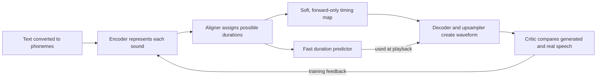
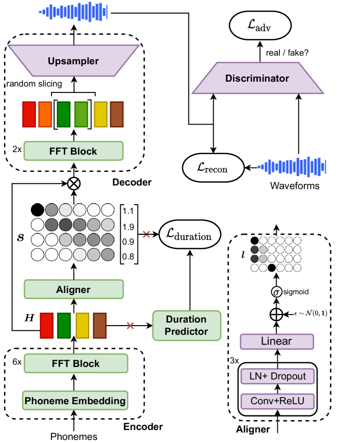
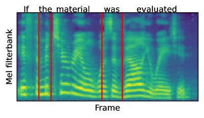

---
cover:
  alt: 'Fig. 1 : The overall architecture and training procedure of AutoTTS. During
    training, audio waveforms of fixed length are generated by randomly selecting
    a sliced hidden sequence. The red cross mark indicates the stop gradient operation.'
  caption: 'Fig. 1 : The overall architecture and training procedure of AutoTTS. During
    training, audio waveforms of fixed length are generated by randomly selecting
    a sliced hidden sequence. The red cross mark indicates the stop gradient operation.'
  image: figures/fig01.png
  relative: true
date: '2022-03-21'
description: Fast speech systems often need a separate tool to decide how long each
  sound should last. AutoTTS learns that timing inside one system, producing natural
  speech quickly with a simpler pipeline.
draft_id: 20260803-ad295def
item_kind: paper
item_source: linkedin
kol: omarsar
paper:
  abs_url: https://arxiv.org/abs/2203.11049
  abstract: Parallel text-to-speech (TTS) models have recently enabled fast and highly-natural
    speech synthesis. However, they typically require external alignment models, which
    are not necessarily optimized for the decoder as they are not jointly trained.
    In this paper, we propose a differentiable duration method for learning monotonic
    alignments between input and output sequences. Our method is based on a soft-duration
    mechanism that optimizes a stochastic process in expectation. Using this differentiable
    duration method, we introduce AutoTTS, a direct text-to-waveform speech synthesis
    model. AutoTTS enables high-fidelity speech synthesis through a combination of
    adversarial training and matching the total ground-truth duration. Experimental
    results show that our model obtains competitive results while enjoying a much
    simpler training pipeline. Audio samples are available online.
  arxiv_id: '2203.11049'
  authors:
  - Bac Nguyen
  - Fabien Cardinaux
  - Stefan Uhlich
  pdf_url: https://arxiv.org/pdf/2203.11049
  published: '2022-03-21'
  title: 'AutoTTS: End-to-End Text-to-Speech Synthesis through Differentiable Duration
    Modeling'
reliability:
  authors_orgs: Bac Nguyen, Fabien Cardinaux, and Stefan Uhlich; Sony Europe B.V.,
    R&D Center, Stuttgart Laboratory 1, Germany.
  code_available: true
  code_url: https://sony.github.io/ai-research-code/autotts/demo/
  evidence: One single-speaker English dataset; internal 20-person MOS study; model-size
    and CPU/GPU speed comparisons.
  venue: arXiv:2203.11049; version 2 dated March 7, 2023.
source_url: ''
summary: Fast speech systems often need a separate tool to decide how long each sound
  should last. AutoTTS learns that timing inside one system, producing natural speech
  quickly with a simpler pipeline.
tags:
- text-to-speech
- speech-synthesis
- duration-modeling
- audio-generation
- alignment
- end-to-end
title: AutoTTS Teaches Speech Synthesis to Keep Its Own Timing
topics:
- ai
- ai/multimodal
---

## The Big Idea

Imagine teaching a reader to speak from a script when nobody has marked how long each sound should last. The word “paper” is only five letters, but its sounds stretch across thousands of audio samples. A fast speech system must decide where each sound begins and ends. Get that timing wrong and words can be clipped, repeated, or skipped.

Many systems solve this by hiring a second specialist: an external alignment model labels the timing first, then the speech model learns from those labels. That makes training a relay race. Errors can pass from one stage to the next, and the final voice is not trained together with the timing tool.

AutoTTS replaces that handoff with a timing mechanism the whole system can learn at once. It turns each sound’s duration into a set of probabilities, letting feedback from the finished waveform reach all the way back to the timing decisions. The result is a single model that goes from phonemes directly to audio.

## How It Works

Think of a karaoke machine with no bouncing ball. For every phoneme, AutoTTS considers several possible lengths: perhaps this sound should occupy one frame, perhaps two, perhaps more. It combines those possibilities into a soft map between the ordered text sounds and successive slices of audio. Because the map only moves forward, the voice cannot jump backward in the sentence.

During training, the system keeps the possibilities soft enough to learn by trial and error. It is pulled in four directions: sound realistic, match the recording’s total length, agree with the learned per-sound durations, and resemble the real recording in useful audio features. A discriminator supplies the “does this sound real?” signal.

There is also a practical shortcut. The full aligner does the careful timing work during training, then teaches a smaller duration predictor. At playback, that predictor chooses concrete lengths quickly. The decoder expands the encoded sounds to those lengths and produces the waveform directly, without a separate spectrogram-to-audio stage.

## What They Found

The authors trained AutoTTS on LJSpeech: 24 hours and 13,100 English clips from one speaker. Their listening study used 20 internal participants and a five-point quality scale. AutoTTS reached 4.28—comfortably into “good” territory and 0.53 points above FastSpeech 2—though recorded speech remained higher at 4.81.

| Evaluation | Ground truth | HiFi-GAN+Mel | Tacotron 2 | FastSpeech 2 | AutoTTS |
|---|---:|---:|---:|---:|---:|
| Listening score, out of 5 | 4.81 ± 0.04 | 4.76 ± 0.05 | 3.92 ± 0.07 | 3.75 ± 0.07 | **4.28 ± 0.06** |

AutoTTS was also the fastest system in the reported setup. On the tested CPU, it created ten seconds of speech in 1.77 seconds—more than five times faster than playback. On the GTX 1080 Ti GPU, it took 0.12 seconds, or roughly 83 times faster than real time.

| Measurement | Tacotron 2 | FastSpeech 2 | AutoTTS |
|---|---:|---:|---:|
| Main model parameters (millions) | 28.19 | 35.16 | 38.69 |
| Separate vocoder parameters (millions) | 13.92 | 13.92 | **0.00** |
| Seconds to generate 10 s of audio on CPU | 8.48 | 5.14 | **1.77** |
| Seconds to generate 10 s of audio on GPU | 1.72 | 0.21 | **0.12** |

The learned timing map became sharp and orderly, and the word boundaries visibly tracked the speech. The paper also reports that individual phoneme durations can be scaled at playback, offering direct control over pacing.

The evidence is focused rather than broad. It comes from one English, single-speaker dataset; the listening panel was internal and had 20 people. Training used eight A100 GPUs for 3,000 epochs, so the simpler pipeline was not a small training job. The paper compares quality and speed with strong two-stage systems, but does not report tests across languages, speakers, or small devices.

## Glossary

- **Phoneme** — the smallest sound unit that can distinguish one word from another.
- **Monotonic alignment** — a mapping that moves forward through text and audio in order, without jumping backward.

## Links

- [arXiv page](https://arxiv.org/abs/2203.11049)
- [PDF](https://arxiv.org/pdf/2203.11049)
- [Audio demo and project page](https://sony.github.io/ai-research-code/autotts/demo/)