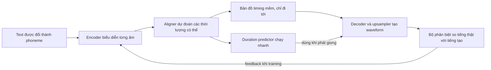

---
cover:
  alt: 'Fig. 1 : The overall architecture and training procedure of AutoTTS. During
    training, audio waveforms of fixed length are generated by randomly selecting
    a sliced hidden sequence. The red cross mark indicates the stop gradient operation.'
  caption: 'Fig. 1 : The overall architecture and training procedure of AutoTTS. During
    training, audio waveforms of fixed length are generated by randomly selecting
    a sliced hidden sequence. The red cross mark indicates the stop gradient operation.'
  image: /posts/2022-03-21-autotts-teaches-speech-synthesis-to-keep-its-own-timing/figures/fig01.png
  relative: false
date: '2022-03-21'
description: TTS tốc độ cao thường cần thêm một công cụ để quyết định mỗi âm kéo dài
  bao lâu. AutoTTS tự học timing ngay trong cùng hệ thống, tạo giọng tự nhiên nhanh
  hơn với pipeline gọn hơn.
draft_id: 20260803-ad295def
item_kind: paper
item_source: linkedin
kol: omarsar
paper:
  abs_url: https://arxiv.org/abs/2203.11049
  abstract: Parallel text-to-speech (TTS) models have recently enabled fast and highly-natural
    speech synthesis. However, they typically require external alignment models, which
    are not necessarily optimized for the decoder as they are not jointly trained.
    In this paper, we propose a differentiable duration method for learning monotonic
    alignments between input and output sequences. Our method is based on a soft-duration
    mechanism that optimizes a stochastic process in expectation. Using this differentiable
    duration method, we introduce AutoTTS, a direct text-to-waveform speech synthesis
    model. AutoTTS enables high-fidelity speech synthesis through a combination of
    adversarial training and matching the total ground-truth duration. Experimental
    results show that our model obtains competitive results while enjoying a much
    simpler training pipeline. Audio samples are available online.
  arxiv_id: '2203.11049'
  authors:
  - Bac Nguyen
  - Fabien Cardinaux
  - Stefan Uhlich
  pdf_url: https://arxiv.org/pdf/2203.11049
  published: '2022-03-21'
  title: 'AutoTTS: End-to-End Text-to-Speech Synthesis through Differentiable Duration
    Modeling'
reliability:
  authors_orgs: Bac Nguyen, Fabien Cardinaux, and Stefan Uhlich; Sony Europe B.V.,
    R&D Center, Stuttgart Laboratory 1, Germany.
  code_available: true
  code_url: https://sony.github.io/ai-research-code/autotts/demo/
  evidence: One single-speaker English dataset; internal 20-person MOS study; model-size
    and CPU/GPU speed comparisons.
  venue: arXiv:2203.11049; version 2 dated March 7, 2023.
source_url: ''
summary: TTS tốc độ cao thường cần thêm một công cụ để quyết định mỗi âm kéo dài bao
  lâu. AutoTTS tự học timing ngay trong cùng hệ thống, tạo giọng tự nhiên nhanh hơn
  với pipeline gọn hơn.
tags:
- text-to-speech
- speech-synthesis
- duration-modeling
- audio-generation
- alignment
- end-to-end
title: 'AutoTTS: để TTS tự học cách canh nhịp câu nói'
topics:
- ai
- ai/multimodal
---

## Ý tưởng chính

Bạn thử đọc một câu mà không biết phải ngân từng âm bao lâu. Chỉ chậm hoặc nhanh sai một nhịp, câu nói đã nghe cụt, lặp từ, thậm chí nuốt mất chữ. Máy đọc văn bản cũng gặp đúng bài toán đó: chuỗi chữ rất ngắn, còn waveform phía sau có tới hàng nghìn lát âm thanh cần được xếp đúng chỗ.

Cách phổ biến lúc bấy giờ là dùng thêm một hệ thống alignment để đánh dấu thời lượng trước. Sau đó TTS mới học theo các nhãn này. Quy trình giống như một người chia nhịp, người khác hát lại. Người đầu canh sai thì người sau cũng học sai, trong khi hai phần không được tối ưu cùng nhau.

AutoTTS gộp việc canh nhịp và tạo tiếng nói vào một vòng training. Thay vì chốt cứng ngay mỗi âm dài bao nhiêu, hệ thống giữ nhiều khả năng dưới dạng xác suất. Nhờ vậy, tín hiệu từ waveform cuối cùng có thể quay ngược về để sửa cả phần timing.

## Cách hoạt động

Hãy hình dung màn hình karaoke chưa có chấm tròn chạy theo lời. Với mỗi phoneme, AutoTTS thử nghĩ: âm này kéo dài một frame, hai frame hay lâu hơn? Các khả năng được ghép thành một bản đồ mềm nối từng âm trong câu với từng đoạn audio. Bản đồ chỉ đi tới, không quay lui, nên thứ tự câu nói được giữ nguyên.

Khi training, các lựa chọn thời lượng vẫn đủ “mềm” để hệ thống tự điều chỉnh. Bốn tín hiệu cùng kéo nó về đúng hướng: tiếng phải giống thật, tổng độ dài phải khớp bản ghi, duration của từng âm phải nhất quán, và đặc trưng audio phải gần với mẫu thật. Một discriminator đảm nhiệm phần chấm xem giọng tạo ra có tự nhiên hay không.

Thật ra thì lúc chạy không cần mang theo toàn bộ aligner phức tạp. Trong training, aligner đóng vai người hướng dẫn cho một duration predictor nhỏ hơn. Đến lúc đọc câu mới, predictor chọn duration cụ thể thật nhanh; decoder kéo giãn các biểu diễn âm theo đúng nhịp đó rồi tạo thẳng waveform. Không còn bước trung gian tạo spectrogram rồi mới đổi sang tiếng.

## Kết quả

Nhóm tác giả train trên LJSpeech, gồm 13.100 clip tiếng Anh, tổng cộng 24 giờ và chỉ có một người đọc. Bài test nghe do 20 người trong nội bộ thực hiện, chấm theo thang 5 điểm. AutoTTS đạt 4,28 điểm: đã nằm rõ trong mức “tốt”, cao hơn FastSpeech 2 đúng 0,53 điểm. Audio thu thật vẫn dẫn đầu với 4,81.

| Bài đánh giá | Ground truth | HiFi-GAN+Mel | Tacotron 2 | FastSpeech 2 | AutoTTS |
|---|---:|---:|---:|---:|---:|
| Điểm nghe, tối đa 5 | 4,81 ± 0,04 | 4,76 ± 0,05 | 3,92 ± 0,07 | 3,75 ± 0,07 | **4,28 ± 0,06** |

Điểm đáng chú ý nữa là tốc độ. Trên CPU trong bài test, AutoTTS tạo 10 giây audio chỉ trong 1,77 giây, tức nhanh hơn tốc độ phát hơn 5 lần. Với GTX 1080 Ti, thời gian còn 0,12 giây, xấp xỉ 83 lần real time.

| Chỉ số | Tacotron 2 | FastSpeech 2 | AutoTTS |
|---|---:|---:|---:|
| Tham số của model chính (triệu) | 28,19 | 35,16 | 38,69 |
| Tham số của vocoder riêng (triệu) | 13,92 | 13,92 | **0,00** |
| Thời gian tạo 10 giây audio trên CPU | 8,48 giây | 5,14 giây | **1,77 giây** |
| Thời gian tạo 10 giây audio trên GPU | 1,72 giây | 0,21 giây | **0,12 giây** |

Bản đồ timing học được trở nên sắc nét và đi đúng thứ tự. Nhìn vào phổ âm thanh, ranh giới giữa các từ cũng hiện ra khá rõ. Paper còn cho biết có thể scale duration của từng phoneme khi chạy để điều chỉnh nhịp đọc.

Phạm vi bằng chứng vẫn gọn. Dữ liệu chỉ có tiếng Anh, một speaker; nhóm nghe thử có 20 người và đều là người tham gia nội bộ. Quá trình training chạy 3.000 epoch trên tám A100 GPU, nên pipeline ít công đoạn hơn không có nghĩa là training nhẹ. Paper so sánh chất lượng và tốc độ với các hệ thống hai bước mạnh, nhưng chưa thử trên nhiều ngôn ngữ, nhiều giọng hay thiết bị nhỏ.

## Thuật ngữ

- **Phoneme** — đơn vị âm thanh nhỏ nhất có thể làm hai từ khác nghĩa nhau.
- **Monotonic alignment** — cách nối text với audio theo đúng thứ tự tiến tới, không nhảy ngược lại.

## Liên kết

- [Trang arXiv](https://arxiv.org/abs/2203.11049)
- [PDF](https://arxiv.org/pdf/2203.11049)
- [Trang project và audio demo](https://sony.github.io/ai-research-code/autotts/demo/)