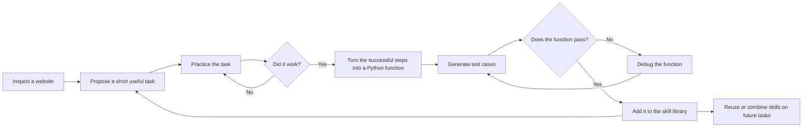

---
cover:
  alt: 'Figure 4: Express Checkout API execution, before (left) and after (right).'
  caption: 'Figure 4: Express Checkout API execution, before (left) and after (right).'
  image: figures/fig06.png
  relative: true
date: '2025-04-09'
description: SkillWeaver lets web agents explore a site, turn successful routines
  into reusable code, and pass those routines to other agents. Tests show sizable
  gains, alongside clear limits in testing and safe real-world use.
draft_id: 20260803-cd46da18
item_kind: paper
item_source: linkedin
kol: omarsar
paper:
  abs_url: https://arxiv.org/abs/2504.07079
  abstract: To survive and thrive in complex environments, humans have evolved sophisticated
    self-improvement mechanisms through environment exploration, hierarchical abstraction
    of experiences into reuseable skills, and collaborative construction of an ever-growing
    skill repertoire. Despite recent advancements, autonomous web agents still lack
    crucial self-improvement capabilities, struggling with procedural knowledge abstraction,
    refining skills, and skill composition. In this work, we introduce SkillWeaver,
    a skill-centric framework enabling agents to self-improve by autonomously synthesizing
    reusable skills as APIs. Given a new website, the agent autonomously discovers
    skills, executes them for practice, and distills practice experiences into robust
    APIs. Iterative exploration continually expands a library of lightweight, plug-and-play
    APIs, significantly enhancing the agent's capabilities. Experiments on WebArena
    and real-world websites demonstrate the efficacy of SkillWeaver, achieving relative
    success rate improvements of 31.8% and 39.8%, respectively. Additionally, APIs
    synthesized by strong agents substantially enhance weaker agents through transferable
    skills, yielding improvements of up to 54.3% on WebArena. These results demonstrate
    the effectiveness of honing diverse website interactions into APIs, which can
    be seamlessly shared among various web agents.
  arxiv_id: '2504.07079'
  authors:
  - Boyuan Zheng
  - Michael Y. Fatemi
  - Xiaolong Jin
  - Zora Zhiruo Wang
  - Apurva Gandhi
  - Yueqi Song
  - Yu Gu
  - Jayanth Srinivasa
  - Gaowen Liu
  - Graham Neubig
  - Yu Su
  pdf_url: https://arxiv.org/pdf/2504.07079
  published: '2025-04-09'
  title: 'SkillWeaver: Web Agents can Self-Improve by Discovering and Honing Skills'
reliability:
  authors_orgs: Boyuan Zheng et al.; The Ohio State University, University of Virginia,
    Purdue University, Carnegie Mellon University, and Cisco Research.
  code_available: true
  code_url: https://github.com/OSU-NLP-Group/SkillWeaver
  evidence: WebArena's 812-task benchmark plus 57 live-site tasks across 4 websites;
    cross-model and human-API comparisons, with documented failure cases.
  venue: arXiv:2504.07079 [cs.AI], submitted April 9, 2025.
summary: SkillWeaver lets web agents explore a site, turn successful routines into
  reusable code, and pass those routines to other agents. Tests show sizable gains,
  alongside clear limits in testing and safe real-world use.
tags:
- web-agents
- skill-learning
- browser-automation
- self-improvement
- tool-use
- webarena
title: 'SkillWeaver: Teaching Web Agents to Turn Practice into Reusable Skills'
topics:
- ai
- ai/llm
- ai/llm/agents
---

## The Big Idea

A web agent opens an unfamiliar shopping site. It has to find the right buttons, survive pop-ups, and remember which page comes next. Then it opens a different site and starts over. Today’s agents often behave like a new temp employee every morning: capable, but repeatedly relearning the same office routine.

SkillWeaver attacks that waste. It lets an agent explore a website, practice useful routines, and package successful routines as small pieces of executable code. The next task can call “identify a pill,” “apply a discount code,” or “check out” as one learned skill instead of reconstructing every click.

The larger idea is shared know-how. A strong agent can build the skill library once, and a weaker agent can use it later without changing its underlying model.

## How It Works

Think of SkillWeaver as an apprentice with a notebook that can run its own instructions.

First, the agent studies a page through its screenshot, URL, and structural map. It proposes a small routine worth learning. The paper groups these routines into three kinds: carrying out a process, navigating to a useful place, or collecting information from a page.

Next, the agent attempts the routine. An LLM judge checks the requested task, the sequence of actions, screenshots, and the website’s response. A successful attempt is distilled into a Python function. The function records what it does, what inputs it expects, what page state it needs, and what happened in earlier attempts.

Finally, SkillWeaver tests the function. It invents input values when necessary, runs the routine, and uses errors or failed outcomes to repair the code. Verified functions enter the library. Later functions can call earlier ones, much as a recipe for dinner can reuse separate instructions for making rice and sauce.

At task time, a selector narrows the library to relevant functions whose starting conditions appear to be satisfied. The agent can still click and type normally, but it now has higher-level shortcuts alongside those basic actions. In this paper, “API” means one of these local browser-automation functions, not a remote web service.

## What They Found

The authors explored each site for 160 iterations, using GPT-4o to build a separate skill library for that site. They evaluated on all five WebArena environments and on 57 tasks across four live websites drawn from Online-Mind2Web.

| Evaluation | Without learned skills | With learned skills | Change |
|---|---:|---:|---:|
| WebArena average, GPT-4o | 22.6% | 29.8% | 31.8% relative gain |
| WebArena average, GPT-4o-mini | 9.2% | 14.1% | about 53% from the rounded scores |
| Four live websites, GPT-4o | 40.2% | 56.2% | 39.8% relative gain |

The headline WebArena result means roughly seven more tasks succeeded for every 100 attempted: 22.6% became 29.8%. Relative to the original success rate, that is a 31.8% improvement. On the live sites, success rose by 16 percentage points. The weaker GPT-4o-mini benefited especially strongly from skills made by GPT-4o. The paper reports a 54.3% gain there; the displayed rounded averages imply about 53%, a small numerical mismatch in the paper.

Results were not uniform. On the live car site, the final success rate stayed at 11.1%. The skills brought the agent to the needed final state in four of nine tasks, but it still failed the last steps. Synthesized skills were competitive with human-written APIs on sites with limited or medium official API support, but human-written APIs did better on GitLab and Maps, where official support was richer.

There are also important boundaries. The live evaluation covered four sites and was judged manually. A test could falsely “verify” a broken function if the code merely hid its errors. Some routines could not be tested without realistic data, such as a valid collaborator email. At run time, agents sometimes ignored the right learned function or supplied the wrong input. The researchers manually checked actions before execution on live sites and added instructions against side-effecting actions; they still identify privacy and harmful real-world actions as deployment risks.

## Glossary

No jargon needed this time.

## Links

- [arXiv page](https://arxiv.org/abs/2504.07079)
- [PDF](https://arxiv.org/pdf/2504.07079)
- [GitHub repository](https://github.com/OSU-NLP-Group/SkillWeaver)
- [Project page](https://osu-nlp-group.github.io/SkillWeaver/)