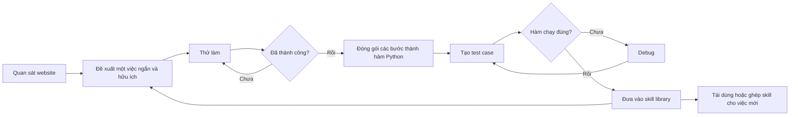
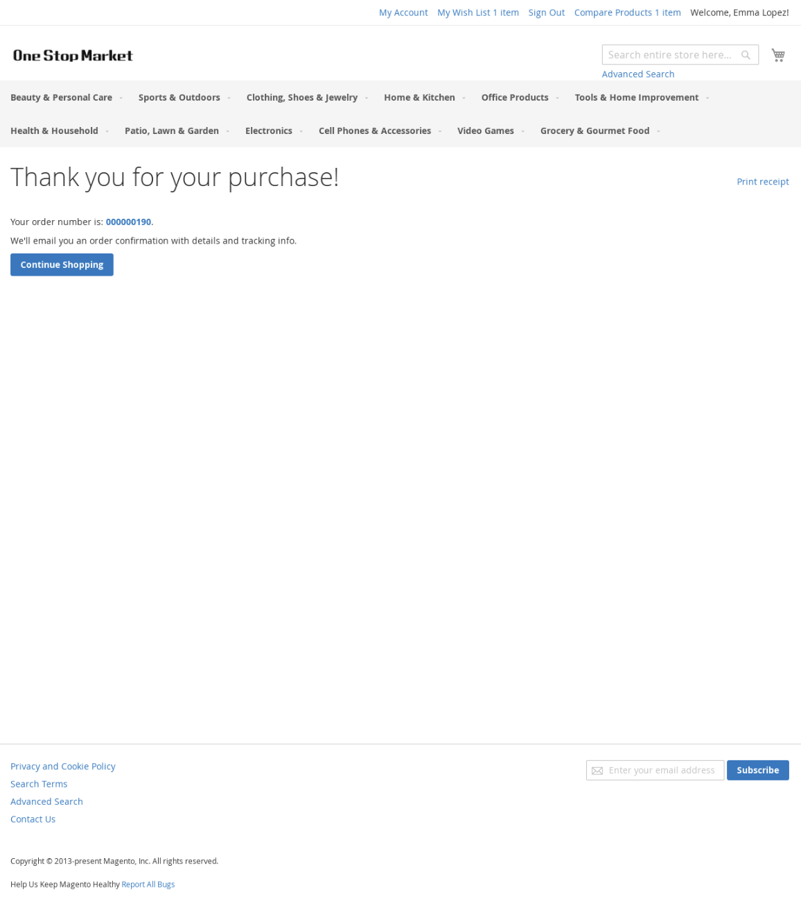

---
cover:
  alt: 'Figure 4: Express Checkout API execution, before (left) and after (right).'
  caption: 'Figure 4: Express Checkout API execution, before (left) and after (right).'
  image: /posts/2025-04-09-skillweaver-teaching-web-agents-to-turn-practice-into-reusab/figures/fig06.png
  relative: false
date: '2025-04-09'
description: SkillWeaver cho web agent tự khám phá website, đóng gói quy trình đã
  làm được thành code và chia sẻ cho agent khác. Kết quả tăng rõ, nhưng khâu test
  và sử dụng an toàn ngoài đời vẫn còn giới hạn.
draft_id: 20260803-cd46da18
item_kind: paper
item_source: linkedin
kol: omarsar
paper:
  abs_url: https://arxiv.org/abs/2504.07079
  abstract: To survive and thrive in complex environments, humans have evolved sophisticated
    self-improvement mechanisms through environment exploration, hierarchical abstraction
    of experiences into reuseable skills, and collaborative construction of an ever-growing
    skill repertoire. Despite recent advancements, autonomous web agents still lack
    crucial self-improvement capabilities, struggling with procedural knowledge abstraction,
    refining skills, and skill composition. In this work, we introduce SkillWeaver,
    a skill-centric framework enabling agents to self-improve by autonomously synthesizing
    reusable skills as APIs. Given a new website, the agent autonomously discovers
    skills, executes them for practice, and distills practice experiences into robust
    APIs. Iterative exploration continually expands a library of lightweight, plug-and-play
    APIs, significantly enhancing the agent's capabilities. Experiments on WebArena
    and real-world websites demonstrate the efficacy of SkillWeaver, achieving relative
    success rate improvements of 31.8% and 39.8%, respectively. Additionally, APIs
    synthesized by strong agents substantially enhance weaker agents through transferable
    skills, yielding improvements of up to 54.3% on WebArena. These results demonstrate
    the effectiveness of honing diverse website interactions into APIs, which can
    be seamlessly shared among various web agents.
  arxiv_id: '2504.07079'
  authors:
  - Boyuan Zheng
  - Michael Y. Fatemi
  - Xiaolong Jin
  - Zora Zhiruo Wang
  - Apurva Gandhi
  - Yueqi Song
  - Yu Gu
  - Jayanth Srinivasa
  - Gaowen Liu
  - Graham Neubig
  - Yu Su
  pdf_url: https://arxiv.org/pdf/2504.07079
  published: '2025-04-09'
  title: 'SkillWeaver: Web Agents can Self-Improve by Discovering and Honing Skills'
reliability:
  authors_orgs: Boyuan Zheng et al.; The Ohio State University, University of Virginia,
    Purdue University, Carnegie Mellon University, and Cisco Research.
  code_available: true
  code_url: https://github.com/OSU-NLP-Group/SkillWeaver
  evidence: WebArena's 812-task benchmark plus 57 live-site tasks across 4 websites;
    cross-model and human-API comparisons, with documented failure cases.
  venue: arXiv:2504.07079 [cs.AI], submitted April 9, 2025.
summary: SkillWeaver cho web agent tự khám phá website, đóng gói quy trình đã làm
  được thành code và chia sẻ cho agent khác. Kết quả tăng rõ, nhưng khâu test và sử
  dụng an toàn ngoài đời vẫn còn giới hạn.
tags:
- web-agents
- skill-learning
- browser-automation
- self-improvement
- tool-use
- webarena
title: 'SkillWeaver: giúp web agent biến luyện tập thành skill tái sử dụng'
topics:
- ai
- ai/llm
- ai/llm/agents
---

## Ý tưởng chính

Bạn giao cho một web agent đặt vé máy bay. Nó lần mò qua ô tìm kiếm, bộ lọc, lịch ngày và hàng loạt nút bấm. Xong việc. Hôm sau, gặp một yêu cầu gần giống như vậy, nó lại phải dò từ đầu. Khá giống chuyện thuê một nhân viên thời vụ rất giỏi nhưng mỗi sáng đều quên mất quy trình của hôm qua.

SkillWeaver muốn giữ lại phần kinh nghiệm đó. Agent tự đi khám phá website, tập các thao tác hữu ích rồi đóng gói đường đi đã thành công thành những hàm code nhỏ. Lần sau, thay vì nghĩ lại từng cú click, nó gọi thẳng một skill như “tìm thuốc theo ký hiệu”, “nhập mã giảm giá” hay “checkout”.

Đáng chú ý là library này không bị khóa vào agent đã tạo ra nó. GPT-4o có thể học skill trước, còn một agent dùng GPT-4o-mini lấy ra dùng sau mà không cần fine-tuning model.

## Cách hoạt động

Hãy hình dung một người học việc có cuốn sổ tay đặc biệt: ghi xong là có thể chạy nguyên quy trình trong sổ.

Mỗi vòng bắt đầu bằng việc agent nhìn screenshot, URL và bản đồ cấu trúc của trang. Từ đó, nó chọn một bài tập vừa sức: làm trọn một quy trình, đi tới đúng khu vực trên site, hoặc lấy thông tin đang nằm trong trang.

Agent làm thử bài tập ấy. Một LLM khác đóng vai người chấm, xem yêu cầu ban đầu, chuỗi hành động, screenshot và phản hồi của website. Nếu đạt, SkillWeaver biến chuỗi thao tác thành một hàm Python. Trong hàm có cả input cần truyền, trạng thái trang cần có trước khi chạy và nhật ký những lần thử trước.

Chưa xong đâu. Hệ thống tự nghĩ ra dữ liệu test, chạy lại hàm rồi sửa code nếu có lỗi. Skill vượt qua bước này mới được đưa vào library. Về sau, một skill mới còn có thể gọi nhiều skill cũ. Nói đơn giản là từ vài động tác lẻ, agent dần ghép được cả quy trình dài.

Khi nhận việc thật, hệ thống chỉ lấy ra những hàm có liên quan và phù hợp với trạng thái hiện tại của trang. Agent vẫn có thể click hay nhập chữ như bình thường, nhưng giờ có thêm các “phím tắt” cấp cao. Chữ “API” trong paper chính là những hàm tự động điều khiển browser này, không phải dịch vụ web ở một server nào đó.

## Kết quả

Nhóm tác giả cho GPT-4o khám phá riêng từng website trong 160 vòng. Sau đó họ thử library tạo được trên năm môi trường của WebArena, đồng thời chạy 57 task thuộc bốn website đang hoạt động trong Online-Mind2Web.

| Phần đánh giá | Không có learned skills | Có learned skills | Mức thay đổi |
|---|---:|---:|---:|
| Trung bình WebArena, GPT-4o | 22,6% | 29,8% | tăng tương đối 31,8% |
| Trung bình WebArena, GPT-4o-mini | 9,2% | 14,1% | khoảng 53% theo số đã làm tròn |
| Bốn website thật, GPT-4o | 40,2% | 56,2% | tăng tương đối 39,8% |

Con số dễ hình dung nhất là WebArena với GPT-4o: cứ 100 task thì có thêm khoảng 7 task hoàn thành, từ 22,6 lên 29,8. Nếu so với mức ban đầu, đó là mức tăng 31,8%. Trên website thật, chênh lệch là 16 điểm phần trăm.

GPT-4o-mini hưởng lợi khá rõ từ skill do GPT-4o tạo. Paper ghi mức tăng 54,3%; nếu tính trực tiếp từ hai số trung bình đã làm tròn trong bảng thì ra khoảng 53%. Đây là một sai lệch số học nhỏ ngay trong paper.

Không phải site nào cũng tiến bộ như nhau. Ở website về xe, tỷ lệ hoàn thành vẫn là 11,1%. Trong bốn trên chín task, skill đã dẫn agent tới đúng trạng thái cuối cần thiết, nhưng agent lại hỏng ở vài bước chốt. Skill tự sinh cũng theo kịp API do con người viết trên những site có ít hoặc vừa phải hỗ trợ chính thức. Với GitLab và Maps, nơi hệ API sẵn có phong phú hơn, API do con người viết vẫn tốt hơn.

Phạm vi thử nghiệm ngoài đời chỉ có bốn website và kết quả được chấm thủ công. Cách test cũng có kẽ hở: một hàm lỗi có thể được coi là “đã xác minh” nếu nó chỉ âm thầm nuốt mọi exception. Một số skill cần dữ liệu thật mới test được, chẳng hạn email hợp lệ để thêm cộng tác viên. Khi chạy task, agent đôi lúc không chọn skill đúng hoặc truyền sai tham số. Với website thật, nhóm nghiên cứu kiểm tra thủ công hành động trước khi cho chạy và thêm rule để tránh thao tác gây hậu quả; paper vẫn xem quyền riêng tư và hành động nguy hiểm là rủi ro cần xử lý.

## Thuật ngữ

Lần này không cần thuật ngữ khó.

## Liên kết

- [Trang arXiv](https://arxiv.org/abs/2504.07079)
- [PDF](https://arxiv.org/pdf/2504.07079)
- [GitHub repository](https://github.com/OSU-NLP-Group/SkillWeaver)
- [Trang dự án](https://osu-nlp-group.github.io/SkillWeaver/)