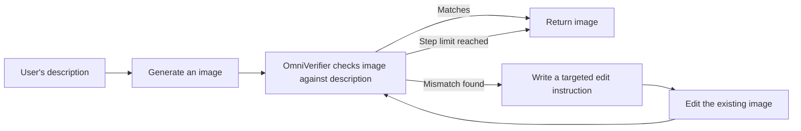

---
cover:
  alt: 'Figure 6 : Qualitative visualization of OmniVerifier-TTS.'
  caption: 'Figure 6 : Qualitative visualization of OmniVerifier-TTS.'
  image: figures/fig06.png
  relative: true
date: '2025-10-15'
description: A visual critic checks whether an AI-made image follows its instructions,
  explains the mismatch, and guides focused repairs over several rounds.
draft_id: 20260803-370f15c4
item_kind: paper
item_source: linkedin
kol: omarsar
paper:
  abs_url: https://arxiv.org/abs/2510.13804
  abstract: 'We introduce Generative Universal Verifier, a novel concept and plugin
    designed for next-generation multimodal reasoning in vision-language models and
    unified multimodal models, providing the fundamental capability of reflection
    and refinement on visual outcomes during the reasoning and generation process.
    This work makes three main contributions: (1) We build ViVerBench, a comprehensive
    benchmark spanning 16 categories of critical tasks for evaluating visual outcomes
    in multimodal reasoning. Results show that existing VLMs consistently underperform
    across these tasks, underscoring a substantial gap from human-level capability
    in reliable visual verification. (2) We design two automated pipelines to construct
    large-scale visual verification data and train OmniVerifier-7B, the first omni-capable
    generative verifier trained for universal visual verification and achieves notable
    gains on ViVerBench(+8.3). Through training, we identify three atomic capabilities
    in visual verification and demonstrate how they generalize and interact synergistically.
    (3) We propose OmniVerifier-TTS, a sequential test-time scaling paradigm that
    leverages the universal verifier to bridge image generation and editing within
    unified models, enhancing the upper bound of generative ability through iterative
    fine-grained optimization. Beyond generation, we extend universal verifier to
    broader world-modeling interleaved reasoning scenarios. Empirically, OmniVerifier-TTS
    achieves improvements on T2I-ReasonBench(+3.7), and GenEval++(+4.3), outperforming
    existing parallel test-time scaling methods, such as Best-of-N. By endowing multimodal
    reasoning with reliable visual verification, OmniVerifier advances both reliable
    reflection during generation and scalable test-time refinement, marking a step
    toward more trustworthy and controllable next-generation reasoning systems.'
  arxiv_id: '2510.13804'
  authors:
  - Xinchen Zhang
  - Xiaoying Zhang
  - Youbin Wu
  - Yanbin Cao
  - Renrui Zhang
  - Ruihang Chu
  - Ling Yang
  - Yujiu Yang
  pdf_url: https://arxiv.org/pdf/2510.13804
  published: '2025-10-15'
  title: Generative Universal Verifier as Multimodal Meta-Reasoner
reliability:
  authors_orgs: Xinchen Zhang, Xiaoying Zhang, Youbin Wu, Yanbin Cao, Renrui Zhang,
    Ruihang Chu, Ling Yang, and Yujiu Yang; Tsinghua University, ByteDance Seed, and
    Princeton University.
  code_available: true
  code_url: https://github.com/Cominclip/OmniVerifier
  evidence: ViVerBench has 3,594 questions across 16 tasks; 9 VLMs evaluated; training
    ablations and two image-generation benchmarks included.
  venue: arXiv preprint 2510.13804, published October 15, 2025.
source_url: ''
summary: A visual critic checks whether an AI-made image follows its instructions,
  explains the mismatch, and guides focused repairs over several rounds.
tags:
- visual-verification
- image-generation
- multimodal-reasoning
- self-refinement
- omniverifier
- viverbench
title: 'OmniVerifier: Teaching Image AI to Check and Repair Its Own Work'
topics:
- ai
- ai/multimodal
---

## The Big Idea

Ask an image generator for “the city hosting the Summer Olympics in 2008,” and it may produce a handsome stadium with the wrong skyline, the wrong year on the sign, or both. The image can look polished while quietly failing the brief. That is more than an artistic nuisance. The same kind of visual mistake matters when AI reads a chart, checks a robot’s next move, or decides whether a route crosses a wall.

The usual response is to generate several images and pick the best. This paper asks a more useful question: can another model inspect the result, explain the exact defect, and request a small repair? The authors’ answer is OmniVerifier-7B, a visual critic trained to compare an image with its instructions. They then place that critic inside a loop called OmniVerifier-TTS, so an image can be checked and edited repeatedly instead of discarded after one bad attempt.

## How It Works

First, the team built ViVerBench: 3,594 true-or-false questions across 16 tasks. Some ask whether every requested object is present. Others test spatial relationships, counting, charts, physics, maze routes, robot actions, or interface states. Twelve domain experts helped create difficult cases; further groups of experts reviewed and tested them. A correct “false” answer also needs an explanation, which makes lucky guessing less useful.

Training examples were made with two complementary tricks. In one, the image stays fixed while a faithful description is altered: perhaps an object changes color or moves to the wrong side. In the other, the description stays fixed while a selected part of the image is replaced. It is like training a proofreader with both kinds of planted error: changing a sentence while keeping the photograph, and changing the photograph while keeping the sentence. After filtering, the authors used 28,000 examples to train OmniVerifier-7B from Qwen2.5-VL-7B.

The experiments separate visual checking into three skills. “Is the requested red cup present?” is direct matching. “Is the cup left of the plate?” checks a relationship. “Does this maze route obey the rules?” requires a longer chain of reasoning. Training on the first two transferred across many tasks. Training on mazes did not transfer much beyond mazes, so the authors used task-specific data for harder reasoning domains.

At generation time, the system behaves like an editor working beside an illustrator:

The loop stops when the verifier says the image matches or after ten rounds. Unlike generating ten independent candidates, each round keeps the useful parts and focuses on the remaining defect.

## What They Found

On ViVerBench, the strongest existing systems were still well short of perfect: Gemini 2.5 Pro reached 74.5% when only the true-or-false choice counted, while Seed 1.5-VL reached 69.3% under the stricter scoring that also checked explanations. Even Gemini 2.5 Pro scored only 58.0% on maze verification, not far above chance for a binary question.

| Task or comparison | Existing method | OmniVerifier method |
|---|---:|---:|
| ViVerBench overall, Qwen2.5-VL-7B base | Base verifier | **+8.3 points** |
| T2I-ReasonBench, Qwen-Image | One-pass generation | **+3.7 points** |
| T2I-ReasonBench, GPT-Image-1 | One-pass generation | **+2.5 points** |
| GenEval++ | Generation without the proposed loop | **+4.3 points** |
| Three generation evaluations, 10-attempt comparison | Parallel selection: 10 fresh images | Better scores in all three, in about **47% of the time** |

The headline verifier gain means roughly eight more correct decisions for every 100 benchmark questions, assuming the reported 8.3-point change is read as an accuracy-point gain. OmniVerifier-7B also surpassed GPT-4o on the benchmark and performed similarly to the much larger Qwen2.5-VL-72B, according to the paper.

The repair loop improved both models tested. The qualitative examples show why: one image needed its city changed to Beijing, then its sign corrected from “2018” to “2008”; another needed several passes to fix a bottle label, liquid color, and chemistry indicator. Small edits accumulate instead of forcing a restart.

The limits are equally concrete. ViVerBench uses binary judgments, and its stricter score relies on GPT-4.1 to judge explanations. The broad transfer result was strongest for object matching and relationships; maze-style and robotics reasoning still needed domain-specific training. The generation study covered two image models and two benchmarks, with at most ten repair rounds, so it does not establish that the loop will help every visual task. The verifier can also become the bottleneck: if it overlooks a defect or approves a bad edit, the loop has no independent safeguard.

## Glossary

- **Sequential test-time scaling** — spending extra computation after a request by improving one result through repeated checking and editing.

## Links

- [arXiv page](https://arxiv.org/abs/2510.13804)
- [PDF](https://arxiv.org/pdf/2510.13804)
- [Project page](https://omniverifier.github.io/)