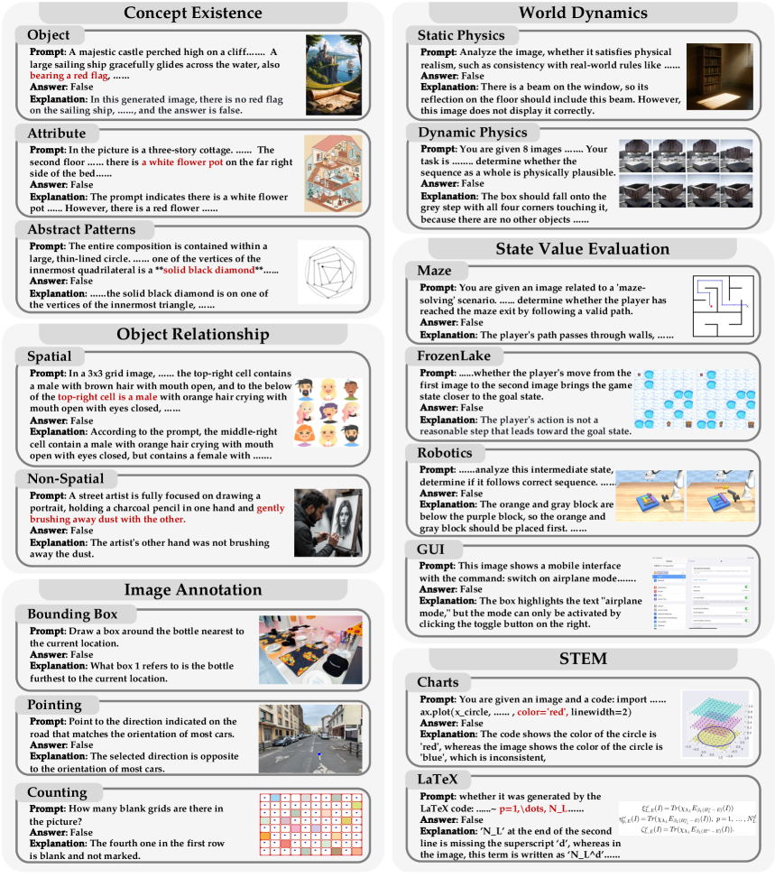
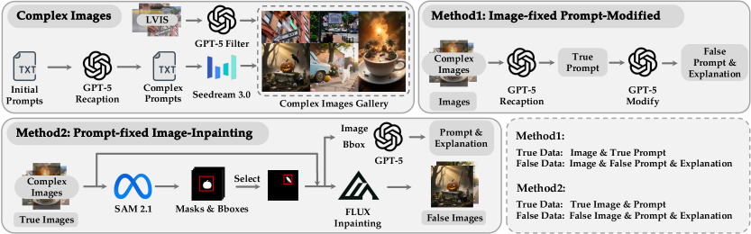
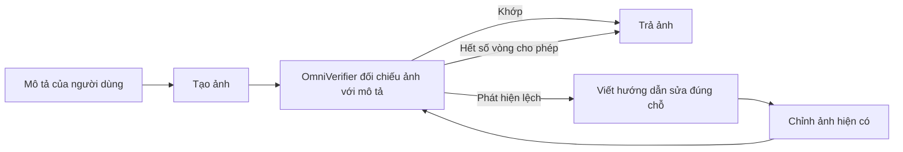
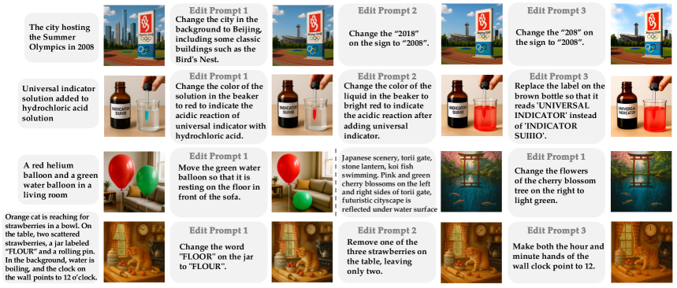

---
cover:
  alt: 'Figure 6 : Qualitative visualization of OmniVerifier-TTS.'
  caption: 'Figure 6 : Qualitative visualization of OmniVerifier-TTS.'
  image: /posts/2025-10-15-omniverifier-teaching-image-ai-to-check-and-repair-its-own-w/figures/fig06.png
  relative: false
date: '2025-10-15'
description: Một verifier đối chiếu ảnh AI với yêu cầu, chỉ ra chỗ sai và hướng dẫn
  sửa từng phần qua nhiều vòng.
draft_id: 20260803-370f15c4
item_kind: paper
item_source: linkedin
kol: omarsar
paper:
  abs_url: https://arxiv.org/abs/2510.13804
  abstract: 'We introduce Generative Universal Verifier, a novel concept and plugin
    designed for next-generation multimodal reasoning in vision-language models and
    unified multimodal models, providing the fundamental capability of reflection
    and refinement on visual outcomes during the reasoning and generation process.
    This work makes three main contributions: (1) We build ViVerBench, a comprehensive
    benchmark spanning 16 categories of critical tasks for evaluating visual outcomes
    in multimodal reasoning. Results show that existing VLMs consistently underperform
    across these tasks, underscoring a substantial gap from human-level capability
    in reliable visual verification. (2) We design two automated pipelines to construct
    large-scale visual verification data and train OmniVerifier-7B, the first omni-capable
    generative verifier trained for universal visual verification and achieves notable
    gains on ViVerBench(+8.3). Through training, we identify three atomic capabilities
    in visual verification and demonstrate how they generalize and interact synergistically.
    (3) We propose OmniVerifier-TTS, a sequential test-time scaling paradigm that
    leverages the universal verifier to bridge image generation and editing within
    unified models, enhancing the upper bound of generative ability through iterative
    fine-grained optimization. Beyond generation, we extend universal verifier to
    broader world-modeling interleaved reasoning scenarios. Empirically, OmniVerifier-TTS
    achieves improvements on T2I-ReasonBench(+3.7), and GenEval++(+4.3), outperforming
    existing parallel test-time scaling methods, such as Best-of-N. By endowing multimodal
    reasoning with reliable visual verification, OmniVerifier advances both reliable
    reflection during generation and scalable test-time refinement, marking a step
    toward more trustworthy and controllable next-generation reasoning systems.'
  arxiv_id: '2510.13804'
  authors:
  - Xinchen Zhang
  - Xiaoying Zhang
  - Youbin Wu
  - Yanbin Cao
  - Renrui Zhang
  - Ruihang Chu
  - Ling Yang
  - Yujiu Yang
  pdf_url: https://arxiv.org/pdf/2510.13804
  published: '2025-10-15'
  title: Generative Universal Verifier as Multimodal Meta-Reasoner
reliability:
  authors_orgs: Xinchen Zhang, Xiaoying Zhang, Youbin Wu, Yanbin Cao, Renrui Zhang,
    Ruihang Chu, Ling Yang, and Yujiu Yang; Tsinghua University, ByteDance Seed, and
    Princeton University.
  code_available: true
  code_url: https://github.com/Cominclip/OmniVerifier
  evidence: ViVerBench has 3,594 questions across 16 tasks; 9 VLMs evaluated; training
    ablations and two image-generation benchmarks included.
  venue: arXiv preprint 2510.13804, published October 15, 2025.
source_url: ''
summary: Một verifier đối chiếu ảnh AI với yêu cầu, chỉ ra chỗ sai và hướng dẫn sửa
  từng phần qua nhiều vòng.
tags:
- visual-verification
- image-generation
- multimodal-reasoning
- self-refinement
- omniverifier
- viverbench
title: 'OmniVerifier: cho AI tự kiểm tra và sửa ảnh của mình'
topics:
- ai
- ai/multimodal
---

## Ý tưởng chính

Bạn nhờ AI vẽ “thành phố đăng cai Olympic mùa hè 2008”. Ảnh nhìn rất thuyết phục, nhưng phía sau lại không phải Bắc Kinh, còn tấm biển ghi nhầm thành 2018. Đây là kiểu lỗi khá khó chịu: tổng thể trông đẹp nên mắt ta dễ bỏ qua chi tiết sai.

Vấn đề không chỉ nằm ở ảnh minh họa. Khi AI đọc chart, kiểm tra đường đi trong mê cung hay hướng dẫn robot đặt đồ vật, một chi tiết hình ảnh sai có thể kéo theo cả quyết định sai. Paper này xây OmniVerifier-7B như một người soát lỗi hình ảnh: nhìn ảnh, đối chiếu với yêu cầu, chỉ ra chỗ lệch và đề xuất cách sửa. Sau đó, OmniVerifier-TTS cho model sửa từng lỗi qua nhiều vòng thay vì bỏ ảnh đi làm lại từ đầu.

## Cách hoạt động

Nhóm tác giả bắt đầu bằng một bài thi dành riêng cho việc “bắt lỗi bằng mắt”. ViVerBench có 3.594 câu hỏi đúng/sai, chia thành 16 task. Có câu hỏi rất trực tiếp, chẳng hạn ảnh có đủ đồ vật được yêu cầu hay không. Có câu khó hơn: vị trí giữa hai vật có đúng không, con số trên chart có khớp không, đường đi có xuyên qua tường không, hoặc robot đã đặt các khối đúng thứ tự chưa.

Mười hai chuyên gia tham gia tạo các ca khó. Những nhóm chuyên gia khác tiếp tục rà soát và đánh giá. Đáng chú ý là với đáp án “sai”, model còn phải giải thích sai ở đâu. Nhờ vậy, đoán mò đúng một lựa chọn chưa đủ để được tính điểm ở cách chấm nghiêm ngặt.

Dữ liệu huấn luyện được tạo theo hai hướng. Hướng thứ nhất giữ nguyên ảnh rồi sửa mô tả để cài một lỗi rõ ràng, ví dụ đổi màu chiếc cốc. Hướng thứ hai giữ nguyên mô tả nhưng thay một vùng trong ảnh. Nói đơn giản là giống lúc ra đề cho người soát báo: khi thì sửa câu chú thích, khi thì sửa bức ảnh, để người học phải biết đối chiếu cả hai. Sau bước lọc, nhóm dùng 28.000 mẫu để huấn luyện OmniVerifier-7B từ Qwen2.5-VL-7B.

Qua các thử nghiệm, nhóm tách kỹ năng kiểm tra thành ba tầng. Tầng đầu là khớp trực tiếp, như “có chiếc cốc đỏ không?”. Tầng hai là quan hệ, như “cốc có nằm bên trái cái đĩa không?”. Tầng ba cần suy luận nhiều bước, chẳng hạn xác minh một đường đi trong mê cung. Dữ liệu của hai tầng đầu giúp model tiến bộ trên nhiều task khác. Riêng kỹ năng mê cung gần như không lan sang domain khác, nên những bài suy luận kiểu này vẫn cần dữ liệu riêng.

Khi dùng để tạo ảnh, quy trình chạy như sau:

Mỗi vòng chỉ tập trung vào lỗi còn lại. Quy trình dừng khi verifier chấp nhận ảnh hoặc đã chạy đủ mười vòng. Khác với cách tạo mười ảnh độc lập rồi chọn một, cách này giữ lại phần đã đúng và sửa tiếp phần chưa ổn.

## Kết quả

ViVerBench cho thấy việc nhận ra ảnh sai vẫn còn khó. Gemini 2.5 Pro đạt 74,5% nếu chỉ chấm lựa chọn đúng/sai. Khi lời giải thích cũng phải hợp lý, điểm tốt nhất là 69,3% của Seed 1.5-VL. Với riêng task mê cung, Gemini 2.5 Pro chỉ đạt 58,0% — khá gần mức may rủi của câu hỏi nhị phân.

| Task hoặc phép so sánh | Phương pháp hiện có | Phương pháp dùng OmniVerifier |
|---|---:|---:|
| Tổng thể ViVerBench, nền Qwen2.5-VL-7B | Verifier gốc | **+8,3 điểm** |
| T2I-ReasonBench, Qwen-Image | Tạo ảnh một lượt | **+3,7 điểm** |
| T2I-ReasonBench, GPT-Image-1 | Tạo ảnh một lượt | **+2,5 điểm** |
| GenEval++ | Tạo ảnh không có vòng lặp đề xuất | **+4,3 điểm** |
| Ba phép đánh giá tạo ảnh, so sánh 10 lượt | Chọn song song từ 10 ảnh mới | Điểm cao hơn ở cả ba, chỉ mất khoảng **47% thời gian** |

Mức tăng 8,3 điểm có thể hiểu gần đúng là cứ 100 câu trong benchmark thì verifier đưa ra thêm khoảng tám quyết định đúng. Paper cũng báo cáo OmniVerifier-7B vượt GPT-4o và đạt mức tương đương Qwen2.5-VL-72B, dù model nền nhỏ hơn nhiều.

Các ví dụ trực quan cho thấy lợi ích của việc sửa nối tiếp. Ảnh Olympic phải qua một lượt đổi bối cảnh sang Bắc Kinh, rồi thêm một lượt sửa “2018” thành “2008”. Ở ví dụ hóa học, model lần lượt chỉnh nhãn chai, màu dung dịch và chữ trên nhãn. Không cần phá đi làm lại toàn bộ.

Phạm vi của kết quả vẫn có giới hạn rõ ràng. ViVerBench chủ yếu dùng câu hỏi đúng/sai; cách chấm nghiêm ngặt còn nhờ GPT-4.1 đánh giá lời giải thích. Khả năng chuyển kỹ năng sang task mới tốt nhất ở việc khớp đồ vật và quan hệ. Các bài như mê cung hay robotics vẫn phải có dữ liệu đúng domain. Phần tạo ảnh mới thử trên hai model, hai benchmark và tối đa mười vòng sửa. Nếu verifier bỏ sót lỗi hoặc duyệt nhầm một bản sửa tệ, quy trình hiện chưa có lớp kiểm tra độc lập khác.

## Thuật ngữ

- **Sequential test-time scaling** — dùng thêm tài nguyên sau khi nhận yêu cầu để liên tục kiểm tra và chỉnh sửa cùng một kết quả.

## Liên kết

- [Trang arXiv](https://arxiv.org/abs/2510.13804)
- [PDF](https://arxiv.org/pdf/2510.13804)
- [Trang dự án](https://omniverifier.github.io/)