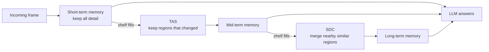

---
cover:
  alt: 'Figure 1 : Overview of FluxMem: Adaptive Hierarchical Memory. Each incoming
    frame is encoded into visual tokens and written to FluxMem in a cascaded short–mid–long
    process. On short-term memory overflow, Temporal Adjacency Selection ( TAS \mathrm{TAS}
    ) retains temporally variant tokens for mid-term memory; on mid-term memory overflow,
    Spatial Domain Consolidation ( SDC \mathrm{SDC} ) merges spatially redundant regions
    into compact anchors for long-term memory. The overflow process is guided by '
  caption: 'Figure 1 : Overview of FluxMem: Adaptive Hierarchical Memory. Each incoming
    frame is encoded into visual tokens and written to FluxMem in a cascaded short–mid–long
    process. On short-term memory overflow, Temporal Adjacency Selection ( TAS \mathrm{TAS}
    ) retains temporally variant tokens for mid-term memory; on mid-term memory overflow,
    Spatial Domain Consolidation ( SDC \mathrm{SDC} ) merges spatially redundant regions
    into compact anchors for long-term memory. The overflow process is guided by '
  image: figures/fig01.png
  relative: true
date: '2026-03-02'
description: FluxMem gives video AI a three-layer memory that preserves recent detail
  while compressing repeated history. Across five tests, it improved scores while
  cutting visual data, latency, and GPU memory.
draft_id: 20260803-e8920ca3
item_kind: paper
item_source: linkedin
kol: omarsar
paper:
  abs_url: https://arxiv.org/abs/2603.02096
  abstract: 'This paper presents FluxMem, a training-free framework for efficient
    streaming video understanding. FluxMem adaptively compresses redundant visual
    memory through a hierarchical, two-stage design: (1) a Temporal Adjacency Selection
    (TAS) module removes redundant visual tokens across adjacent frames, and (2) a
    Spatial Domain Consolidation (SDC) module further merges spatially repetitive
    regions within each frame into compact representations. To adapt effectively to
    dynamic scenes, we introduce a self-adaptive token compression mechanism in both
    TAS and SDC, which automatically determines the compression rate based on intrinsic
    scene statistics rather than manual tuning. Extensive experiments demonstrate
    that FluxMem achieves new state-of-the-art results on existing online video benchmarks,
    reaching 76.4 on StreamingBench and 67.2 on OVO-Bench under real-time settings,
    while reducing latency by 69.9% and peak GPU memory by 34.5% on OVO-Bench. Furthermore,
    it maintains strong offline performance, achieving 73.1 on MLVU while using 65%
    fewer visual tokens.'
  arxiv_id: '2603.02096'
  authors:
  - Yiweng Xie
  - Bo He
  - Junke Wang
  - Xiangyu Zheng
  - Ziyi Ye
  - Zuxuan Wu
  pdf_url: https://arxiv.org/pdf/2603.02096
  published: '2026-03-02'
  title: 'FluxMem: Adaptive Hierarchical Memory for Streaming Video Understanding'
reliability:
  authors_orgs: Yiweng Xie, Bo He, Junke Wang, Xiangyu Zheng, Ziyi Ye, and Zuxuan
    Wu; Fudan University, Shanghai Innovation Institute, Shanghai Key Laboratory of
    Multimodal Embodied AI, and University of Maryland, College Park.
  code_available: true
  code_url: https://github.com/ShareLab-SII/FluxMem
  evidence: Five video benchmarks, component and threshold ablations, and latency
    and GPU-memory measurements.
  venue: arXiv preprint 2603.02096, submitted March 2, 2026.
source_url: ''
summary: FluxMem gives video AI a three-layer memory that preserves recent detail
  while compressing repeated history. Across five tests, it improved scores while
  cutting visual data, latency, and GPU memory.
tags:
- streaming-video
- video-understanding
- visual-token-compression
- hierarchical-memory
- qwen2.5-vl
- adaptive-compression
title: 'FluxMem: How a Video AI Remembers More by Storing Less'
topics:
- ai
- ai/multimodal
---

## The Big Idea

Imagine an AI assistant watching a live security feed. Most seconds show the same hallway, the same door, the same patch of wall. Yet a conventional system may keep describing every patch of every frame to its LLM as if each were new. The longer it watches, the larger and slower that visual history becomes. That matters for robots, cars, and smart glasses, where an answer that arrives late can be useless.

The obvious fix—throw away more of the video—creates a second problem. The assistant needs a crisp view of what just happened, but an hour-old scene can often survive as a rough summary. One deletion rule for everything is like filing today's urgent notes and last year's receipts in the same drawer.

FluxMem gives video memory three shelves. It keeps recent frames in detail, removes repeated content as frames age, and compresses the oldest material even further. It does this without additional training and adjusts how aggressively it compresses to each scene.

> On OVO-Bench, FluxMem cut post-encoding latency by 69.9% while raising the score by 3.5 points.

## How It Works

A new frame first goes onto the short-term shelf untouched. Think of it as the papers currently spread across your desk: recent details may matter, so nothing is summarized yet.

When that shelf fills, Temporal Adjacency Selection compares each small region with nearby regions in the frames immediately before and after it. If a region barely changed—the wall is still the same wall—it can go. A moving hand or a newly opened door stays. Comparing a small neighborhood rather than one exact pixel location helps tolerate camera shake and motion.

Older material eventually reaches Spatial Domain Consolidation. Here FluxMem groups nearby, similar regions within a frame and replaces each group with one representative summary. It is the difference between remembering every brick and remembering “brick wall.”

The cutoff is not fixed. FluxMem uses the score pattern within each frame to split “mostly repeated” from “meaningfully different.” A quiet meeting room therefore gets compressed more aggressively than a fast action scene. When a question arrives, the system gives the LLM the detailed recent shelf plus the increasingly compact older shelves, in time order.

FluxMem can also reuse its frame-change scores as a trigger for proactive responses. A large scene change can prompt the system to speak without running a separate detector, though the trigger sensitivity still has one tunable setting.

## What They Found

The authors attached FluxMem to Qwen2.5-VL-7B and tested five video benchmarks: two streaming and three offline. Across all five, the compressed-memory version scored higher than the unmodified model.

| Benchmark or setting | Qwen2.5-VL-7B baseline | With FluxMem |
|---|---:|---:|
| StreamingBench, real-time | 73.9 | 76.4 |
| OVO-Bench, real-time | 63.3 | 67.2 |
| OVO-Bench, overall | 49.8 | 53.3 |
| VideoMME | 63.3 | 65.3 |
| MLVU | 67.9 | 73.1 |
| LongVideoBench | 60.7 | 61.1 |

The headline is not just the score gain. On StreamingBench, the model discarded roughly seven out of every ten visual tokens and still improved by 2.5 points. On MLVU, it used about 65% fewer visual tokens and gained 5.2 points. Removing repetition sometimes helped understanding rather than merely preserving it.

| Efficiency test | Score change | Latency reduction | Peak GPU-memory reduction |
|---|---:|---:|---:|
| OVO-Bench | +3.5 points | 69.9% | 34.5% |
| MLVU | +5.2 points | 44.3% | 31.2% |

Those timing tests start after visual features have already been extracted, so the latency reduction is not an end-to-end camera-to-answer measurement. The memory update itself added 4.1 milliseconds per frame in the online setup.

The component tests support the three-shelf design. On MLVU, combining mid- and long-term compression reached 73.1 while removing 65.6% of tokens. Across the online and offline aggregate, the full hierarchy scored 71.6 with a 64.3% reduction. The adaptive cutoff also removed much more material than the best fixed cutoff at nearly the same score: 84.5% versus 63.8% in long-term memory, with scores of 65.4 and 65.6.

The scope is still controlled. All experiments used one base model, Qwen2.5-VL-7B, sampled video at one frame per second, and ran on eight A100 GPUs. The five benchmarks cover both streaming and pre-recorded video, but they do not establish performance at full camera frame rates or across other model families and real deployments.

## Glossary

- **Otsu's method** — A classic way to choose a dividing line that best separates two clusters of values, used here to distinguish repeated from informative visual content.

## Links

- [arXiv page](https://arxiv.org/abs/2603.02096)
- [PDF](https://arxiv.org/pdf/2603.02096)
- [GitHub repository](https://github.com/YiwengXie/FluxMem)