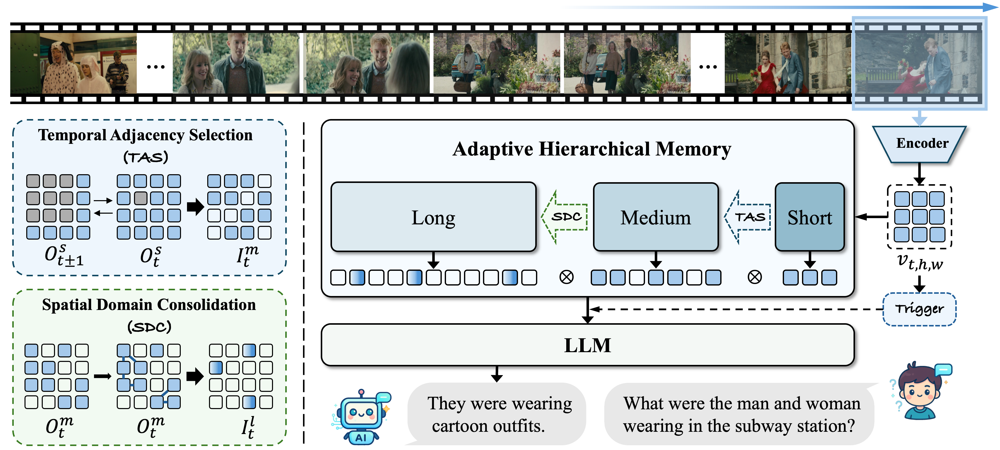
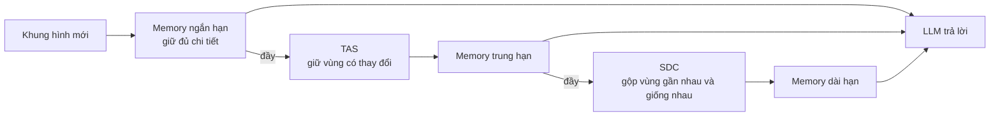
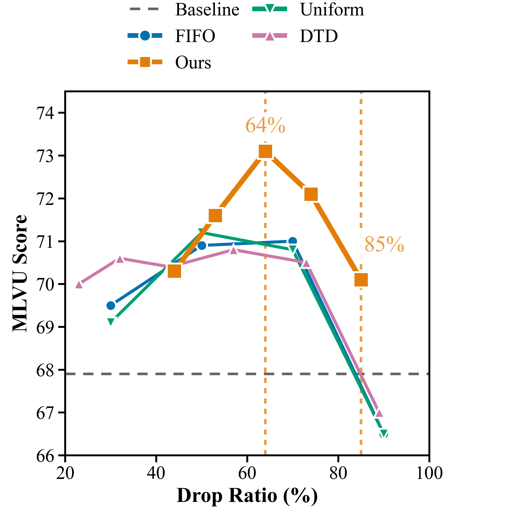

---
cover:
  alt: 'Figure 1 : Overview of FluxMem: Adaptive Hierarchical Memory. Each incoming
    frame is encoded into visual tokens and written to FluxMem in a cascaded short–mid–long
    process. On short-term memory overflow, Temporal Adjacency Selection ( TAS \mathrm{TAS}
    ) retains temporally variant tokens for mid-term memory; on mid-term memory overflow,
    Spatial Domain Consolidation ( SDC \mathrm{SDC} ) merges spatially redundant regions
    into compact anchors for long-term memory. The overflow process is guided by '
  caption: 'Figure 1 : Overview of FluxMem: Adaptive Hierarchical Memory. Each incoming
    frame is encoded into visual tokens and written to FluxMem in a cascaded short–mid–long
    process. On short-term memory overflow, Temporal Adjacency Selection ( TAS \mathrm{TAS}
    ) retains temporally variant tokens for mid-term memory; on mid-term memory overflow,
    Spatial Domain Consolidation ( SDC \mathrm{SDC} ) merges spatially redundant regions
    into compact anchors for long-term memory. The overflow process is guided by '
  image: /posts/2026-03-02-fluxmem-how-a-video-ai-remembers-more-by-storing-less/figures/fig01.png
  relative: false
date: '2026-03-02'
description: 'FluxMem chia memory video thành ba tầng: giữ rõ chuyện vừa xảy ra và
  nén mạnh phần lịch sử lặp lại. Trên năm benchmark, cách này tăng điểm đồng thời
  giảm dữ liệu hình ảnh, latency và GPU memory.'
draft_id: 20260803-e8920ca3
item_kind: paper
item_source: linkedin
kol: omarsar
paper:
  abs_url: https://arxiv.org/abs/2603.02096
  abstract: 'This paper presents FluxMem, a training-free framework for efficient
    streaming video understanding. FluxMem adaptively compresses redundant visual
    memory through a hierarchical, two-stage design: (1) a Temporal Adjacency Selection
    (TAS) module removes redundant visual tokens across adjacent frames, and (2) a
    Spatial Domain Consolidation (SDC) module further merges spatially repetitive
    regions within each frame into compact representations. To adapt effectively to
    dynamic scenes, we introduce a self-adaptive token compression mechanism in both
    TAS and SDC, which automatically determines the compression rate based on intrinsic
    scene statistics rather than manual tuning. Extensive experiments demonstrate
    that FluxMem achieves new state-of-the-art results on existing online video benchmarks,
    reaching 76.4 on StreamingBench and 67.2 on OVO-Bench under real-time settings,
    while reducing latency by 69.9% and peak GPU memory by 34.5% on OVO-Bench. Furthermore,
    it maintains strong offline performance, achieving 73.1 on MLVU while using 65%
    fewer visual tokens.'
  arxiv_id: '2603.02096'
  authors:
  - Yiweng Xie
  - Bo He
  - Junke Wang
  - Xiangyu Zheng
  - Ziyi Ye
  - Zuxuan Wu
  pdf_url: https://arxiv.org/pdf/2603.02096
  published: '2026-03-02'
  title: 'FluxMem: Adaptive Hierarchical Memory for Streaming Video Understanding'
reliability:
  authors_orgs: Yiweng Xie, Bo He, Junke Wang, Xiangyu Zheng, Ziyi Ye, and Zuxuan
    Wu; Fudan University, Shanghai Innovation Institute, Shanghai Key Laboratory of
    Multimodal Embodied AI, and University of Maryland, College Park.
  code_available: true
  code_url: https://github.com/ShareLab-SII/FluxMem
  evidence: Five video benchmarks, component and threshold ablations, and latency
    and GPU-memory measurements.
  venue: arXiv preprint 2603.02096, submitted March 2, 2026.
source_url: ''
summary: 'FluxMem chia memory video thành ba tầng: giữ rõ chuyện vừa xảy ra và nén
  mạnh phần lịch sử lặp lại. Trên năm benchmark, cách này tăng điểm đồng thời giảm
  dữ liệu hình ảnh, latency và GPU memory.'
tags:
- streaming-video
- video-understanding
- visual-token-compression
- hierarchical-memory
- qwen2.5-vl
- adaptive-compression
title: 'FluxMem: AI xem video nhớ tốt hơn bằng cách lưu ít đi'
topics:
- ai
- ai/multimodal
---

## Ý tưởng chính

Hãy hình dung một AI đang xem camera trong nhà kho. Suốt nhiều phút, phần lớn khung hình chẳng có gì mới: vẫn cái kệ ấy, nền nhà ấy, ánh đèn ấy. Nhưng nếu AI giữ nguyên mọi chi tiết để lát nữa còn trả lời câu hỏi, phần memory sẽ phình ra liên tục. Máy tốn thêm thời gian, tốn GPU, và phản hồi chậm đúng lúc robot hay xe tự hành cần quyết định nhanh.

Xóa bớt thì dễ. Xóa đúng mới khó. Chuyện vừa xảy ra cần được giữ rõ, còn cảnh từ rất lâu có thể chỉ cần một bản tóm tắt. Dùng cùng một mức nén cho cả hai giống như bạn ghi biên bản cuộc họp đang diễn ra và lưu hồ sơ cũ với đúng một mức chi tiết.

FluxMem chia memory video thành ba tầng: ngắn hạn, trung hạn và dài hạn. Càng cũ, thông tin càng được lọc kỹ hơn. Điểm hay là hệ thống tự nhìn mức độ thay đổi của từng cảnh để quyết định nén bao nhiêu, không cần train thêm.

> Trên OVO-Bench, FluxMem giảm 69,9% latency sau bước mã hóa hình ảnh, đồng thời tăng 3,5 điểm.

## Cách hoạt động

Khung hình mới vào tầng ngắn hạn trước và được giữ nguyên. Bạn có thể coi đây là mặt bàn làm việc: giấy tờ vừa dùng vẫn nên để đầy đủ vì một chi tiết nhỏ có thể sắp trở nên quan trọng.

Khi tầng này đầy, Temporal Adjacency Selection so từng vùng nhỏ với các vùng lân cận ở khung hình ngay trước và ngay sau. Bức tường không đổi thì bỏ. Cánh cửa vừa mở thì giữ. Nó nhìn trong một ô lân cận nhỏ thay vì ép hai điểm phải trùng vị trí tuyệt đối, nên camera rung nhẹ cũng ít gây nhầm hơn.

Thông tin cũ hơn lại đi qua Spatial Domain Consolidation. Những vùng gần nhau và giống nhau trong cùng một khung hình được gom thành nhóm, rồi mỗi nhóm chỉ giữ một đại diện. Nói đơn giản là thay vì nhớ từng viên gạch, hệ thống nhớ rằng ở đó có một bức tường gạch.

FluxMem không đặt sẵn một ngưỡng chung cho mọi video. Nó xem phân bố điểm khác biệt trong từng khung hình rồi tự tách phần “lặp lại” khỏi phần “đáng giữ.” Vì thế, cảnh phòng họp yên ắng có thể bị nén mạnh hơn một trận đấu nhiều chuyển động. Đến lúc có câu hỏi, LLM nhận cả ba tầng theo đúng thứ tự thời gian: phần mới còn chi tiết, phần cũ đã gọn hơn.

Hệ thống còn tái sử dụng chính điểm thay đổi giữa các khung hình để biết khi nào nên chủ động phản hồi. Nếu cảnh đổi đủ mạnh, AI có thể lên tiếng mà không cần thêm một bộ phát hiện riêng. Tuy vậy, độ nhạy của cơ chế này vẫn có một tham số phải chỉnh.

## Kết quả

Nhóm tác giả gắn FluxMem vào Qwen2.5-VL-7B rồi thử trên năm benchmark: hai bài cho video streaming và ba bài cho video có sẵn. Cả năm đều cho điểm cao hơn model gốc dù số visual token giảm mạnh.

| Benchmark hoặc thiết lập | Qwen2.5-VL-7B gốc | Có FluxMem |
|---|---:|---:|
| StreamingBench, real-time | 73,9 | 76,4 |
| OVO-Bench, real-time | 63,3 | 67,2 |
| OVO-Bench, tổng thể | 49,8 | 53,3 |
| VideoMME | 63,3 | 65,3 |
| MLVU | 67,9 | 73,1 |
| LongVideoBench | 60,7 | 61,1 |

Con số đáng chú ý nhất nằm ở lượng dữ liệu bị bỏ. Trên StreamingBench, cứ mười visual token thì khoảng bảy token được loại, nhưng điểm vẫn tăng 2,5. Với MLVU, hệ thống dùng ít hơn khoảng 65% visual token và tăng 5,2 điểm. Tức là việc dọn phần lặp không chỉ giữ được chất lượng; trong các thử nghiệm này, nó còn giúp model hiểu video tốt hơn.

| Bài đo hiệu quả | Thay đổi điểm | Giảm latency | Giảm peak GPU memory |
|---|---:|---:|---:|
| OVO-Bench | +3,5 điểm | 69,9% | 34,5% |
| MLVU | +5,2 điểm | 44,3% | 31,2% |

Có một chi tiết cần đọc đúng: phép đo latency bắt đầu sau khi feature hình ảnh đã được trích xuất. Vì vậy, đây không phải thời gian trọn vẹn từ camera đến câu trả lời. Riêng việc cập nhật memory trong thiết lập online tốn thêm 4,1 mili giây cho mỗi khung hình.

Các thử nghiệm tháo từng bộ phận cho thấy ba tầng có vai trò bổ sung nhau. Trên MLVU, phối hợp tầng trung hạn và dài hạn đạt 73,1 điểm trong khi bỏ 65,6% token. Khi gộp kết quả online và offline, cấu hình đủ ba tầng đạt 71,6 điểm với mức giảm 64,3%. Ngưỡng tự thích nghi cũng nén mạnh hơn ngưỡng cố định mà gần như không đổi điểm: ở tầng dài hạn là 84,5% so với 63,8%, còn điểm lần lượt là 65,4 và 65,6.

Phạm vi thử nghiệm vẫn khá cụ thể. Tác giả chỉ dùng một model nền là Qwen2.5-VL-7B, lấy mẫu video ở một khung hình mỗi giây và chạy trên tám GPU A100. Năm benchmark có cả streaming lẫn video offline, nhưng chưa cho biết kết quả ở tốc độ camera đầy đủ, trên các họ model khác hay trong triển khai thực tế.

## Thuật ngữ

- **Otsu's method** — Một cách cổ điển để tự chọn đường ranh phân tách tốt nhất hai cụm giá trị; ở đây nó giúp chia nội dung lặp lại và nội dung đáng giữ.

## Liên kết

- [Trang arXiv](https://arxiv.org/abs/2603.02096)
- [PDF](https://arxiv.org/pdf/2603.02096)
- [GitHub repository](https://github.com/YiwengXie/FluxMem)