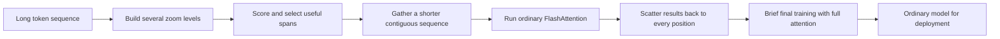
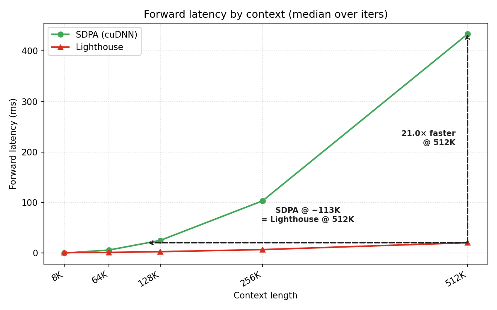
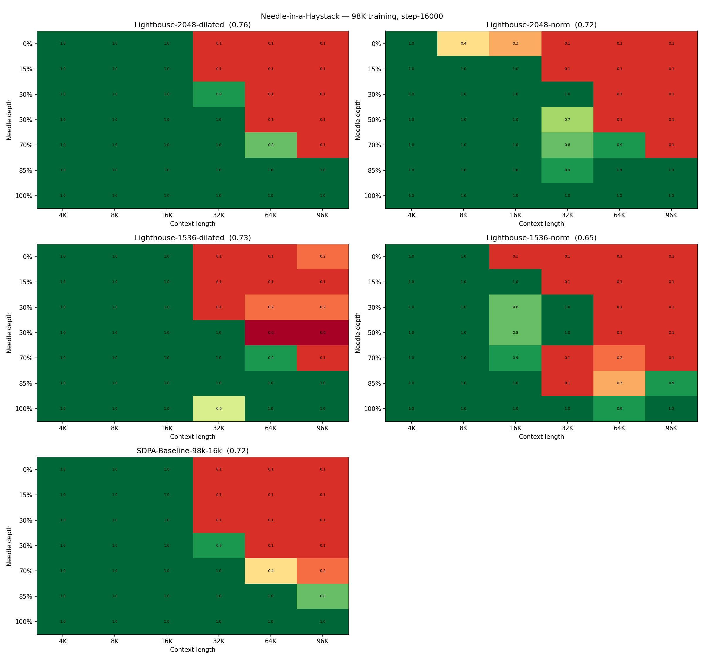

---
cover:
  alt: (a) Forward Latency
  caption: (a) Forward Latency
  image: figures/fig01.png
  relative: true
date: '2026-05-07'
description: Lighthouse trains long-context models through a temporary hierarchy,
  then removes it before deployment. In early tests, it cut total training time while
  matching or improving the dense-attention baseline.
draft_id: 20260803-2b779c3c
item_kind: paper
item_source: linkedin
kol: omarsar
paper:
  abs_url: https://arxiv.org/abs/2605.06554
  abstract: 'Training causal transformers at extreme sequence lengths is bottlenecked
    by the quadratic time and memory of scaled dot-product attention (SDPA). In this
    work, we propose Lighthouse Attention, a training-only symmetrical selection-based
    hierarchical attention algorithm that wraps around ordinary SDPA and can be easily
    removed towards the end of the training. Our hierarchical selection is also gradient-free,
    which exempts us from dealing with a complicated and potentially inefficient backward
    pass kernel. Our contribution is three-fold: (i) A subquadratic hierarchical pre-
    and post-processing step that does adaptive compression and decompression of the
    sequence. (ii) A symmetrical compression strategy that pools queries, keys and
    values at the same time, while preserving left-to-right causality, which greatly
    improves parallelism. (iii) A two stage training approach which we pre-train for
    the majority of the time with Lighthouse Attention and recover a full attention
    model at the end with a short training. We run preliminary small scale LLM pre-training
    experiments that show the effectiveness of our method compared to full attention
    training with all other settings matched, where we achieve a faster total training
    time and lower final loss after the recovery phase. Full code is available at:
    https://github.com/ighoshsubho/lighthouse-attention'
  arxiv_id: '2605.06554'
  authors:
  - Bowen Peng
  - Subho Ghosh
  - Jeffrey Quesnelle
  pdf_url: https://arxiv.org/pdf/2605.06554
  published: '2026-05-07'
  title: Long Context Pre-Training with Lighthouse Attention
reliability:
  authors_orgs: Bowen Peng, Subho Ghosh, and Jeffrey Quesnelle; Nous Research.
  code_available: true
  code_url: https://github.com/ighoshsubho/lighthouse-attention
  evidence: 530M-parameter model on C4; 50.3B training tokens; three recovery schedules,
    latency scaling, design ablations, and a simplified retrieval test.
  venue: arXiv preprint 2605.06554, published May 7, 2026.
source_url: ''
summary: Lighthouse trains long-context models through a temporary hierarchy, then
  removes it before deployment. In early tests, it cut total training time while matching
  or improving the dense-attention baseline.
tags:
- long-context training
- lighthouse attention
- efficient attention
- flashattention
- hierarchical attention
- dense recovery
title: 'Lighthouse Attention: A Faster Detour for Training on Very Long Text'
topics:
- ai
- ai/llm
- ai/llm/training
---

## The Big Idea

Imagine training an assistant to read an entire filing cabinet at once. Every time it considers one page, it compares that page with every other page. Double the cabinet, and the comparison work grows roughly fourfold. That is the long-context training problem: ordinary attention becomes brutally expensive as the input grows.

Lighthouse Attention, from researchers at Nous Research, treats most of training like reading a map at several zoom levels. It keeps detailed pieces where they seem useful and compressed summaries elsewhere. Then, near the end, the researchers remove this temporary scaffold and finish training with ordinary attention, leaving no Lighthouse-specific machinery in the deployed model.

> At 512K tokens, Lighthouse's attention step was 21× faster in the forward pass than dense attention on the tested B200 GPU.

## How It Works

Think of a newspaper editor making three versions of a day's coverage: every article, short section summaries, and a front-page digest. Lighthouse does this simultaneously to the queries, keys, and values used inside attention. Each summary therefore represents the same span from all three viewpoints.

A simple, parameter-free score ranks entries across those levels. The coarsest overview is always retained; selected finer entries add detail. Lighthouse gathers the winners into one ordinary, contiguous mini-document, runs stock FlashAttention on it, then spreads the results back to the original positions while preserving left-to-right causality. The selection decision itself receives no gradient, and the method adds no learned selector or auxiliary training loss.

The training recipe has two acts. Lighthouse handles the first 10,000–12,000 steps. Dense attention handles the remaining steps, with the total fixed at 16,000. When the switch happens, loss jumps because the model suddenly sees a different attention pattern. It settles within roughly 1,000–1,500 dense-attention steps.

## What They Found

The main experiment used a 530-million-parameter Llama-3-style model, 98,304-token sequences, C4 data, eight B200 GPUs, and about 50.3 billion training tokens. Every tested switch schedule finished with lower training loss than dense attention trained from scratch on the same token budget. Because lower is better, 0.6980 versus 0.7237 means the model ended about 3.6% lower on this loss measure.

| Training schedule, 16,000 steps total | Dense from scratch | Lighthouse, then dense |
|---|---:|---:|
| 10K Lighthouse + 6K dense | 0.7237 | 0.6980 |
| 11K Lighthouse + 5K dense | 0.7237 | within 0.6980–0.7102 |
| 12K Lighthouse + 4K dense | 0.7237 | 0.7102 |

The paper reports the middle schedule only as part of the 0.6980–0.7102 range in the available text, so it is not assigned a more precise value here.

The microbenchmark isolates one attention layer on a single B200. At 512K tokens, Lighthouse was 21× faster for the forward pass and 17.3× faster for the backward pass. Across complete 16,000-step runs, including the dense recovery phase, it took 22.5–27.0 hours instead of 37.9 hours: a 1.40×–1.69× end-to-end speedup.

| Measurement | Dense attention | Lighthouse |
|---|---:|---:|
| Forward latency at 512K | about 21× Lighthouse | 1× |
| Backward latency at 512K | about 17.3× Lighthouse | 1× |
| Stage-one throughput at 98K | about 46K tokens/s/GPU | 83.5K–126K tokens/s/GPU |
| Full 16K-step runtime | 37.9 h | 22.5–27.0 h |
| Total B200-hours | 303.2 | 179.6–215.7 |

A simplified retrieval test hid one digit inside contexts up to 96K tokens. Three of four recovered Lighthouse models matched or exceeded the dense baseline's 72% mean retrieval; the best reached 76%, or roughly three correct retrievals out of four. The weakest reached 65%. Larger selection budgets helped retrieval even though smaller budgets produced better training loss.

| Recovered model | Dense baseline | Lighthouse 2048 dilated | Lighthouse 2048 norm | Lighthouse 1536 dilated | Lighthouse 1536 norm |
|---|---:|---:|---:|---:|---:|
| Mean digit retrieval | 72% | 76% | 72% | 73% | 65% |

These are preliminary, small-scale pretraining results from one 530M model family, one main dataset, and B200 hardware. The headline quality comparison is training loss, not a broad suite of downstream tasks. The retrieval test uses single digits because full-prose retrieval was near zero for every model at this training scale. Lighthouse itself is not intended for autoregressive decoding; deployment depends on the final dense-attention recovery. Its gathered attention also remains quadratic in the shortened sequence, and behavior is untested if the selection budget must grow with context length.

## Glossary

- **SDPA** — The standard form of full attention in which every position can compare itself with all permitted earlier positions.
- **Needle-in-a-Haystack test** — A recall test that hides a small fact inside a long input and asks the model to retrieve it.

## Links

- [arXiv page](https://arxiv.org/abs/2605.06554)
- [PDF](https://arxiv.org/pdf/2605.06554)
- [GitHub repository](https://github.com/ighoshsubho/lighthouse-attention)