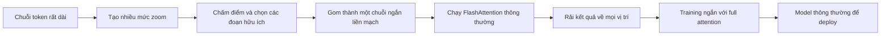

---
cover:
  alt: (a) Forward Latency
  caption: (a) Forward Latency
  image: /posts/2026-05-07-lighthouse-attention-a-faster-detour-for-training-on-very-lo/figures/fig01.png
  relative: false
date: '2026-05-07'
description: Lighthouse dùng một hệ thống phân tầng tạm thời khi train model với context
  dài, rồi tháo bỏ trước khi deploy. Thử nghiệm ban đầu cho thấy tổng thời gian training
  giảm mà kết quả vẫn ngang hoặc tốt hơn dense attention.
draft_id: 20260803-2b779c3c
item_kind: paper
item_source: linkedin
kol: omarsar
paper:
  abs_url: https://arxiv.org/abs/2605.06554
  abstract: 'Training causal transformers at extreme sequence lengths is bottlenecked
    by the quadratic time and memory of scaled dot-product attention (SDPA). In this
    work, we propose Lighthouse Attention, a training-only symmetrical selection-based
    hierarchical attention algorithm that wraps around ordinary SDPA and can be easily
    removed towards the end of the training. Our hierarchical selection is also gradient-free,
    which exempts us from dealing with a complicated and potentially inefficient backward
    pass kernel. Our contribution is three-fold: (i) A subquadratic hierarchical pre-
    and post-processing step that does adaptive compression and decompression of the
    sequence. (ii) A symmetrical compression strategy that pools queries, keys and
    values at the same time, while preserving left-to-right causality, which greatly
    improves parallelism. (iii) A two stage training approach which we pre-train for
    the majority of the time with Lighthouse Attention and recover a full attention
    model at the end with a short training. We run preliminary small scale LLM pre-training
    experiments that show the effectiveness of our method compared to full attention
    training with all other settings matched, where we achieve a faster total training
    time and lower final loss after the recovery phase. Full code is available at:
    https://github.com/ighoshsubho/lighthouse-attention'
  arxiv_id: '2605.06554'
  authors:
  - Bowen Peng
  - Subho Ghosh
  - Jeffrey Quesnelle
  pdf_url: https://arxiv.org/pdf/2605.06554
  published: '2026-05-07'
  title: Long Context Pre-Training with Lighthouse Attention
reliability:
  authors_orgs: Bowen Peng, Subho Ghosh, and Jeffrey Quesnelle; Nous Research.
  code_available: true
  code_url: https://github.com/ighoshsubho/lighthouse-attention
  evidence: 530M-parameter model on C4; 50.3B training tokens; three recovery schedules,
    latency scaling, design ablations, and a simplified retrieval test.
  venue: arXiv preprint 2605.06554, published May 7, 2026.
source_url: ''
summary: Lighthouse dùng một hệ thống phân tầng tạm thời khi train model với context
  dài, rồi tháo bỏ trước khi deploy. Thử nghiệm ban đầu cho thấy tổng thời gian training
  giảm mà kết quả vẫn ngang hoặc tốt hơn dense attention.
tags:
- long-context training
- lighthouse attention
- efficient attention
- flashattention
- hierarchical attention
- dense recovery
title: 'Lighthouse Attention: đường vòng nhanh hơn để train với context rất dài'
topics:
- ai
- ai/llm
- ai/llm/training
---

## Ý tưởng chính

Bạn thử hình dung một AI phải đọc nguyên một tủ hồ sơ trong một lượt. Mỗi trang lại cần đối chiếu với gần như mọi trang trước đó. Tủ hồ sơ dài gấp đôi thì lượng so sánh có thể tăng gần bốn lần. Với context dài, phần attention trong lúc training nhanh chóng trở thành hóa đơn GPU lớn nhất.

Nhóm tác giả tại Nous Research đưa ra Lighthouse Attention. Nói đơn giản là trong phần lớn quá trình training, model không nhìn tài liệu chỉ ở một độ chi tiết. Nó dùng nhiều mức zoom, giữ đoạn quan trọng ở dạng chi tiết và nén phần còn lại thành bản tóm tắt. Đến chặng cuối, toàn bộ lớp hỗ trợ này được tháo ra. Model quay về attention thông thường để sẵn sàng deploy.

> Ở context 512K token, bước attention của Lighthouse chạy forward nhanh hơn 21 lần so với dense attention trên GPU B200 được thử nghiệm.

## Cách hoạt động

Hãy nghĩ đến một tòa soạn có ba bản của cùng một số báo: bản đầy đủ, bản tóm tắt theo chuyên mục và bản điểm tin trang nhất. Lighthouse tạo ra các tầng tương tự cho cả ba thành phần mà attention sử dụng. Vì chúng được nén đồng bộ, mỗi ô ở một tầng luôn nói về cùng một đoạn văn bản.

Sau đó, một cách chấm điểm không có parameter riêng sẽ chọn các đoạn đáng giữ. Tầng thô nhất luôn có mặt để không vùng nào biến mất hoàn toàn. Những mục được chọn được xếp lại thành một chuỗi ngắn, liền mạch. FlashAttention thông thường xử lý chuỗi này, rồi kết quả được rải ngược về đủ các vị trí ban đầu mà không làm lộ thông tin từ tương lai.

Quy trình training chia làm hai chặng. Lighthouse chạy trong 10.000 đến 12.000 step đầu. Dense attention chạy phần còn lại, nhưng tổng vẫn giữ nguyên 16.000 step. Ngay lúc đổi chế độ, loss tăng vọt. Thật ra thì điều này không bất ngờ: model vừa bị đổi “cách đọc”. Sau khoảng 1.000–1.500 step, nó ổn định trở lại.

## Kết quả

Thử nghiệm chính dùng model kiểu Llama 3 với 530 triệu parameter, sequence dài 98.304 token, dữ liệu C4, tám GPU B200 và khoảng 50,3 tỷ token training. Cả ba thời điểm chuyển chế độ đều kết thúc với training loss thấp hơn model dùng dense attention từ đầu, dù ngân sách token như nhau. Với metric này, thấp hơn là tốt hơn; từ 0,7237 xuống 0,6980 tương đương mức loss cuối thấp hơn khoảng 3,6%.

| Lịch training, tổng 16.000 step | Dense từ đầu | Lighthouse rồi dense |
|---|---:|---:|
| 10K Lighthouse + 6K dense | 0,7237 | 0,6980 |
| 11K Lighthouse + 5K dense | 0,7237 | trong khoảng 0,6980–0,7102 |
| 12K Lighthouse + 4K dense | 0,7237 | 0,7102 |

Bản paper hiện có chỉ nêu lịch ở giữa trong khoảng 0,6980–0,7102, nên bài này không gán cho nó một con số chính xác hơn.

Khi đo riêng một attention layer trên một B200 ở 512K token, Lighthouse nhanh hơn 21 lần ở forward và 17,3 lần ở backward. Nếu tính trọn cả 16.000 step, bao gồm chặng recovery bằng dense attention, thời gian giảm từ 37,9 giờ xuống 22,5–27,0 giờ. Tức nhanh hơn 1,40–1,69 lần từ đầu đến cuối.

| Phép đo | Dense attention | Lighthouse |
|---|---:|---:|
| Độ trễ forward ở 512K | khoảng 21× Lighthouse | 1× |
| Độ trễ backward ở 512K | khoảng 17,3× Lighthouse | 1× |
| Throughput chặng đầu ở 98K | khoảng 46K token/s/GPU | 83,5K–126K token/s/GPU |
| Thời gian đủ 16K step | 37,9 giờ | 22,5–27,0 giờ |
| Tổng B200-giờ | 303,2 | 179,6–215,7 |

Nhóm tác giả còn giấu một chữ số trong context dài tới 96K token rồi yêu cầu model tìm lại. Ba trong bốn cấu hình Lighthouse sau recovery đạt bằng hoặc hơn baseline dense ở mức trung bình 72%. Cấu hình tốt nhất đạt 76% — nói nôm na là tìm đúng khoảng ba trong bốn lần. Cấu hình yếu nhất chỉ đạt 65%. Đáng chú ý là giữ nhiều mục hơn giúp bài recall, trong khi giữ ít hơn lại cho training loss đẹp hơn.

| Model sau recovery | Dense baseline | Lighthouse 2048 dilated | Lighthouse 2048 norm | Lighthouse 1536 dilated | Lighthouse 1536 norm |
|---|---:|---:|---:|---:|---:|
| Tỷ lệ tìm đúng trung bình | 72% | 76% | 72% | 73% | 65% |

Phạm vi bằng chứng vẫn còn hẹp. Đây là pretraining quy mô nhỏ trên một họ model 530M, một dataset chính và phần cứng B200. So sánh chất lượng chủ yếu dựa vào training loss, chưa phải một bộ downstream task rộng. Bài retrieval cũng chỉ dùng một chữ số vì phiên bản giấu cả đoạn văn cho kết quả gần 0 ở mọi model tại quy mô training này. Lighthouse không dùng trực tiếp cho autoregressive decoding; model deploy được là nhờ chặng recovery với dense attention. Cuối cùng, attention trên chuỗi đã rút gọn vẫn tăng theo bình phương độ dài của chính chuỗi đó, và paper chưa kiểm tra trường hợp ngân sách chọn phải tăng cùng context.

## Thuật ngữ

- **SDPA** — Dạng full attention tiêu chuẩn, nơi mỗi vị trí có thể so sánh với mọi vị trí trước đó được phép nhìn.
- **Needle-in-a-Haystack test** — Bài kiểm tra giấu một mẩu thông tin nhỏ trong input rất dài rồi yêu cầu model tìm lại.

## Liên kết

- [Trang arXiv](https://arxiv.org/abs/2605.06554)
- [PDF](https://arxiv.org/pdf/2605.06554)
- [GitHub repository](https://github.com/ighoshsubho/lighthouse-attention)