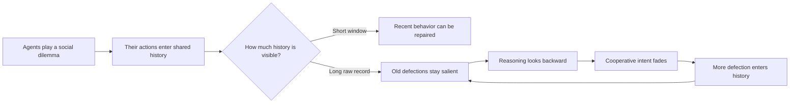
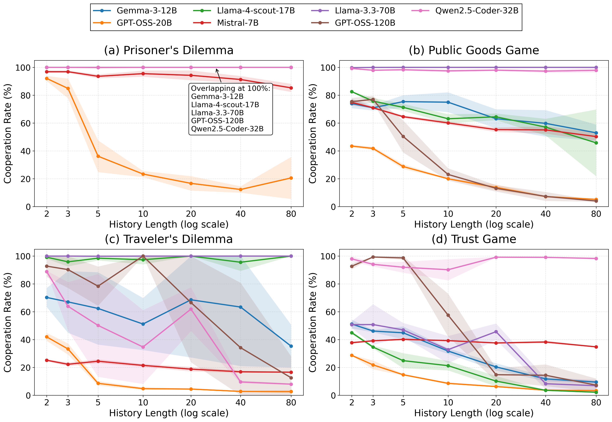
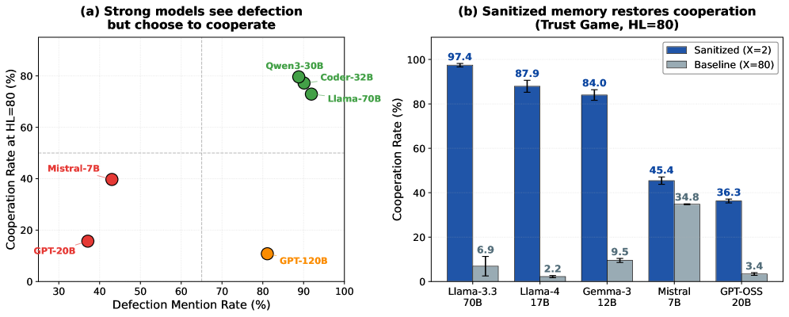

---
cover:
  alt: 'Figure 2: Cooperation rate across four social dilemmas as history length (
    H ​ L HL ) expands. The x-axis (non-linear scale) begins at H ​ L = 2 HL=2 to
    focus on the strategic regime of repeated interaction. Each panel reports the
    mean cooperation rate, with shaded bands denoting standard deviation.'
  caption: 'Figure 2: Cooperation rate across four social dilemmas as history length
    ( H ​ L HL ) expands. The x-axis (non-linear scale) begins at H ​ L = 2 HL=2 to
    focus on the strategic regime of repeated interaction. Each panel reports the
    mean cooperation rate, with shaded bands denoting standard deviation.'
  image: figures/fig02.png
  relative: true
date: '2026-05-08'
description: Giving AI agents a longer record of past interactions can make them dwell
  on old betrayals and cooperate less. A study across seven models shows why the content
  of memory matters more than its size.
draft_id: 20260803-1abf6ebf
item_kind: paper
item_source: linkedin
kol: omarsar
paper:
  abs_url: https://arxiv.org/abs/2605.08060
  abstract: 'Context window expansion is often treated as a straightforward capability
    upgrade for LLMs, but we find it systematically fails in multi-agent social dilemmas.
    Across 7 LLMs and 4 games over 500 rounds, expanding accessible history degrades
    cooperation in 18 of 28 model--game settings, a pattern we term the memory curse.
    We isolate the underlying mechanism through three analyses. First, lexical analysis
    of 378,000 reasoning traces associates this breakdown with eroding forward-looking
    intent rather than rising paranoia. We validate this using targeted fine-tuning
    as a cognitive probe: a LoRA adapter trained exclusively on forward-looking traces
    mitigates the decay and transfers zero-shot to distinct games. Second, memory
    sanitization holds prompt length fixed while replacing visible history with synthetic
    cooperative records, which restores cooperation substantially, proving the trigger
    is memory content, not length alone. Finally, ablating explicit Chain-of-Thought
    reasoning often reduces the collapse, showing that deliberation paradoxically
    amplifies the memory curse. Together, these results recast memory as an active
    determinant of multi-agent behavior: longer recall can either destabilize or support
    cooperation depending on the reasoning patterns it elicits.'
  arxiv_id: '2605.08060'
  authors:
  - Jiayuan Liu
  - Tianqin Li
  - Shiyi Du
  - Xin Luo
  - Haoxuan Zeng
  - Emanuel Tewolde
  - Tai Sing Lee
  - Tonghan Wang
  - Carl Kingsford
  - Vincent Conitzer
  pdf_url: https://arxiv.org/pdf/2605.08060
  published: '2026-05-08'
  title: 'The Memory Curse: How Expanded Recall Erodes Cooperative Intent in LLM Agents'
reliability:
  authors_orgs: Jiayuan Liu, Tianqin Li, Shiyi Du, Xin Luo, Haoxuan Zeng, Emanuel
    Tewolde, Tai Sing Lee, Tonghan Wang, Carl Kingsford, and Vincent Conitzer; Carnegie
    Mellon University, Foundations of Cooperative AI Lab (FOCAL), University of Michigan,
    and Harvard University.
  code_available: false
  code_url: ''
  evidence: 7 LLMs across 4 repeated social dilemmas, 9 history lengths, 3 runs per
    setting, up to 500 rounds; 378,000 reasoning traces plus fine-tuning, memory-sanitization,
    and reasoning-ablation tests.
  venue: arXiv preprint 2605.08060, published May 8, 2026.
source_url: ''
summary: Giving AI agents a longer record of past interactions can make them dwell
  on old betrayals and cooperate less. A study across seven models shows why the content
  of memory matters more than its size.
tags:
- agent memory
- multi-agent cooperation
- social dilemmas
- long context
- chain-of-thought
- memory curse
title: When Perfect Memory Makes AI Agents Less Cooperative
topics:
- ai
- ai/llm
- ai/llm/agents
---

## The Big Idea

Imagine two colleagues keeping a perfect, searchable ledger of every awkward handoff, missed deadline, and small act of generosity between them. You might expect the record to help them learn to work together. But it can also turn one bad afternoon into permanent evidence that the other person cannot be trusted.

That is the problem behind this paper. AI agents are increasingly expected to negotiate, coordinate, and share resources over long stretches of time. Giving them more memory sounds like an obvious upgrade. Yet across repeated social dilemmas, the researchers found that a longer visible history often made agents less cooperative. They call this the “memory curse.”

The proposed explanation is not that the agents suddenly become much more paranoid. Long records pull their attention backward. Language about future mutual benefit fades, while old defections remain available as reasons to play it safe. The paper’s answer is therefore simple: useful memory needs curation and a forward-looking way of reasoning, not just more storage.

## How It Works

The researchers placed copies of the same LLM into four familiar conflicts: the Prisoner’s Dilemma, Traveler’s Dilemma, Public Goods Game, and Trust Game. In each, grabbing a short-term advantage can hurt everyone over time. Two or three agents played for as many as 500 rounds, knowing there was a 99% chance of another round. The experiment varied how many previous rounds each agent could see: from none to 80.

Think of the visible history as a security-camera reel. With two rounds of footage, an agent sees the latest exchange and may try to reset the relationship. With 80 rounds, every old betrayal stays on screen. One noisy move can trigger retaliation; the retaliation then becomes fresh evidence for more retaliation.

The main sweep covered seven LLMs, four games, nine history lengths, and three runs per setting. The authors then opened the agents’ reasoning logs—378,000 traces—and counted language associated with future cooperation versus history-following and risk avoidance.

They also ran three useful checks. First, they trained a small LoRA adapter on Mistral-7B using only traces rich in forward-looking reasoning, then tested whether the effect transferred to other games. Second, they kept an 80-round prompt the same length but replaced most of its contents with synthetic cooperative records. Third, they removed explicit step-by-step reasoning to see whether deliberation helped or hurt.

## What They Found

Longer recall reduced cooperation in 18 of the 28 model–game combinations. In plain language, nearly two out of every three combinations got worse as more history became available. Ten combinations remained at or above 95% cooperation across all tested history lengths, so the effect was common, not universal.

| Model and game | Short memory: 2 rounds | Long memory: 80 rounds |
|---|---:|---:|
| Gemma-3-12B, Trust Game | 51.2% | 9.5% |
| GPT-OSS-20B, Prisoner’s Dilemma | 92.1% | 20.6% |
| Llama-4-Scout-17B, Public Goods Game | 82.6% | 45.8% |
| GPT-OSS-120B, Trust Game | 92.7% | 7.3% |

The language analysis points to lost optimism more than added fear. At 80 rounds, settings resistant to the curse had a mean forward-looking-language ratio of 0.504, versus 0.340 in vulnerable settings. For GPT-OSS-20B, cooperative language fell by 57% as the visible history expanded, while the absolute amount of defensive language stayed roughly stable.

The interventions support that mechanism, though they do not prove a full account of what happens inside the models.

| Test | Baseline | Intervention | Result |
|---|---|---|---:|
| Mistral-7B across four games at 80-round memory | Base model | LoRA trained on forward-looking Public Goods traces | +14.7 to +79.3 percentage points |
| Llama-3.3-70B at its hardest tested game, 80-round memory | Explicit reasoning | Final answer only | 6.9% → 100.0% cooperation |
| Trust Game, fixed 80-round prompt | 80 real rounds | 2 real rounds plus 78 synthetic cooperative rounds | Large recovery across all five shown models |

The fine-tuned Mistral model improved in all four games, including three it had not been trained on. Its general benchmark scores stayed comparable, with a 2.3% gain on GSM8K reported alongside stable knowledge and coding results. Still, the training traces were highly entangled with the desired behavior: 98% of the forward-looking examples ended in cooperation. The authors filtered by reasoning style rather than action, but acknowledge that this does not eliminate action learning as an explanation.

The sanitization test is especially revealing. Prompt length remained fixed, yet changing the record changed behavior. For example, Llama-3.3-70B rose from 6.9% cooperation with 80 real rounds to 97.4% when only two recent rounds were real and the other 78 showed synthetic mutual cooperation.

> More memory did not merely preserve the relationship; in many settings, it preserved the grudge.

These are controlled games, not workplaces or markets. Agents shared the same backbone within each main experiment, every setting had three runs, and cooperation was defined by fixed game actions. The keyword analysis is also a coarse window into reasoning, not a direct measurement of internal intent. The study shows a repeatable failure mode under these conditions; it does not establish that every long-memory agent will behave this way in open-ended life.

## Glossary

- **Social dilemma** — a situation where the tempting choice for one participant can leave the whole group worse off.
- **LoRA adapter** — a small set of learned additions that changes a model’s behavior without retraining the whole model.

## Links

- [arXiv page](https://arxiv.org/abs/2605.08060)
- [PDF](https://arxiv.org/pdf/2605.08060)