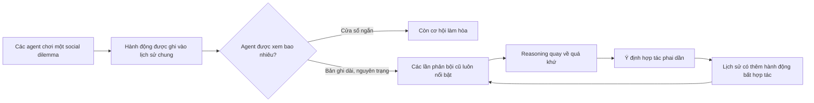

---
cover:
  alt: 'Figure 2: Cooperation rate across four social dilemmas as history length (
    H ​ L HL ) expands. The x-axis (non-linear scale) begins at H ​ L = 2 HL=2 to
    focus on the strategic regime of repeated interaction. Each panel reports the
    mean cooperation rate, with shaded bands denoting standard deviation.'
  caption: 'Figure 2: Cooperation rate across four social dilemmas as history length
    ( H ​ L HL ) expands. The x-axis (non-linear scale) begins at H ​ L = 2 HL=2 to
    focus on the strategic regime of repeated interaction. Each panel reports the
    mean cooperation rate, with shaded bands denoting standard deviation.'
  image: /posts/2026-05-08-when-perfect-memory-makes-ai-agents-less-cooperative/figures/fig02.png
  relative: false
date: '2026-05-08'
description: Cho AI agent xem lịch sử dài hơn có thể khiến nó bám vào những lần phản
  bội cũ và ít hợp tác hơn. Nghiên cứu trên bảy model cho thấy nội dung memory quan
  trọng hơn độ dài.
draft_id: 20260803-1abf6ebf
item_kind: paper
item_source: linkedin
kol: omarsar
paper:
  abs_url: https://arxiv.org/abs/2605.08060
  abstract: 'Context window expansion is often treated as a straightforward capability
    upgrade for LLMs, but we find it systematically fails in multi-agent social dilemmas.
    Across 7 LLMs and 4 games over 500 rounds, expanding accessible history degrades
    cooperation in 18 of 28 model--game settings, a pattern we term the memory curse.
    We isolate the underlying mechanism through three analyses. First, lexical analysis
    of 378,000 reasoning traces associates this breakdown with eroding forward-looking
    intent rather than rising paranoia. We validate this using targeted fine-tuning
    as a cognitive probe: a LoRA adapter trained exclusively on forward-looking traces
    mitigates the decay and transfers zero-shot to distinct games. Second, memory
    sanitization holds prompt length fixed while replacing visible history with synthetic
    cooperative records, which restores cooperation substantially, proving the trigger
    is memory content, not length alone. Finally, ablating explicit Chain-of-Thought
    reasoning often reduces the collapse, showing that deliberation paradoxically
    amplifies the memory curse. Together, these results recast memory as an active
    determinant of multi-agent behavior: longer recall can either destabilize or support
    cooperation depending on the reasoning patterns it elicits.'
  arxiv_id: '2605.08060'
  authors:
  - Jiayuan Liu
  - Tianqin Li
  - Shiyi Du
  - Xin Luo
  - Haoxuan Zeng
  - Emanuel Tewolde
  - Tai Sing Lee
  - Tonghan Wang
  - Carl Kingsford
  - Vincent Conitzer
  pdf_url: https://arxiv.org/pdf/2605.08060
  published: '2026-05-08'
  title: 'The Memory Curse: How Expanded Recall Erodes Cooperative Intent in LLM Agents'
reliability:
  authors_orgs: Jiayuan Liu, Tianqin Li, Shiyi Du, Xin Luo, Haoxuan Zeng, Emanuel
    Tewolde, Tai Sing Lee, Tonghan Wang, Carl Kingsford, and Vincent Conitzer; Carnegie
    Mellon University, Foundations of Cooperative AI Lab (FOCAL), University of Michigan,
    and Harvard University.
  code_available: false
  code_url: ''
  evidence: 7 LLMs across 4 repeated social dilemmas, 9 history lengths, 3 runs per
    setting, up to 500 rounds; 378,000 reasoning traces plus fine-tuning, memory-sanitization,
    and reasoning-ablation tests.
  venue: arXiv preprint 2605.08060, published May 8, 2026.
source_url: ''
summary: Cho AI agent xem lịch sử dài hơn có thể khiến nó bám vào những lần phản bội
  cũ và ít hợp tác hơn. Nghiên cứu trên bảy model cho thấy nội dung memory quan trọng
  hơn độ dài.
tags:
- agent memory
- multi-agent cooperation
- social dilemmas
- long context
- chain-of-thought
- memory curse
title: Khi memory quá tốt khiến AI agent khó hợp tác hơn
topics:
- ai
- ai/llm
- ai/llm/agents
---

## Ý tưởng chính

Bạn thử hình dung hai đồng nghiệp có một cuốn sổ ghi không sót chuyện gì. Ai từng giúp ai, ai từng trễ hẹn, ai đã “chơi xấu” đúng một lần cách đây ba tháng — tất cả đều nằm đó. Cuốn sổ có thể giúp họ hiểu nhau hơn. Nhưng nó cũng có thể biến một lỗi nhỏ thành món nợ không bao giờ được xóa.

AI agent cũng gặp đúng chuyện này. Khi phải làm việc cùng nhau lâu dài, ta thường nghĩ cho agent xem thêm lịch sử là tốt. Nhóm nghiên cứu lại thấy điều ngược lại trong nhiều trường hợp: càng nhớ nhiều vòng chơi, agent càng ít hợp tác. Họ gọi hiện tượng này là “memory curse”.

Nói đơn giản là agent không hẳn trở nên đa nghi hơn. Vấn đề là nó dần thôi nghĩ về lợi ích chung ở phía trước. Những lần phản bội cũ cứ nằm trong prompt, sẵn sàng làm lý do cho lựa chọn an toàn ở hiện tại. Vì vậy, memory tốt không chỉ cần chứa nhiều; nó còn phải biết lọc và giữ được góc nhìn dài hạn.

## Cách hoạt động

Nhóm tác giả cho các bản sao của cùng một LLM chơi bốn trò chơi về hợp tác: Prisoner’s Dilemma, Traveler’s Dilemma, Public Goods Game và Trust Game. Luật khác nhau, nhưng điểm chung rất đời thường: ăn phần hơn ngay bây giờ có thể khiến cả nhóm thiệt về lâu dài.

Mỗi nhóm hai hoặc ba agent chơi tối đa 500 vòng. Chúng được báo rằng sau mỗi vòng có 99% khả năng sẽ gặp lại đúng đối thủ đó. Điểm mấu chốt là lượng lịch sử được xem. Có agent không thấy vòng nào trước đó; có agent thấy tới 80 vòng.

Hãy coi phần lịch sử như đoạn camera an ninh. Xem hai cảnh gần nhất, bạn còn dễ nghĩ “thử làm hòa xem sao”. Xem lại cả cuộn băng dài, mỗi lần đối phương từng chơi xấu đều hiện ra. Một lỗi ngẫu nhiên dẫn tới trả đũa. Lần trả đũa ấy lại trở thành bằng chứng mới để tiếp tục trả đũa.

Thí nghiệm chính gồm bảy LLM, bốn trò chơi, chín độ dài memory và ba lượt chạy cho mỗi cấu hình. Sau đó, nhóm tác giả phân tích 378.000 reasoning trace, xem ngôn ngữ hướng tới lợi ích tương lai còn xuất hiện bao nhiêu so với kiểu bám lịch sử và né rủi ro.

Họ còn làm ba phép thử khá hay. Một là dùng các trace có reasoning hướng về tương lai để train LoRA cho Mistral-7B, rồi mang sang những trò chơi khác. Hai là vẫn giữ prompt dài 80 vòng, nhưng thay phần lớn lịch sử bằng các bản ghi hợp tác tổng hợp. Ba là bỏ phần reasoning từng bước, chỉ yêu cầu agent đưa ra quyết định cuối cùng.

## Kết quả

Trong 28 cặp model–trò chơi, có 18 cặp hợp tác kém đi khi memory dài hơn. Hiểu nôm na, gần hai trên ba trường hợp bị ảnh hưởng. Tuy vậy, 10 cặp vẫn giữ mức hợp tác từ 95% trở lên ở mọi độ dài đã thử. Memory curse phổ biến, nhưng không phải định luật áp cho mọi model và mọi trò chơi.

| Model và trò chơi | Memory ngắn: 2 vòng | Memory dài: 80 vòng |
|---|---:|---:|
| Gemma-3-12B, Trust Game | 51,2% | 9,5% |
| GPT-OSS-20B, Prisoner’s Dilemma | 92,1% | 20,6% |
| Llama-4-Scout-17B, Public Goods Game | 82,6% | 45,8% |
| GPT-OSS-120B, Trust Game | 92,7% | 7,3% |

Điều đáng chú ý là ngôn ngữ hợp tác biến mất nhanh hơn ngôn ngữ phòng thủ tăng lên. Ở cửa sổ 80 vòng, nhóm chống chịu tốt có tỷ lệ từ ngữ hướng về tương lai trung bình 0,504; nhóm bị memory curse chỉ còn 0,340. Riêng GPT-OSS-20B, ngôn ngữ hợp tác giảm 57% khi lịch sử dài ra, trong khi lượng ngôn ngữ phòng thủ tuyệt đối gần như không đổi.

Các phép can thiệp đi cùng một hướng. Dù vậy, chúng mới củng cố cơ chế mà bài báo đề xuất, chưa thể mô tả trọn vẹn những gì diễn ra bên trong model.

| Phép thử | Mốc so sánh | Can thiệp | Kết quả |
|---|---|---|---:|
| Mistral-7B trong bốn trò chơi, memory 80 vòng | Model gốc | LoRA train bằng trace hướng tới tương lai từ Public Goods | +14,7 đến +79,3 điểm phần trăm |
| Llama-3.3-70B ở trò khó nhất đã thử, memory 80 vòng | Có reasoning rõ từng bước | Chỉ trả lời quyết định cuối | 6,9% → 100,0% hợp tác |
| Trust Game, prompt luôn dài 80 vòng | 80 vòng thật | 2 vòng thật và 78 vòng hợp tác tổng hợp | Cả năm model trong hình đều phục hồi mạnh |

LoRA của Mistral-7B giúp tăng hợp tác ở cả bốn trò, kể cả ba trò không có trong dữ liệu train. Các benchmark tổng quát gần như giữ nguyên; bài báo ghi nhận GSM8K tăng 2,3%, còn kiến thức và coding ổn định ở mức tương đương. Nhưng có một điểm cần nhớ: 98% trace được chọn vì có reasoning hướng tới tương lai cũng kết thúc bằng hành động hợp tác. Tác giả không lọc theo nhãn hành động, song chính họ cũng nói thiết kế này chưa loại bỏ hoàn toàn khả năng model chỉ học hành động mong muốn.

Thử nghiệm “làm sạch” memory cho thấy nội dung mới là nút thắt. Độ dài prompt không đổi. Chỉ cần thay bản ghi, hành vi đã khác. Chẳng hạn Llama-3.3-70B tăng từ 6,9% hợp tác với 80 vòng thật lên 97,4% khi chỉ giữ hai vòng thật gần nhất và cho 78 vòng còn lại là lịch sử hai bên cùng hợp tác.

> Memory dài không chỉ giữ lại mối quan hệ; trong nhiều cấu hình, nó giữ luôn cả mối hằn.

Đây vẫn là các trò chơi có luật cứng, chưa phải công ty hay thị trường ngoài đời. Trong thí nghiệm chính, các agent dùng cùng backbone; mỗi cấu hình chạy ba lần; “hợp tác” được quy về một hành động đã định sẵn. Phân tích từ khóa cũng chỉ là cách nhìn khá thô vào reasoning, không phải máy đo trực tiếp “ý định” bên trong. Kết quả chỉ ra một failure mode lặp lại được trong phạm vi này, chứ chưa cho phép kết luận mọi agent có memory dài đều sẽ cư xử như vậy.

## Thuật ngữ

- **Social dilemma** — tình huống mà lựa chọn có lợi trước mắt cho một người lại có thể khiến cả nhóm nhận kết quả tệ hơn.
- **LoRA adapter** — một phần tham số nhỏ được học thêm để đổi hành vi của model mà không cần train lại toàn bộ model.

## Liên kết

- [Trang arXiv](https://arxiv.org/abs/2605.08060)
- [PDF](https://arxiv.org/pdf/2605.08060)