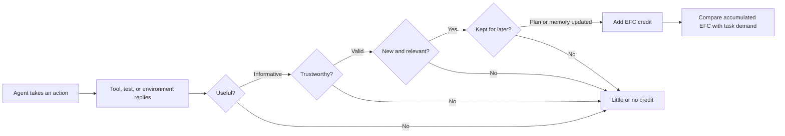

---
cover:
  alt: 'Figure 2: Matched-budget feedback-quality control. Left: low- and high-feedback-quality
    trajectories are matched pairwise in raw budget, with zero mean raw-cost and tool-call
    deltas. Middle: under the same budget, the high-EFC condition increases success
    from 0.27 0.27 to 0.90 0.90 . Right: the high-EFC condition raises all event-level
    EFC factors: informativeness (I), validity (V), non-redundancy (R), and memory
    update (M).'
  caption: 'Figure 2: Matched-budget feedback-quality control. Left: low- and high-feedback-quality
    trajectories are matched pairwise in raw budget, with zero mean raw-cost and tool-call
    deltas. Middle: under the same budget, the high-EFC condition increases success
    from 0.27 0.27 to 0.90 0.90 . Right: the high-EFC condition raises all event-level
    EFC factors: informativeness (I), validity (V), non-redundancy (R), and memory
    update (M).'
  image: figures/fig02.png
  relative: true
date: '2026-05-28'
description: Counting an agent’s tokens and tool calls can hide whether it learned
  anything useful. This paper measures feedback that is trustworthy, new, and remembered—and
  predicts success far better.
draft_id: 20260803-cbc49fc3
item_kind: paper
item_source: linkedin
kol: omarsar
paper:
  abs_url: https://arxiv.org/abs/2605.29682
  abstract: Agent harnesses shape language-model performance by controlling tool use,
    feedback, verification, memory, and repair. Yet raw test-time expenditure, such
    as tokens, tool calls, wall time, or cost, cannot distinguish useful feedback
    from redundant or unstable interaction. We introduce \emph{Effective Feedback
    Compute} (EFC), a trace-level scaling coordinate for informative, valid, non-redundant,
    and retained feedback. We further define Estimated-EFC, NRS-EFC, harness efficiency
    $η$, and task-demand normalization for realistic traces and heterogeneous tasks.
    Across synthetic, real, held-out, and prospective evaluations, EFC-based coordinates
    outperform raw-compute baselines and SAS. Oracle-EFC/$D_{\mathrm{task}}$ reaches
    $R^2=0.99$ in controlled scaling, and NRS-EFC/$D_{\mathrm{task}}$ reaches $R^2=0.93$
    on real traces where raw compute has near-zero or negative fit. Finally, \ours
    uses EFC as a companion control layer for existing harnesses, improving mean pass
    rate from $61.2\%$ to $68.2\%$ while reducing mean raw cost from $213.8$ to $85.1$
    under matched settings. These results suggest that harness scaling depends on
    durable, task-sufficient feedback rather than raw computation alone.
  arxiv_id: '2605.29682'
  authors:
  - Xuanliang Zhang
  - Dingzirui Wang
  - Keyan Xu
  - Qingfu Zhu
  - Wanxiang Che
  pdf_url: https://arxiv.org/pdf/2605.29682
  published: '2026-05-28'
  title: Scaling Laws for Agent Harnesses via Effective Feedback Compute
reliability:
  authors_orgs: Xuanliang Zhang, Dingzirui Wang, Keyan Xu, Qingfu Zhu, and Wanxiang
    Che; Harbin Institute of Technology.
  code_available: false
  evidence: Synthetic and executable tasks, three real benchmark subsets, module ablations,
    held-out splits, and a prospective validation batch.
  venue: arXiv:2605.29682, published May 28, 2026.
source_url: ''
summary: Counting an agent’s tokens and tool calls can hide whether it learned anything
  useful. This paper measures feedback that is trustworthy, new, and remembered—and
  predicts success far better.
tags:
- agent-harnesses
- effective-feedback-compute
- test-time-scaling
- tool-use
- memory
- verification
title: Why Useful Feedback Beats Bigger Budgets for AI Agents
topics:
- ai
- ai/llm
- ai/llm/agents
---

## The Big Idea

Imagine two junior colleagues given the same afternoon, the same research tools, and the same number of chances to ask for help. One keeps hearing vague advice, repeats old searches, and forgets earlier corrections. The other gets specific, trustworthy feedback and writes each useful discovery into the working plan. Their time sheets look identical. Their results will not.

AI agents have the same problem. The software around an agent—the part that chooses tools, checks work, stores memory, and decides whether to try again—is often judged by how many tokens, tool calls, or dollars it consumes. Those totals say little about whether the agent learned anything it could use.

This paper proposes **Effective Feedback Compute (EFC)**: count a piece of feedback only when it is informative, valid, non-redundant, and retained for a later decision. Then compare that useful feedback with how much the task actually demands. In short, measure productive learning, not activity.

> With the budget held fixed, higher-quality feedback raised success from 27% to 90%.

## How It Works

Think of EFC as an expense policy for evidence. A receipt is reimbursed only if it passes four checks. Did the observation reveal something relevant? Is it backed by a reliable test or tool result? Is it new rather than a repeat? Did the agent update its plan or memory because of it? The paper multiplies these four scores, so one weak link sharply reduces the credit.

In synthetic tasks, the researchers know the hidden correct state, so they can calculate an “oracle” version of EFC. For realistic traces, they estimate it from visible clues: whether a checker ran, whether a tool result was cited later, whether the plan changed, whether the agent avoided repeating an error, and whether progress survived into later steps. On noisy real traces, their NRS-EFC variant discounts unstable observations and repeated attempts.

The denominator matters too. Finding one fact in a document and repairing a software repository do not require the same amount of evidence. The paper estimates task demand from factors such as required steps, ambiguity over which tool to use, state-tracking load, observation noise, and availability of reliable checks. EFC divided by this demand asks a practical question: did the agent gather enough durable evidence for *this* job?

Finally, the authors fit the same failure curve to every candidate measure—tokens, time, cost, tool calls, an earlier multivariable baseline called SAS, and the EFC measures. They test three models and seven harness styles across synthetic tasks, executable coding tasks, real benchmark subsets, held-out configurations, and a prospectively collected batch.

## What They Found

The controlled comparison is unusually clean. Raw token count explained only a third of the variation in failure rates. Demand-normalized Oracle-EFC explained 99%. That does not mean it predicted every individual run; it means the fitted curve closely tracked the average failure rates across the tested groups.

| Evaluation | Raw tokens | Tool calls | SAS | EFC-based measure |
|---|---:|---:|---:|---:|
| Controlled synthetic scaling, R² | 0.33 | 0.42 | 0.88 | **0.99** (Oracle-EFC / task demand) |
| Held-out trace-time estimation, R² | 0.44 | 0.68 | about 0.86 | **0.93** (Estimated-EFC / task demand) |
| Executable code tasks, R² | 0.78 | 0.94 | 0.95 | **0.97** (Estimated-EFC / task demand) |
| Mixed real traces, R² | -0.08 | -0.02 | 0.43 | **0.92** (NRS-EFC / task demand) |
| Prospective real-trace holdout, R² | below 0 | below 0 | 0.26 | **0.85** (NRS-EFC / task demand) |

The headline intervention is easier to feel than the fit statistics. With raw cost and tool calls matched pair by pair, success moved from 27% to 90%—an increase of 63 percentage points, or roughly 63 extra successes per 100 attempts. Stronger routing, verification, and memory also raised the amount of effective feedback extracted from a fixed budget. Across module settings, that efficiency explained 97% of the variation in success, while raw cost explained 1%.

Generalization was promising but not uniform. On a mixed unseen-task set, raw spending had an R² of -0.42, worse than simply predicting the average. NRS-EFC reached 0.70, and a calibrated task-demand adjustment reached 0.83. The hand-designed adjustment reached only 0.53, showing that the difficulty formula does not transfer automatically and needs calibration for a new task mix.

The boundaries are important. The real evaluations used automatically verifiable subsets of HumanEval, Terminal-Bench 2.0, and SWE-bench Verified, excluding tasks with unstable dependencies or excessive setup. EFC estimation was calibrated first on synthetic tasks. Harness efficiency also changed by setting: deep feedback loops worked best on HumanEval-style code, all harnesses were inefficient on Terminal tasks, and earlier or mid-stage designs sometimes led on SWE tasks. The authors therefore present EFC as a predictive companion for harness design, not a universal score that removes the need to study each environment. They identify broader open-ended environments and better task-demand calibration as future work.

## Glossary

- **Effective Feedback Compute (EFC)** — A score that credits feedback only when it is useful, trustworthy, new, and carried into later decisions.
- **R²** — A fit score where 1 means a prediction curve matches the measured pattern perfectly, 0 means it does no better than predicting the average, and negative values are worse.

## Links

- [arXiv page](https://arxiv.org/abs/2605.29682)
- [PDF](https://arxiv.org/pdf/2605.29682)