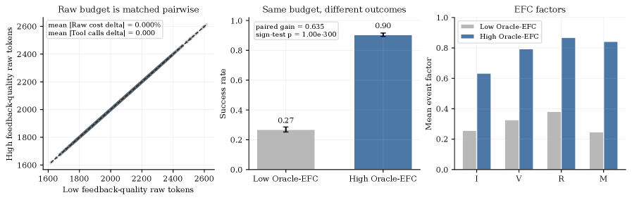
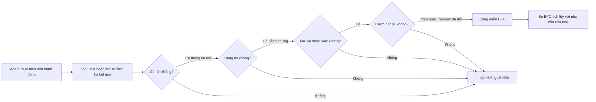
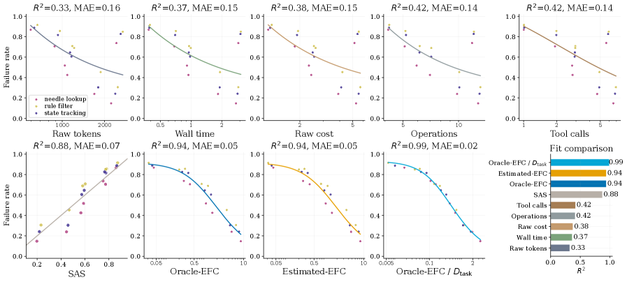
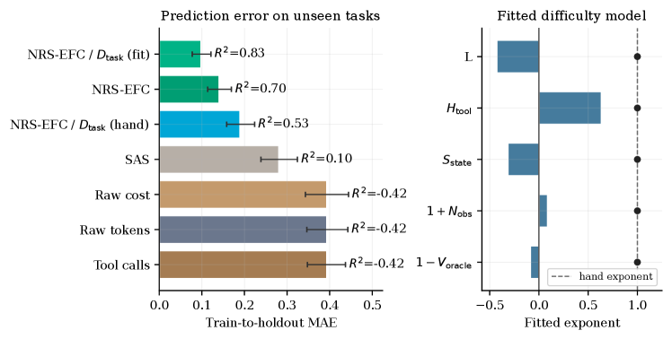

---
cover:
  alt: 'Figure 2: Matched-budget feedback-quality control. Left: low- and high-feedback-quality
    trajectories are matched pairwise in raw budget, with zero mean raw-cost and tool-call
    deltas. Middle: under the same budget, the high-EFC condition increases success
    from 0.27 0.27 to 0.90 0.90 . Right: the high-EFC condition raises all event-level
    EFC factors: informativeness (I), validity (V), non-redundancy (R), and memory
    update (M).'
  caption: 'Figure 2: Matched-budget feedback-quality control. Left: low- and high-feedback-quality
    trajectories are matched pairwise in raw budget, with zero mean raw-cost and tool-call
    deltas. Middle: under the same budget, the high-EFC condition increases success
    from 0.27 0.27 to 0.90 0.90 . Right: the high-EFC condition raises all event-level
    EFC factors: informativeness (I), validity (V), non-redundancy (R), and memory
    update (M).'
  image: /posts/2026-05-28-why-useful-feedback-beats-bigger-budgets-for-ai-agents/figures/fig02.png
  relative: false
date: '2026-05-28'
description: Đếm token hay số lần gọi tool chưa cho biết agent có học được gì hữu
  ích. Paper này đo phần feedback đáng tin, mới và được giữ lại để dự đoán khả năng
  thành công.
draft_id: 20260803-cbc49fc3
item_kind: paper
item_source: linkedin
kol: omarsar
paper:
  abs_url: https://arxiv.org/abs/2605.29682
  abstract: Agent harnesses shape language-model performance by controlling tool use,
    feedback, verification, memory, and repair. Yet raw test-time expenditure, such
    as tokens, tool calls, wall time, or cost, cannot distinguish useful feedback
    from redundant or unstable interaction. We introduce \emph{Effective Feedback
    Compute} (EFC), a trace-level scaling coordinate for informative, valid, non-redundant,
    and retained feedback. We further define Estimated-EFC, NRS-EFC, harness efficiency
    $η$, and task-demand normalization for realistic traces and heterogeneous tasks.
    Across synthetic, real, held-out, and prospective evaluations, EFC-based coordinates
    outperform raw-compute baselines and SAS. Oracle-EFC/$D_{\mathrm{task}}$ reaches
    $R^2=0.99$ in controlled scaling, and NRS-EFC/$D_{\mathrm{task}}$ reaches $R^2=0.93$
    on real traces where raw compute has near-zero or negative fit. Finally, \ours
    uses EFC as a companion control layer for existing harnesses, improving mean pass
    rate from $61.2\%$ to $68.2\%$ while reducing mean raw cost from $213.8$ to $85.1$
    under matched settings. These results suggest that harness scaling depends on
    durable, task-sufficient feedback rather than raw computation alone.
  arxiv_id: '2605.29682'
  authors:
  - Xuanliang Zhang
  - Dingzirui Wang
  - Keyan Xu
  - Qingfu Zhu
  - Wanxiang Che
  pdf_url: https://arxiv.org/pdf/2605.29682
  published: '2026-05-28'
  title: Scaling Laws for Agent Harnesses via Effective Feedback Compute
reliability:
  authors_orgs: Xuanliang Zhang, Dingzirui Wang, Keyan Xu, Qingfu Zhu, and Wanxiang
    Che; Harbin Institute of Technology.
  code_available: false
  evidence: Synthetic and executable tasks, three real benchmark subsets, module ablations,
    held-out splits, and a prospective validation batch.
  venue: arXiv:2605.29682, published May 28, 2026.
source_url: ''
summary: Đếm token hay số lần gọi tool chưa cho biết agent có học được gì hữu ích.
  Paper này đo phần feedback đáng tin, mới và được giữ lại để dự đoán khả năng thành
  công.
tags:
- agent-harnesses
- effective-feedback-compute
- test-time-scaling
- tool-use
- memory
- verification
title: Vì sao feedback hữu ích hơn ngân sách lớn với AI agent
topics:
- ai
- ai/llm
- ai/llm/agents
---

## Ý tưởng chính

Hãy hình dung hai đồng nghiệp có cùng ba giờ làm việc, cùng bộ công cụ và cùng số lần được hỏi ý kiến. Một người nhận toàn góp ý mơ hồ, tìm đi tìm lại một thứ rồi quên mất lỗi vừa sửa. Người kia nhận phản hồi đúng chỗ, có bằng chứng rõ ràng, và cập nhật ngay kế hoạch. Chi phí nhìn trên bảng chấm công giống hệt nhau. Kết quả thì khác xa.

AI agent cũng rơi vào tình huống đó. Người ta thường nhìn số token, số lần gọi tool hay tổng chi phí để đánh giá phần mềm điều phối agent. Nhưng một agent gọi tool mười lần chưa chắc học được nhiều hơn agent chỉ gọi ba lần.

Câu trả lời của paper là **Effective Feedback Compute (EFC)**. Nói đơn giản là, chỉ tính phần feedback vừa hữu ích, đáng tin, không lặp lại, lại còn được giữ để dùng ở bước sau. Sau đó phải đặt lượng feedback ấy cạnh độ khó thực tế của task, thay vì coi mọi task như nhau.

> Giữ nguyên ngân sách, feedback tốt hơn đã kéo tỷ lệ thành công từ 27% lên 90%.

## Cách hoạt động

Bạn có thể xem EFC như quy trình duyệt một khoản chi. Mỗi feedback phải qua bốn cửa. Nó có mang lại thông tin đúng việc đang làm không? Có test hoặc kết quả từ tool xác nhận không? Nó có mới, hay chỉ nhắc lại điều agent đã biết? Và quan trọng nhất, agent có sửa plan hoặc memory để dùng thông tin đó về sau không? Bốn điểm được nhân với nhau, nên chỉ cần một cửa gần như trượt là feedback đó hầu như không được tính.

Ở các bài toán synthetic, nhóm nghiên cứu biết trạng thái đúng bị giấu bên trong. Nhờ vậy họ tính được Oracle-EFC, tức phiên bản có “đáp án hậu trường”. Khi chuyển sang trace thật, họ chỉ dùng dấu hiệu quan sát được: checker có chạy không, kết quả từ tool có được nhắc lại ở bước sau không, plan có đổi không, lỗi cũ có tái diễn không, tiến bộ có được giữ lại không. Với trace nhiều nhiễu, NRS-EFC còn giảm điểm cho quan sát thiếu ổn định và các lần thử lặp đi lặp lại.

Một điểm đáng chú ý là mẫu số. Tìm một chi tiết trong tài liệu rõ ràng khác với sửa cả repository. Vì thế paper ước lượng nhu cầu của task qua số bước cần thiết, độ mơ hồ khi chọn tool, lượng trạng thái phải theo dõi, nhiễu trong quan sát và mức độ sẵn có của test đáng tin. Lấy EFC chia cho nhu cầu đó sẽ trả lời câu hỏi gần với thực tế hơn: feedback tích lũy đã đủ cho đúng task này chưa?

Cuối cùng, nhóm tác giả dùng cùng một đường dự đoán lỗi để so token, thời gian, chi phí, số lần gọi tool, baseline SAS và các biến thể EFC. Thử nghiệm bao gồm ba model, bảy kiểu harness, task synthetic, bài code có thể chạy, các tập con benchmark thực tế, cấu hình bị giữ lại để test và một batch được thu thập sau khi cách đo đã chốt.

## Kết quả

Ở thí nghiệm có kiểm soát, số token chỉ giải thích khoảng một phần ba biến động của tỷ lệ lỗi. Oracle-EFC sau khi điều chỉnh theo nhu cầu task đạt R² 0,99. Hiểu cho đúng: con số này nói đường dự đoán bám rất sát tỷ lệ lỗi trung bình của các nhóm được đo, chứ không phải đoán đúng 99% từng lần chạy riêng lẻ.

| Bài đánh giá | Token thô | Số lần gọi tool | SAS | Thước đo dựa trên EFC |
|---|---:|---:|---:|---:|
| Scaling synthetic có kiểm soát, R² | 0,33 | 0,42 | 0,88 | **0,99** (Oracle-EFC / nhu cầu task) |
| Ước lượng trong trace trên tập giữ lại, R² | 0,44 | 0,68 | khoảng 0,86 | **0,93** (Estimated-EFC / nhu cầu task) |
| Bài code có thể chạy, R² | 0,78 | 0,94 | 0,95 | **0,97** (Estimated-EFC / nhu cầu task) |
| Trace thực tế trộn nhiều loại, R² | -0,08 | -0,02 | 0,43 | **0,92** (NRS-EFC / nhu cầu task) |
| Batch trace thực tế thu sau, R² | dưới 0 | dưới 0 | 0,26 | **0,85** (NRS-EFC / nhu cầu task) |

Kết quả dễ hình dung nhất vẫn là phép thử giữ nguyên ngân sách. Chi phí và số lần gọi tool được ghép cặp bằng nhau, nhưng tỷ lệ thành công tăng từ 27% lên 90%. Tức là trong 100 lần thử, có thêm khoảng 63 lần thành công chỉ nhờ feedback tốt hơn. Router, verifier và memory mạnh hơn cũng giúp harness rút ra nhiều feedback hữu ích hơn từ cùng một ngân sách. Qua các cấu hình module, hiệu suất này giải thích 97% biến động về thành công; chi phí thô chỉ giải thích 1%.

Khi sang task chưa thấy, bức tranh vẫn tốt nhưng không hoàn toàn trơn tru. Trên một tập task hỗn hợp, chi tiêu thô có R² -0,42, còn tệ hơn đoán mọi nhóm bằng giá trị trung bình. NRS-EFC đạt 0,70. Khi nhu cầu task được fit lại trên tập calibration, con số lên 0,83. Nhưng công thức nhu cầu viết tay chỉ đạt 0,53. Nói cách khác, ý tưởng “feedback phải đủ so với task” có ích, còn cách chấm độ khó thì cần hiệu chỉnh cho từng hỗn hợp task.

Giới hạn của bằng chứng cũng khá rõ. Phần đánh giá thực chỉ dùng các tập con có thể kiểm tra tự động của HumanEval, Terminal-Bench 2.0 và SWE-bench Verified; task có dependency thiếu ổn định hoặc chi phí thiết lập quá lớn bị loại. Bộ ước lượng EFC ban đầu được calibration bằng task synthetic. Hiệu suất harness cũng đổi theo môi trường: vòng feedback sâu dẫn đầu ở code kiểu HumanEval, mọi harness đều kém hiệu quả trên Terminal, còn SWE đôi khi hợp với thiết kế đời đầu hoặc tầm giữa hơn. Vì vậy paper dùng EFC như một thước đo đi kèm để thiết kế harness, không phải một điểm số vạn năng. Nhóm tác giả để việc mở rộng sang môi trường open-ended và cải thiện cách calibration nhu cầu task cho nghiên cứu tiếp theo.

## Thuật ngữ

- **Effective Feedback Compute (EFC)** — Điểm chỉ được cộng khi feedback hữu ích, đáng tin, không lặp và được mang sang quyết định tiếp theo.
- **R²** — Điểm độ khớp: 1 là đường dự đoán khớp hoàn hảo với mẫu đo, 0 là không hơn đoán giá trị trung bình, còn số âm là tệ hơn.

## Liên kết

- [Trang arXiv](https://arxiv.org/abs/2605.29682)
- [PDF](https://arxiv.org/pdf/2605.29682)