---
cover:
  alt: 'Figure 1: Motivation. Current skill construction paradigms generally face
    several limitations: (a) Skill Fragmentation , capturing merely local procedures
    for isolated subtasks; (b) Limited Diversity , suffering from the inherent biases
    of a single model; and (c) Poor Transferability , exhibiting clear performance
    drops across different LLM backbones. To tackle these challenges, we propose CSTS,
    a novel tree-search-based skill construction framework that constructs structured,
    diverse, and gener'
  caption: 'Figure 1: Motivation. Current skill construction paradigms generally face
    several limitations: (a) Skill Fragmentation , capturing merely local procedures
    for isolated subtasks; (b) Limited Diversity , suffering from the inherent biases
    of a single model; and (c) Poor Transferability , exhibiting clear performance
    drops across different LLM backbones. To tackle these challenges, we propose CSTS,
    a novel tree-search-based skill construction framework that constructs structured,
    diverse, and gener'
  image: figures/fig01.png
  relative: true
date: '2026-06-15'
description: OpenClaw-Skill builds AI agents a structured library of procedures by
  comparing ideas from several models and keeping the ones that work across them.
  On two agent benchmarks, the trained models improved consistently over their Qwen
  starting points.
draft_id: 20260803-491a9752
item_kind: paper
item_source: linkedin
kol: omarsar
paper:
  abs_url: https://arxiv.org/abs/2606.16774
  abstract: 'Equipping Large Language Model (LLM) agents with effective skills is
    crucial for solving complex tasks in real-world systems like OpenClaw. In this
    work, we aim to develop a framework that automatically constructs such reusable
    skills to enhance LLMs in tool use, multi-step reasoning, and dynamic environment
    interaction. To this end, we propose Collective Skill Tree Search (CSTS), a novel
    tree-search-based skill construction framework that constructs structured, diverse
    and generalizable tree of skills. The core idea of CSTS is to leverage collective
    intelligence to jointly search, identify and compose effective skills via two
    iterative phases: Collective Skill Node Generation (CSN-Gen) and Collective Skill
    Node Assessment (CSN-Assess). CSN-Gen exploits collective knowledge from multiple
    models to explore diverse candidate skills for each subtask, enabling comprehensive
    skill exploration. CSN-Assess employs multiple models as judges to evaluate and
    select skill nodes with two scoring mechanisms: (1) collective quality scoring
    that aggregates independent evaluations to produce a robust estimate of skill
    effectiveness, and (2) collective transferability scoring that explicitly verifies
    whether a skill generalizes well across different models. With CSTS, we construct
    a set of comprehensive tree of skills along with skill-augmented training data,
    enabling models to effectively learn and utilize skills. Besides, we introduce
    Collective Skill Reinforcement Learning, which actively selects multiple relevant
    skills from the tree to broaden solution-space exploration, avoid being trapped
    by a single skill and its resulting homogeneous or suboptimal solutions. As a
    result, our trained model, OpenClaw-Skill, exhibits outstanding agentic capabilities
    in long-horizon planning, tool use and generalization over challenging benchmarks.'
  arxiv_id: '2606.16774'
  authors:
  - Tianyi Lin
  - Chuanyu Sun
  - Jingyi Zhang
  - Changxu Wei
  - Huanjin Yao
  - Shunyu Liu
  - Xikun Zhang
  - Liu Liu
  - Jiaxing Huang
  pdf_url: https://arxiv.org/pdf/2606.16774
  published: '2026-06-15'
  title: 'OpenClaw-Skill: Collective Skill Tree Search for Agentic Large Language
    Models'
reliability:
  authors_orgs: Tianyi Lin, Chuanyu Sun, Jingyi Zhang, Changxu Wei, Huanjin Yao, Shunyu
    Liu, Xikun Zhang, Liu Liu, and Jiaxing Huang; affiliations listed are The Hong
    Kong Polytechnic University, Nanyang Technological University, Tsinghua University,
    Royal Melbourne Institute of Technology, and Beijing University of Aeronautics
    and Astronautics.
  code_available: false
  evidence: Four Qwen backbones evaluated on QwenClawBench and PinchBench; 2,000 SFT
    examples and a component ablation are reported.
  venue: arXiv preprint 2606.16774, published June 15, 2026.
source_url: ''
summary: OpenClaw-Skill builds AI agents a structured library of procedures by comparing
  ideas from several models and keeping the ones that work across them. On two agent
  benchmarks, the trained models improved consistently over their Qwen starting points.
tags:
- agent-skills
- skill-tree
- tool-use
- reinforcement-learning
- qwen
- openclaw
title: OpenClaw-Skill Turns Agent Tips into Tested, Reusable Playbooks
topics:
- ai
- ai/llm
- ai/llm/agents
---

## The Big Idea

Imagine hiring a capable assistant and handing them a drawer full of sticky notes: “check the file,” “retry the command,” “verify the output.” Each note may help once. But the notes do not say which comes first, how they connect, or whether the advice still works when a different assistant takes over.

That is the problem OpenClaw-Skill attacks. AI agents can spend many steps moving through files, websites, code, and tool errors. Existing systems often turn past experience into isolated tips, sometimes drawn from just one model. The paper’s answer is to build a **tree of skills**: an ordered set of reusable procedures, proposed by several models and tested for both quality and portability.

This matters beyond AI research because a dependable agent is less like a chatbot with a clever answer and more like a colleague following a sound operating procedure. The work aims to preserve not just what succeeded, but the sequence, checks, and recovery steps that made it succeed.

## How It Works

Think of the method as creating a restaurant’s operating manual from several experienced chefs. First, split a complicated service into stations. Ask several chefs how they would handle each station. Have a panel inspect their instructions, then let other chefs try them. Keep the instructions that are clear *and* travel well.

```mermaid
flowchart LR
    A[Complex agent task] --> B[Split into ordered subtasks]
    B --> C[Several models attempt each subtask]
    C --> D[Turn each attempt into a candidate skill]
    D --> E[Judge clarity and effectiveness]
    E --> F[Test the skill on other models]
    F --> G[Select nodes and assemble a skill path]
    G --> H[Fine-tune on 2,000 guided examples]
    H --> I[Compare several skills during reinforcement learning]
    I --> J[OpenClaw-Skill]
```

For each subtask—say, inspect a repository, infer the right command, run it, then verify the result—multiple models produce full attempts. A shared synthesizer compresses each attempt into a candidate procedure containing when to use it, required inputs, actions, expected output, checks, and recovery advice.

The assessment has two gates. Several model judges score whether a candidate is clear, complete, executable, and relevant. Then the candidate is handed to models that did not create it. Their verified performance becomes a transfer score. The best combined candidate is selected at each stage, and the selected nodes form an ordered route through the larger task.

The authors use these routes to make 2,000 training examples and fine-tune each model for two passes. A final reinforcement-learning stage makes several candidate skills compete on the same subtask. Successful routes are encouraged; weaker ones are suppressed. In everyday terms, the agent does not memorize one chef’s recipe. It practices several and learns which procedure holds up under pressure.

## What They Found

The authors tested four Qwen backbones on QwenClawBench, which covers long tasks involving tools, files, code, web interaction, and feedback. Every backbone improved.

| QwenClawBench backbone | Starting model | OpenClaw-Skill | Gain |
|---|---:|---:|---:|
| Qwen3-4B | Not reported in the text extract | Not reported in the text extract | +5.8 |
| Qwen3-8B | Not reported in the text extract | Not reported in the text extract | +4.3 |
| Qwen3.5-4B | 31.5 | 41.2 | +9.7 |
| Qwen3.5-9B | 34.5 | 44.9 | +10.4 |

The headline result is the 9B model’s 10.4-point gain: about a 30% lift relative to its 34.5 starting score. Some task categories moved much more sharply. For the 9B model, SVM rose from 33.2 to 70.9 and CS from 30.2 to 78.4; the paper’s text extract does not expand those category abbreviations.

On PinchBench, the paper reports both the best run and the mean across runs. The larger 123-task version is the more revealing stress test.

| PinchBench setting | Metric | Qwen3.5-9B | OpenClaw-Skill 9B | Gain |
|---|---|---:|---:|---:|
| 23 tasks | Best success rate | 67.5 | 72.8 | +5.3 |
| 23 tasks | Mean success rate | 53.8 | 58.9 | +5.1 |
| 123 tasks | Best success rate | 61.1 | 68.2 | +7.1 |
| 123 tasks | Mean success rate | 47.1 | 53.6 | +6.5 |

On the expanded benchmark, the mean success rate rose by 6.5 points. Put plainly, across repeated runs the trained model completed about six to seven more tasks per hundred than its starting model, if the benchmark rate is read as a percentage.

The component test shows that the gain did not arrive in one jump.

| QwenClawBench ablation on Qwen3.5-9B | Overall score |
|---|---:|
| Base model | 34.5 |
| Add collective skill generation | 39.8 |
| Also add quality and transfer assessment | 42.8 |
| Also add collective skill reinforcement learning | 44.9 |

These are controlled benchmark results, not a deployment study. The experiments use four related Qwen backbones, two agent benchmarks, 2,000 fine-tuning examples, and eight H100 GPUs. The paper does not report human-user testing, and the supplied metadata lists no public code repository. The evidence therefore supports improvement in the tested setup, while leaving cost, behavior on other model families, and real workplace reliability open.

## Glossary

- **skill-conditioned rollout** — a complete attempt made while the agent is given one particular procedure to follow.
- **transferability score** — a test of whether a procedure created from one model’s experience also helps different models.

## Links

- [arXiv page](https://arxiv.org/abs/2606.16774)
- [PDF](https://arxiv.org/pdf/2606.16774)