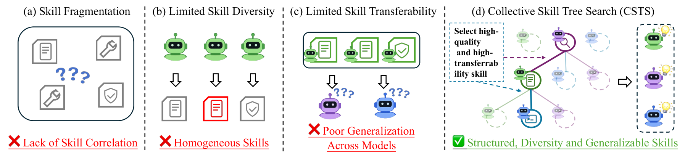
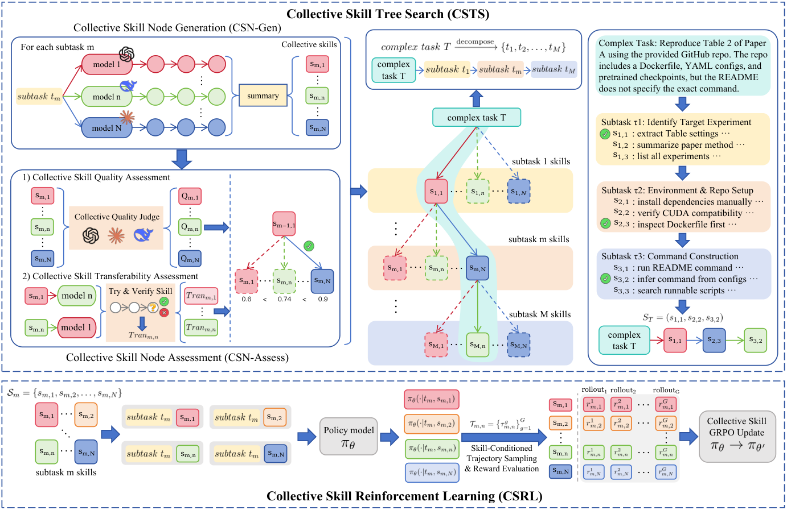

---
cover:
  alt: 'Figure 1: Motivation. Current skill construction paradigms generally face
    several limitations: (a) Skill Fragmentation , capturing merely local procedures
    for isolated subtasks; (b) Limited Diversity , suffering from the inherent biases
    of a single model; and (c) Poor Transferability , exhibiting clear performance
    drops across different LLM backbones. To tackle these challenges, we propose CSTS,
    a novel tree-search-based skill construction framework that constructs structured,
    diverse, and gener'
  caption: 'Figure 1: Motivation. Current skill construction paradigms generally face
    several limitations: (a) Skill Fragmentation , capturing merely local procedures
    for isolated subtasks; (b) Limited Diversity , suffering from the inherent biases
    of a single model; and (c) Poor Transferability , exhibiting clear performance
    drops across different LLM backbones. To tackle these challenges, we propose CSTS,
    a novel tree-search-based skill construction framework that constructs structured,
    diverse, and gener'
  image: /posts/2026-06-15-openclaw-skill-turns-agent-tips-into-tested-reusable-playboo/figures/fig01.png
  relative: false
date: '2026-06-15'
description: OpenClaw-Skill xây cho AI agent một thư viện quy trình có cấu trúc bằng
  cách lấy ý tưởng từ nhiều model rồi giữ lại những cách làm dùng tốt trên model khác.
  Trên hai benchmark cho agent, các model sau training đều tốt hơn bản Qwen ban đầu.
draft_id: 20260803-491a9752
item_kind: paper
item_source: linkedin
kol: omarsar
paper:
  abs_url: https://arxiv.org/abs/2606.16774
  abstract: 'Equipping Large Language Model (LLM) agents with effective skills is
    crucial for solving complex tasks in real-world systems like OpenClaw. In this
    work, we aim to develop a framework that automatically constructs such reusable
    skills to enhance LLMs in tool use, multi-step reasoning, and dynamic environment
    interaction. To this end, we propose Collective Skill Tree Search (CSTS), a novel
    tree-search-based skill construction framework that constructs structured, diverse
    and generalizable tree of skills. The core idea of CSTS is to leverage collective
    intelligence to jointly search, identify and compose effective skills via two
    iterative phases: Collective Skill Node Generation (CSN-Gen) and Collective Skill
    Node Assessment (CSN-Assess). CSN-Gen exploits collective knowledge from multiple
    models to explore diverse candidate skills for each subtask, enabling comprehensive
    skill exploration. CSN-Assess employs multiple models as judges to evaluate and
    select skill nodes with two scoring mechanisms: (1) collective quality scoring
    that aggregates independent evaluations to produce a robust estimate of skill
    effectiveness, and (2) collective transferability scoring that explicitly verifies
    whether a skill generalizes well across different models. With CSTS, we construct
    a set of comprehensive tree of skills along with skill-augmented training data,
    enabling models to effectively learn and utilize skills. Besides, we introduce
    Collective Skill Reinforcement Learning, which actively selects multiple relevant
    skills from the tree to broaden solution-space exploration, avoid being trapped
    by a single skill and its resulting homogeneous or suboptimal solutions. As a
    result, our trained model, OpenClaw-Skill, exhibits outstanding agentic capabilities
    in long-horizon planning, tool use and generalization over challenging benchmarks.'
  arxiv_id: '2606.16774'
  authors:
  - Tianyi Lin
  - Chuanyu Sun
  - Jingyi Zhang
  - Changxu Wei
  - Huanjin Yao
  - Shunyu Liu
  - Xikun Zhang
  - Liu Liu
  - Jiaxing Huang
  pdf_url: https://arxiv.org/pdf/2606.16774
  published: '2026-06-15'
  title: 'OpenClaw-Skill: Collective Skill Tree Search for Agentic Large Language
    Models'
reliability:
  authors_orgs: Tianyi Lin, Chuanyu Sun, Jingyi Zhang, Changxu Wei, Huanjin Yao, Shunyu
    Liu, Xikun Zhang, Liu Liu, and Jiaxing Huang; affiliations listed are The Hong
    Kong Polytechnic University, Nanyang Technological University, Tsinghua University,
    Royal Melbourne Institute of Technology, and Beijing University of Aeronautics
    and Astronautics.
  code_available: false
  evidence: Four Qwen backbones evaluated on QwenClawBench and PinchBench; 2,000 SFT
    examples and a component ablation are reported.
  venue: arXiv preprint 2606.16774, published June 15, 2026.
source_url: ''
summary: OpenClaw-Skill xây cho AI agent một thư viện quy trình có cấu trúc bằng cách
  lấy ý tưởng từ nhiều model rồi giữ lại những cách làm dùng tốt trên model khác.
  Trên hai benchmark cho agent, các model sau training đều tốt hơn bản Qwen ban đầu.
tags:
- agent-skills
- skill-tree
- tool-use
- reinforcement-learning
- qwen
- openclaw
title: 'OpenClaw-Skill: ghép các skill rời rạc thành playbook cho AI agent'
topics:
- ai
- ai/llm
- ai/llm/agents
---

## Ý tưởng chính

Hãy hình dung bạn giao một việc dài cho trợ lý mới, nhưng tài liệu bàn giao chỉ là một xấp giấy nhớ: “kiểm tra file”, “chạy lại lệnh”, “nhớ đối chiếu output”. Từng mẩu có vẻ hữu ích. Đến lúc làm thật, người trợ lý vẫn không biết nên bắt đầu ở đâu, bước nào phụ thuộc bước nào, hay gặp lỗi thì quay lại đoạn nào.

AI agent cũng vướng đúng chuyện đó. Một nhiệm vụ có thể kéo dài qua nhiều file, trang web, tool và lần chạy code. Cách học skill hiện nay thường chắt ra vài mẹo cục bộ từ kinh nghiệm của một model. OpenClaw-Skill đổi cách tổ chức: tạo một **skill tree**, trong đó các quy trình nhỏ được xếp theo thứ tự, lấy từ nhiều model và chỉ giữ lại sau khi đã thử xem chúng có dùng tốt trên model khác hay không.

Nói đơn giản là, một agent đáng tin không chỉ cần “thông minh”. Nó cần playbook giống như một đội vận hành tốt: biết làm gì trước, kiểm tra gì sau và xử lý ra sao nếu lệnh hỏng giữa chừng.

## Cách hoạt động

Có thể ví hệ thống này với việc viết sổ tay vận hành nhà hàng từ kinh nghiệm của nhiều đầu bếp. Chia ca làm thành từng công đoạn. Mỗi người đề xuất một cách xử lý. Một hội đồng đọc và chấm. Sau đó đưa công thức cho người khác nấu thử. Cách nào rõ ràng mà vẫn chạy tốt khi đổi người thì mới được giữ lại.

```mermaid
flowchart LR
    A[Nhiệm vụ agent phức tạp] --> B[Tách thành các bước có thứ tự]
    B --> C[Nhiều model thử từng bước]
    C --> D[Biến mỗi lần thử thành một skill]
    D --> E[Chấm độ rõ ràng và hiệu quả]
    E --> F[Đưa skill cho model khác dùng thử]
    F --> G[Chọn node và ghép thành skill path]
    G --> H[Fine-tuning với 2.000 ví dụ có hướng dẫn]
    H --> I[Cho nhiều skill cạnh tranh khi reinforcement learning]
    I --> J[OpenClaw-Skill]
```

Ví dụ, để chạy lại một thí nghiệm từ repo, agent có thể phải đọc cấu hình, xác định command, thực thi rồi kiểm tra kết quả. Ở mỗi bước, nhiều model cùng làm và để lại toàn bộ quá trình. Một bộ tổng hợp sẽ rút mỗi quá trình thành candidate skill: dùng khi nào, cần input gì, nên làm những action nào, output mong đợi ra sao, cách kiểm tra và cách cứu lỗi.

Tiếp theo là hai vòng lọc. Nhiều model đóng vai giám khảo, xem skill có rõ, đủ, thực thi được và đúng việc hay không. Chưa hết. Skill do một model tạo ra còn được đưa cho các model khác dùng thử. Kết quả đã qua kiểm chứng trở thành điểm transfer. Ở mỗi tầng, candidate có tổng điểm tốt nhất được chọn. Các node thắng cuộc nối lại thành một lộ trình hoàn chỉnh.

Từ các lộ trình đó, nhóm tác giả tạo 2.000 ví dụ để fine-tuning, chạy hai epoch cho mỗi model. Sau đó đến reinforcement learning: nhiều skill khác nhau cùng được dùng cho một subtask, rồi các kết quả cạnh tranh trực tiếp. Cách làm tốt được tăng trọng số; cách yếu bị giảm. Thật ra thì agent không bị ép thuộc một “công thức gia truyền”. Nó tập nhiều cách và học xem cách nào bền nhất.

## Kết quả

Nhóm nghiên cứu thử trên bốn Qwen backbone với QwenClawBench. Benchmark này gồm các nhiệm vụ dài, có dùng tool, thao tác file, chạy code, tương tác web và đọc feedback. Cả bốn backbone đều tăng điểm.

| Backbone trên QwenClawBench | Model ban đầu | OpenClaw-Skill | Mức tăng |
|---|---:|---:|---:|
| Qwen3-4B | Không có trong phần text trích xuất | Không có trong phần text trích xuất | +5,8 |
| Qwen3-8B | Không có trong phần text trích xuất | Không có trong phần text trích xuất | +4,3 |
| Qwen3.5-4B | 31,5 | 41,2 | +9,7 |
| Qwen3.5-9B | 34,5 | 44,9 | +10,4 |

Con số nổi bật nhất là bản 9B tăng 10,4 điểm, tương đương khoảng 30% so với mốc 34,5 ban đầu. Một vài nhóm task còn nhảy mạnh hơn: với bản 9B, SVM tăng từ 33,2 lên 70,9 và CS từ 30,2 lên 78,4. Bản text được cung cấp không giải thích hai chữ viết tắt này.

Với PinchBench, paper báo cả lần chạy tốt nhất lẫn mức trung bình qua nhiều lần chạy. Bản mở rộng 123 task cho thấy rõ hơn khả năng chịu tải của cách làm.

| Thiết lập PinchBench | Chỉ số | Qwen3.5-9B | OpenClaw-Skill 9B | Mức tăng |
|---|---|---:|---:|---:|
| 23 task | Tỷ lệ thành công tốt nhất | 67,5 | 72,8 | +5,3 |
| 23 task | Tỷ lệ thành công trung bình | 53,8 | 58,9 | +5,1 |
| 123 task | Tỷ lệ thành công tốt nhất | 61,1 | 68,2 | +7,1 |
| 123 task | Tỷ lệ thành công trung bình | 47,1 | 53,6 | +6,5 |

Ở bản 123 task, tỷ lệ thành công trung bình tăng 6,5 điểm. Hiểu nôm na, nếu đọc tỷ lệ của benchmark theo phần trăm, cứ 100 task thì model sau training hoàn thành thêm khoảng sáu đến bảy task so với model gốc.

Ablation cho thấy từng mảnh trong hệ thống đóng góp nối tiếp nhau.

| Ablation trên Qwen3.5-9B với QwenClawBench | Điểm tổng |
|---|---:|
| Model gốc | 34,5 |
| Thêm bước tạo skill tập thể | 39,8 |
| Thêm chấm chất lượng và khả năng transfer | 42,8 |
| Thêm collective skill reinforcement learning | 44,9 |

Đây là kết quả benchmark có kiểm soát, chưa phải nghiên cứu triển khai ngoài đời. Thí nghiệm chỉ dùng bốn backbone cùng họ Qwen, hai benchmark cho agent, 2.000 ví dụ fine-tuning và tám GPU H100. Paper không báo cáo thử nghiệm với người dùng. Metadata được cung cấp cũng không có repo code public. Vì vậy, kết quả xác nhận mức tăng trong setup đã thử; còn chi phí, khả năng áp dụng sang họ model khác và độ tin cậy trong công việc thật vẫn chưa được đo.

## Thuật ngữ

- **skill-conditioned rollout** — một lần agent làm trọn vẹn nhiệm vụ trong khi được cấp đúng một quy trình cụ thể để đi theo.
- **transferability score** — phép đo xem quy trình rút ra từ kinh nghiệm của một model có giúp được các model khác hay không.

## Liên kết

- [Trang arXiv](https://arxiv.org/abs/2606.16774)
- [PDF](https://arxiv.org/pdf/2606.16774)