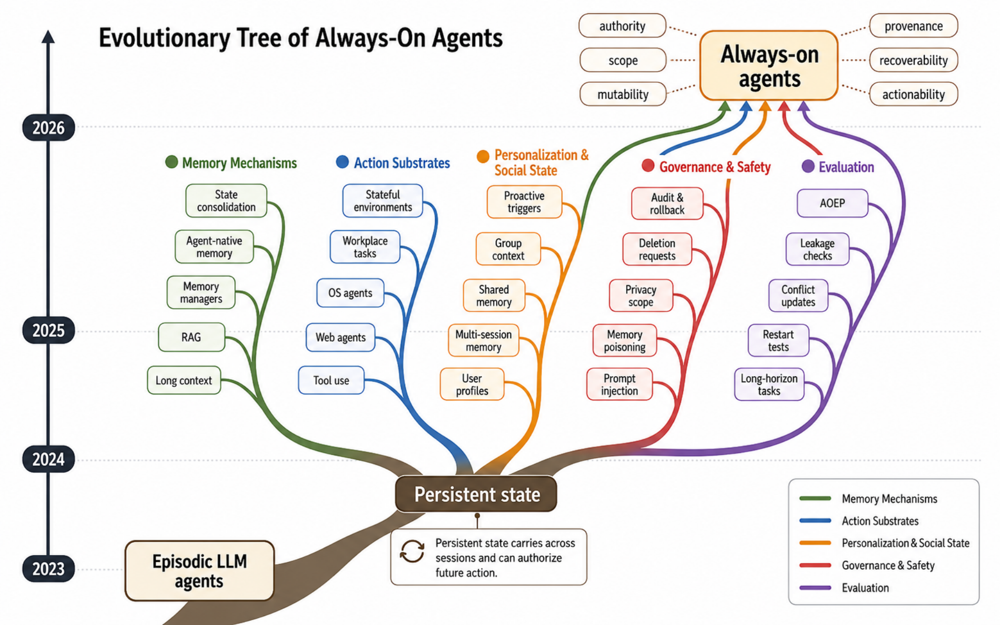

---
cover:
  alt: 'Figure 1: Evolutionary tree of always-on agents. The figure sketches the survey’s
    organizing claim: episodic LLM agents become always-on not by running continuously,
    but when durable state persists across sessions and can authorize future action.
    Five strands map the field’s current build-out: memory mechanisms, action substrates,
    personalization and social state, governance and safety, and evaluation. The target
    state is qualified by six diagnostic axes: authority, scope, mutability, provenance'
  caption: 'Figure 1: Evolutionary tree of always-on agents. The figure sketches the
    survey’s organizing claim: episodic LLM agents become always-on not by running
    continuously, but when durable state persists across sessions and can authorize
    future action. Five strands map the field’s current build-out: memory mechanisms,
    action substrates, personalization and social state, governance and safety, and
    evaluation. The target state is qualified by six diagnostic axes: authority, scope,
    mutability, provenance'
  image: figures/fig01.png
  relative: true
date: '2026-06-29'
description: An assistant that remembers across months can save work—but old permissions
  and bad records can keep acting too. This survey maps the missing controls for persistent
  AI agents.
draft_id: 20260803-c1f46e85
item_kind: paper
item_source: linkedin
kol: omarsar
paper:
  abs_url: https://arxiv.org/abs/2606.30306
  abstract: 'Always-on agents are systems whose future behavior depends on durable
    state accumulated across earlier interactions. We treat them as persistent-state
    systems: the operative system includes retrievable memories, but also task ledgers,
    permissions, credentials, commitments, provenance and audit records, shared state,
    trigger conditions, and externally committed effects linked to those records.
    The survey reads the literature through six diagnostic axes for each state item,
    authority, scope, mutability, provenance, recoverability, and actionability, and
    through a lifecycle in which state is written, validated, organized, retrieved,
    acted upon, updated, forgotten, audited, and sometimes rolled back. Across a 435-work
    coded corpus, treated as a scoped map rather than an exhaustive census, the literature
    concentrates more heavily on accumulating and retrieving state than on governing,
    recovering, or relinquishing it. We therefore introduce the Always-On Evaluation
    Protocol (AOEP-v0), a pilot evaluation contract that makes these governance requirements
    concrete by scoring state mutation and recovery obligations rather than answer
    quality alone. The resulting agenda connects always-on agents to databases, distributed
    systems, formal methods, capability security, and machine unlearning.'
  arxiv_id: '2606.30306'
  authors:
  - Tianyu Ding
  - Aditya Nannapaneni
  - Bingfan Liu
  - Ling Zhang
  pdf_url: https://arxiv.org/pdf/2606.30306
  published: '2026-06-29'
  title: Always-OnAgents:A Survey of Persistent Memory, State, and Governance in LLMAgents
reliability:
  authors_orgs: Tianyu Ding, Aditya Nannapaneni, Bingfan Liu, and Ling Zhang; affiliations
    are not stated in the provided text.
  code_available: false
  evidence: 435-work coded corpus; blind second-coder check on 236 works; AOEP-v0
    pilot protocol.
  venue: arXiv preprint 2606.30306, published June 29, 2026.
source_url: ''
summary: An assistant that remembers across months can save work—but old permissions
  and bad records can keep acting too. This survey maps the missing controls for persistent
  AI agents.
tags:
- always-on agents
- persistent state
- agent memory
- state governance
- rollback
- aoep
title: When an AI Agent Remembers Too Much, Who Gets to Undo It?
topics:
- ai
- ai/llm
- ai/llm/agents
---

## The Big Idea

Imagine hiring an assistant who never forgets. On Monday, you mention that you prefer morning flights. Months later, the assistant books one automatically. Helpful. But what if you changed your mind, the preference belonged to a different trip, or the assistant used an old company card whose permission had expired?

That is the problem behind “always-on” agents. The phrase does not mean an agent runs every second. It means yesterday’s records can shape—or authorize—tomorrow’s actions. Those records include more than chat memories: open tasks, permissions, credentials, shared notes, triggers, audit trails, and commitments already made in the outside world.

This survey’s answer is to treat the agent less like a chatbot with a good memory and more like a bank with a ledger. Every durable record needs rules: who authorized it, where it applies, whether it can change, where it came from, whether its effects can be undone, and how directly it can cause an action.

> State becomes authoritative.

## How It Works

The authors built a scoped map of 435 works, mainly from 2023–2026, with older research included when it supplied useful foundations. They searched arXiv, Semantic Scholar, OpenReview, and the ACL Anthology, followed citations in both directions, and deliberately searched under-covered areas such as rollback, deletion, verification, and durable execution. Each work was tagged by category, lifecycle stage, state property, and application area.

Their everyday test is simple. Take any stored item—say, “use the corporate card for travel”—and ask six questions:

- Who gave this record permission to influence an action?
- Does it apply to this user, task, tool, and time?
- Can it be corrected, replaced, expired, or locked?
- Can we trace its source and later transformations?
- Can we repair the records and actions that depended on it?
- Is it merely evidence, or can it directly trigger a consequential action?

The paper then follows state through a full lifecycle. This is closer to managing a case file than searching a notebook: new information must be checked before it enters the file, and removing a bad page is not enough if copies or decisions derived from it remain elsewhere.

This framing separates always-on agents from nearby technologies. A long-context model uses information placed in its current window. A typical RAG system reads from a curated collection. An episodic agent resets after the task. An always-on agent writes its own history, carries it across sessions, and may act on it later. That write-and-reuse loop creates the new obligation.

The survey also proposes AOEP-v0, a pilot evaluation contract. Instead of judging only whether the final answer looks right, it records events and snapshots so a validator can check whether state changes, deletion, revocation, and recovery followed the rules. In other words, it grades the bookkeeping behind the answer.

## What They Found

The literature is much better at helping agents accumulate and retrieve state than at helping them relinquish or repair it.

| Coded signal | Better-covered item | Works | Thinner-covered item | Works |
|---|---|---:|---|---:|
| Lifecycle stage | Retrieve | 269/435 (61.8%) | Rollback | 27/435 (6.2%) |
| Lifecycle stage | Write | 200/435 (46.0%) | Forget | 66/435 (15.2%) |
| Lifecycle stage | — | — | Audit | 88/435 (20.2%) |
| State property | Mutability | 160/435 (36.8%) | Authority | 72/435 (16.6%) |
| State property | Provenance | 153/435 (35.2%) | — | — |

Put plainly, retrieval appeared in nearly two out of three papers, while rollback appeared in about one out of sixteen. More starkly, none of the 435 coded works reported how successfully—or at what cost—a system recovered after its state was corrupted.

The authors tried to stress-test that conclusion. Their later searches specifically targeted governance and grew the corpus by more than four times. The governance share rose from roughly one-sixth to about one-third, but rollback remained rare and later rounds showed diminishing returns. The skew was also stronger, not weaker, when the authors restricted the data to work submitted through 2024.

These are mapping results, not a definitive census of every relevant paper. The earliest rejected candidates were not preserved in a uniform screening table, and the corpus used one main coding pass. A blind second coder checked 236 works, reaching 0.82 pooled agreement for lifecycle stages and 0.74 for state properties. The paper therefore presents the counts as directional evidence. AOEP-v0 is also a pilot protocol, not proof that today’s agents can meet all of its requirements.

## Glossary

- **AOEP-v0** — The paper’s pilot checklist and data format for testing whether an agent changes and repairs persistent state correctly.
- **Authority monotonicity** — The rule that stored information may influence an action only while its original permission remains valid.

## Links

- [arXiv page](https://arxiv.org/abs/2606.30306)
- [PDF](https://arxiv.org/pdf/2606.30306)