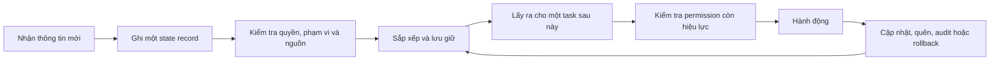

---
cover:
  alt: 'Figure 1: Evolutionary tree of always-on agents. The figure sketches the survey’s
    organizing claim: episodic LLM agents become always-on not by running continuously,
    but when durable state persists across sessions and can authorize future action.
    Five strands map the field’s current build-out: memory mechanisms, action substrates,
    personalization and social state, governance and safety, and evaluation. The target
    state is qualified by six diagnostic axes: authority, scope, mutability, provenance'
  caption: 'Figure 1: Evolutionary tree of always-on agents. The figure sketches the
    survey’s organizing claim: episodic LLM agents become always-on not by running
    continuously, but when durable state persists across sessions and can authorize
    future action. Five strands map the field’s current build-out: memory mechanisms,
    action substrates, personalization and social state, governance and safety, and
    evaluation. The target state is qualified by six diagnostic axes: authority, scope,
    mutability, provenance'
  image: /posts/2026-06-29-when-an-ai-agent-remembers-too-much-who-gets-to-undo-it/figures/fig01.png
  relative: false
date: '2026-06-29'
description: Một trợ lý nhớ được nhiều tháng có thể đỡ rất nhiều việc, nhưng permission
  cũ và record sai cũng có thể tiếp tục gây tác động. Survey này chỉ ra những cơ chế
  kiểm soát còn thiếu cho persistent AI agent.
draft_id: 20260803-c1f46e85
item_kind: paper
item_source: linkedin
kol: omarsar
paper:
  abs_url: https://arxiv.org/abs/2606.30306
  abstract: 'Always-on agents are systems whose future behavior depends on durable
    state accumulated across earlier interactions. We treat them as persistent-state
    systems: the operative system includes retrievable memories, but also task ledgers,
    permissions, credentials, commitments, provenance and audit records, shared state,
    trigger conditions, and externally committed effects linked to those records.
    The survey reads the literature through six diagnostic axes for each state item,
    authority, scope, mutability, provenance, recoverability, and actionability, and
    through a lifecycle in which state is written, validated, organized, retrieved,
    acted upon, updated, forgotten, audited, and sometimes rolled back. Across a 435-work
    coded corpus, treated as a scoped map rather than an exhaustive census, the literature
    concentrates more heavily on accumulating and retrieving state than on governing,
    recovering, or relinquishing it. We therefore introduce the Always-On Evaluation
    Protocol (AOEP-v0), a pilot evaluation contract that makes these governance requirements
    concrete by scoring state mutation and recovery obligations rather than answer
    quality alone. The resulting agenda connects always-on agents to databases, distributed
    systems, formal methods, capability security, and machine unlearning.'
  arxiv_id: '2606.30306'
  authors:
  - Tianyu Ding
  - Aditya Nannapaneni
  - Bingfan Liu
  - Ling Zhang
  pdf_url: https://arxiv.org/pdf/2606.30306
  published: '2026-06-29'
  title: Always-OnAgents:A Survey of Persistent Memory, State, and Governance in LLMAgents
reliability:
  authors_orgs: Tianyu Ding, Aditya Nannapaneni, Bingfan Liu, and Ling Zhang; affiliations
    are not stated in the provided text.
  code_available: false
  evidence: 435-work coded corpus; blind second-coder check on 236 works; AOEP-v0
    pilot protocol.
  venue: arXiv preprint 2606.30306, published June 29, 2026.
source_url: ''
summary: Một trợ lý nhớ được nhiều tháng có thể đỡ rất nhiều việc, nhưng permission
  cũ và record sai cũng có thể tiếp tục gây tác động. Survey này chỉ ra những cơ chế
  kiểm soát còn thiếu cho persistent AI agent.
tags:
- always-on agents
- persistent state
- agent memory
- state governance
- rollback
- aoep
title: Khi AI agent nhớ quá lâu, ai có quyền hoàn tác?
topics:
- ai
- ai/llm
- ai/llm/agents
---

## Ý tưởng chính

Bạn nói với trợ lý rằng các chuyến công tác nên bay buổi sáng. Vài tháng sau, nó tự đặt vé đúng như vậy. Nghe rất tiện. Nhưng nếu sở thích đó chỉ dành cho một chuyến cụ thể thì sao? Hoặc thẻ công ty lưu từ lần trước đã hết quyền sử dụng?

Đó mới là điểm khó của “always-on” agent. Không cần chạy 24/7. Chỉ cần chuyện xảy ra hôm qua vẫn có thể chi phối hành động ngày mai là đã đủ. Và thứ được giữ lại không chỉ là nội dung chat. Nó còn có task đang dở, permission, credential, trigger, log kiểm tra và cả những cam kết đã tạo ra bên ngoài hệ thống.

Nhóm tác giả đề nghị nhìn agent như một nơi quản lý hồ sơ có quyền tạo hành động, chứ không phải chatbot nhớ dai. Mỗi record phải trả lời được sáu chuyện: ai cho phép dùng, dùng ở đâu, sửa được không, nguồn từ đâu, hậu quả có thể hoàn tác không, và bản thân nó chỉ là thông tin hay có thể trực tiếp “bấm nút”.

> State giờ có quyền chi phối hành động.

## Cách hoạt động

Nhóm nghiên cứu lập một bản đồ gồm 435 công trình, chủ yếu trong giai đoạn 2023–2026. Các nền tảng cũ hơn vẫn được giữ lại nếu giúp xây khung khái niệm. Nguồn tìm kiếm gồm arXiv, Semantic Scholar, OpenReview và ACL Anthology. Họ còn lần theo trích dẫn hai chiều, rồi chủ động săn các mảng vốn ít xuất hiện như rollback, xóa dữ liệu, kiểm chứng và durable execution.

Mỗi công trình được gắn nhiều nhãn: thuộc loại nghiên cứu nào, chạm vào bước nào trong vòng đời state, quan tâm thuộc tính gì và dùng trong lĩnh vực nào. Sau đó, với từng record—ví dụ “hãy dùng thẻ công ty khi đi công tác”—họ đặt sáu câu hỏi:

- Ai đã cấp quyền để record này ảnh hưởng đến hành động?
- Nó dành cho đúng người, đúng việc, đúng tool và đúng thời điểm chưa?
- Có thể sửa, thay thế, cho hết hạn hoặc khóa lại không?
- Có lần ngược được nguồn và các lần biến đổi về sau không?
- Nếu record sai, có sửa được cả dữ liệu lẫn những hành động phụ thuộc vào nó không?
- Đây chỉ là bằng chứng, hay là một chỉ dẫn có thể gây hậu quả thật?

Nói đơn giản là, đây giống quản lý hồ sơ vụ việc hơn là tìm một dòng trong sổ tay. Thông tin mới phải được kiểm tra trước khi nhập. Khi phát hiện sai, xóa bản gốc vẫn chưa đủ nếu bản tóm tắt, bản sao hoặc quyết định dựa trên nó còn tồn tại.

Khung này cũng vạch ranh giới khá rõ. Long-context model xử lý thứ đang nằm trong cửa sổ hiện tại. RAG thường đọc từ kho dữ liệu đã được chuẩn bị sẵn. Agent theo từng phiên sẽ reset khi xong việc. Còn always-on agent tự ghi lịch sử, mang nó qua nhiều phiên rồi có thể hành động dựa trên lịch sử ấy. Chính vòng lặp “tự ghi rồi tự dùng” làm phát sinh bài toán quản trị.

Paper còn đưa ra AOEP-v0, một evaluation contract thử nghiệm. Thay vì chỉ chấm câu trả lời cuối có đúng hay không, giao thức ghi lại event và snapshot. Validator nhờ đó kiểm tra được việc sửa state, thu hồi permission, xóa dữ liệu và phục hồi có đúng quy tắc không. Tức là không chỉ chấm sản phẩm cuối, mà còn chấm cả sổ sách phía sau.

## Kết quả

Bức tranh hiện ra khá lệch: cộng đồng đã làm nhiều cách để agent ghi và tìm lại state, nhưng làm ít hơn hẳn cho chuyện từ bỏ hoặc sửa hậu quả của state đó.

| Tín hiệu được mã hóa | Hạng mục được phủ nhiều hơn | Số công trình | Hạng mục còn mỏng | Số công trình |
|---|---|---:|---|---:|
| Bước trong vòng đời | Retrieve | 269/435 (61,8%) | Rollback | 27/435 (6,2%) |
| Bước trong vòng đời | Write | 200/435 (46,0%) | Forget | 66/435 (15,2%) |
| Bước trong vòng đời | — | — | Audit | 88/435 (20,2%) |
| Thuộc tính state | Mutability | 160/435 (36,8%) | Authority | 72/435 (16,6%) |
| Thuộc tính state | Provenance | 153/435 (35,2%) | — | — |

Hiểu theo cách đời thường: gần hai trong ba paper có đụng tới retrieval, nhưng chỉ khoảng một trong mười sáu nói tới rollback. Đáng chú ý hơn, trong toàn bộ 435 công trình được mã hóa, không công trình nào báo cáo phục hồi sau khi state bị làm hỏng thành công đến mức nào hoặc tốn bao nhiêu chi phí.

Nhóm tác giả cũng cố kiểm tra xem có phải họ tìm sai chỗ hay không. Các vòng tìm kiếm về sau nhắm thẳng vào governance và làm corpus tăng hơn bốn lần. Tỷ lệ công trình về governance đi từ khoảng một phần sáu lên khoảng một phần ba, nhưng rollback vẫn hiếm và những vòng cuối bắt đầu cho ít kết quả mới. Nếu chỉ xét các công trình nộp đến hết 2024, độ lệch còn rõ hơn.

Dù vậy, đây là bản đồ có phạm vi, không phải thống kê toàn bộ lĩnh vực. Danh sách ứng viên bị loại ở các vòng đầu không được lưu thành một bảng screening đồng nhất. Việc gắn nhãn có một lượt chính; coder thứ hai kiểm tra mù 236 công trình và đạt mức đồng thuận gộp 0,82 cho các bước vòng đời, 0,74 cho thuộc tính state. Vì thế, các con số nên được đọc như bằng chứng về xu hướng. AOEP-v0 cũng mới là protocol thử nghiệm, chưa chứng minh rằng agent hiện tại đáp ứng được toàn bộ yêu cầu.

## Thuật ngữ

- **AOEP-v0** — Checklist và định dạng dữ liệu thử nghiệm của paper để kiểm tra agent có thay đổi và sửa persistent state đúng cách hay không.
- **Authority monotonicity** — Quy tắc nói rằng thông tin đã lưu chỉ được phép ảnh hưởng đến hành động khi permission ban đầu vẫn còn hiệu lực.

## Liên kết

- [Trang arXiv](https://arxiv.org/abs/2606.30306)
- [PDF](https://arxiv.org/pdf/2606.30306)