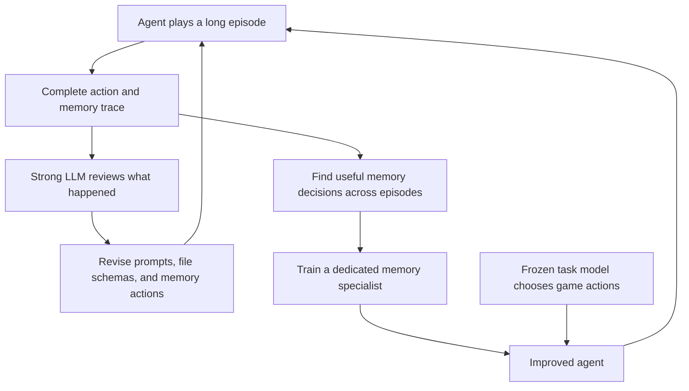

---
cover:
  alt: 'Figure 1: Memory skill optimization with Qwen2.5-32B-Instruct. Starting from
    a base agent equipped with file-system memory (v0), AUTOMEM progressively improves
    performance through memory scaffold optimization (v0–v5/v4/v2), followed by memory
    proficiency training (+train) that yields further gains on top of the optimized
    scaffold.'
  caption: 'Figure 1: Memory skill optimization with Qwen2.5-32B-Instruct. Starting
    from a base agent equipped with file-system memory (v0), AUTOMEM progressively
    improves performance through memory scaffold optimization (v0–v5/v4/v2), followed
    by memory proficiency training (+train) that yields further gains on top of the
    optimized scaffold.'
  image: figures/fig01.png
  relative: true
date: '2026-07-01'
description: AutoMem improves long-running AI agents by teaching them what to save,
  how to organize it, and when to look it up. Across three games, better memory alone
  roughly doubled to quadrupled performance.
draft_id: 20260803-78ef6085
item_kind: paper
item_source: linkedin
kol: omarsar
paper:
  abs_url: https://arxiv.org/abs/2607.01224
  abstract: 'Memory expertise is a learned skill: knowing what to encode, when to
    retrieve, and how to organize knowledge--a capacity known in cognitive science
    as metamemory. We bring this perspective to LLMs by treating memory management
    as a trainable skill. We promote file-system operations to first-class memory
    actions alongside task actions, letting the model itself decide how to manage
    its memory. This memory skill improves along two axes: the structure that supports
    it (prompts, file schemas, action vocabulary), and the proficiency of the model
    exercising it. Both axes resist manual optimization: episodes in long-horizon
    tasks run for thousands of steps, and a single memory mistake can hide long before
    it surfaces, making human review of full trajectories impractical. We introduce
    AutoMem, a framework that automates both axes. In the first loop, a strong LLM
    reviews complete agent trajectories and iteratively revises the memory structure
    that shapes how the agent interacts with its memory files. In the second loop,
    the agent''s own good memory decisions are identified from many episodes and used
    as training signal to sharpen the model''s memory proficiency directly. Across
    three procedurally generated long-horizon games (Crafter, MiniHack, and NetHack),
    optimizing memory alone--without modifying the model''s task-action behavior--improved
    the base agent''s performance ~2x-4x, bringing a 32B open-weight model competitive
    with frontier systems such as Claude Opus 4.5 and Gemini 3.1 Pro Thinking. Our
    results show that memory management is an independently learnable skill, and a
    high-leverage objective yielding large gains on long-horizon tasks.'
  arxiv_id: '2607.01224'
  authors:
  - Shengguang Wu
  - Hao Zhu
  - Yuhui Zhang
  - Xiaohan Wang
  - Serena Yeung-Levy
  pdf_url: https://arxiv.org/pdf/2607.01224
  published: '2026-07-01'
  title: 'AutoMem: Automated Learning of Memory as a Cognitive Skill'
reliability:
  authors_orgs: Shengguang Wu, Hao Zhu, Yuhui Zhang, Xiaohan Wang, and Serena Yeung-Levy;
    affiliations are not stated in the supplied files.
  code_available: true
  code_url: https://autolearnmem.github.io/
  evidence: Three procedurally generated game benchmarks; staged scaffold and memory-proficiency
    results are reported.
  venue: arXiv:2607.01224 [cs.AI], submitted July 1, 2026.
summary: AutoMem improves long-running AI agents by teaching them what to save, how
  to organize it, and when to look it up. Across three games, better memory alone
  roughly doubled to quadrupled performance.
tags:
- automem
- agent-memory
- metamemory
- memory-management
- long-horizon-agents
- qwen2.5-32b
title: 'AutoMem: Teaching AI Agents to Manage Their Own Memory'
topics:
- ai
- ai/llm
- ai/llm/agents
---

## The Big Idea

Imagine hiring a brilliant assistant for a month-long case. Each morning, they wake up with a blank desk. They can keep notes, but no one has taught them what deserves writing down, how to file it, or when to look it up. Soon the useful clue from Monday is buried under trivia from Tuesday.

Long-running AI agents face the same problem. One poor memory decision may not hurt until thousands of steps later, which makes reviewing and fixing the behavior by hand painfully difficult. AutoMem treats memory management as a skill the agent can learn—not as a storage box bolted onto it.

The answer has two parts. First, another powerful LLM studies complete runs and redesigns the agent’s note-taking system. Then good memory choices from many runs become training examples for a dedicated memory specialist, while the model choosing game actions stays unchanged.

> “Memory management is an independently learnable skill, and a high-leverage objective yielding large gains on long-horizon tasks.”

## How It Works

The agent’s memory is a set of files. Reading, writing, and organizing those files are available as ordinary actions beside moves in the game. That matters because the agent—not a fixed retrieval rule—decides what to record and when to fetch it. Think of it as giving the assistant a filing cabinet and making filing part of the job.

AutoMem then improves this behavior through two outer loops:

The first loop improves the workplace. A strong reviewer examines a whole episode, then rewrites the instructions, file layout, or available memory commands. The new design is tested in another round and revised again.

The second loop improves the worker. AutoMem collects successful memory decisions and uses them to train the component that handles memory operations. Crucially, the task-action model is frozen. If the score rises, the reported intervention is better memory use rather than a newly trained game-playing policy.

The tests use Crafter, MiniHack, and NetHack. Their worlds vary from episode to episode, reducing the chance that an agent can simply replay a memorized solution. They also stretch decisions over long sequences, so an old observation can become useful much later.

## What They Found

The base Qwen2.5-32B-Instruct agent began with file-system memory, labeled v0. Repeated scaffold revisions produced the best intermediate version for each game. Training the memory specialist added another gain.

| Game | Base file memory (v0) | Best revised scaffold | Scaffold + memory training |
|---|---:|---:|---:|
| Crafter | 25.0% | 47.3% (v5) | 51.4% |
| MiniHack | 7.5% | 27.5% (v4) | 30.0% |
| NetHack | 0.42% | 1.57% (v2) | 1.85% |

In plain terms, Crafter performance roughly doubled. MiniHack rose from about 8 successful points in every 100 to 30, a fourfold result. NetHack moved from 0.42% to 1.85%—still low in absolute terms, but more than four times the starting score. The paper summarizes the overall improvement as roughly 2×–4× and reports that the 32B open-weight model became competitive with Claude Opus 4.5 and Gemini 3.1 Pro Thinking.

These are results from three procedurally generated games, not office work, medical workflows, or open-web research. The supplied material does not establish that the same gains transfer to those settings. It also provides no public code link. What the experiments do isolate is narrow and useful: changing memory structure and memory proficiency while leaving task-action behavior untouched.

## Glossary

- **Metamemory** — the ability to judge what should be remembered, how it should be organized, and when it should be recalled.
- **Memory scaffold** — the instructions, file layout, and available operations that shape how an agent uses its memory.

## Links

- [arXiv page](https://arxiv.org/abs/2607.01224)
- [PDF](https://arxiv.org/pdf/2607.01224)