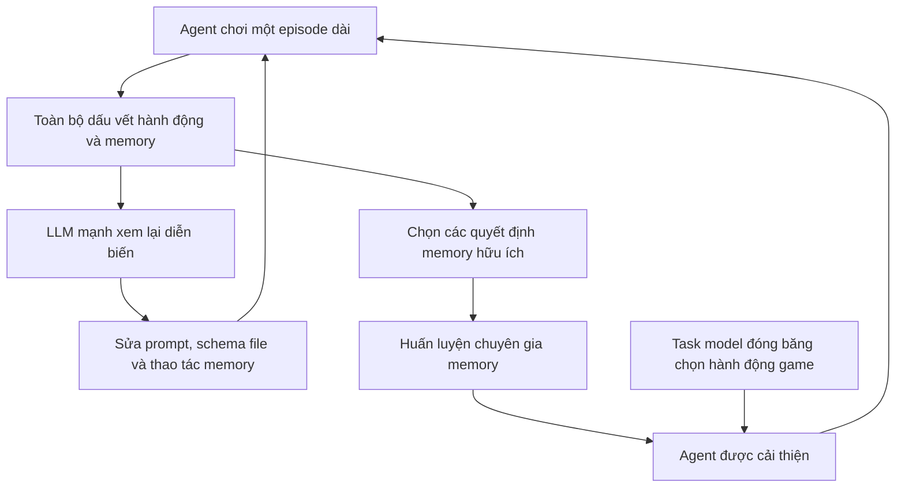
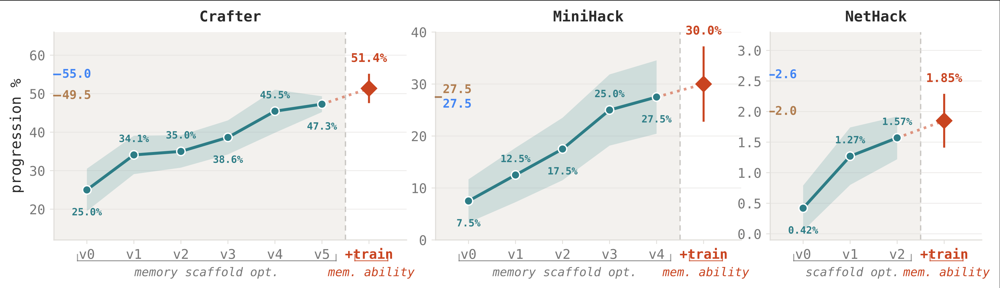

---
cover:
  alt: 'Figure 1: Memory skill optimization with Qwen2.5-32B-Instruct. Starting from
    a base agent equipped with file-system memory (v0), AUTOMEM progressively improves
    performance through memory scaffold optimization (v0–v5/v4/v2), followed by memory
    proficiency training (+train) that yields further gains on top of the optimized
    scaffold.'
  caption: 'Figure 1: Memory skill optimization with Qwen2.5-32B-Instruct. Starting
    from a base agent equipped with file-system memory (v0), AUTOMEM progressively
    improves performance through memory scaffold optimization (v0–v5/v4/v2), followed
    by memory proficiency training (+train) that yields further gains on top of the
    optimized scaffold.'
  image: /posts/2026-07-01-automem-teaching-ai-agents-to-manage-their-own-memory/figures/fig01.png
  relative: false
date: '2026-07-01'
description: AutoMem dạy AI agent biết nên lưu gì, sắp xếp ra sao và lúc nào cần tìm
  lại. Chỉ riêng việc cải thiện memory đã giúp kết quả trên ba game tăng khoảng hai
  đến bốn lần.
draft_id: 20260803-78ef6085
item_kind: paper
item_source: linkedin
kol: omarsar
paper:
  abs_url: https://arxiv.org/abs/2607.01224
  abstract: 'Memory expertise is a learned skill: knowing what to encode, when to
    retrieve, and how to organize knowledge--a capacity known in cognitive science
    as metamemory. We bring this perspective to LLMs by treating memory management
    as a trainable skill. We promote file-system operations to first-class memory
    actions alongside task actions, letting the model itself decide how to manage
    its memory. This memory skill improves along two axes: the structure that supports
    it (prompts, file schemas, action vocabulary), and the proficiency of the model
    exercising it. Both axes resist manual optimization: episodes in long-horizon
    tasks run for thousands of steps, and a single memory mistake can hide long before
    it surfaces, making human review of full trajectories impractical. We introduce
    AutoMem, a framework that automates both axes. In the first loop, a strong LLM
    reviews complete agent trajectories and iteratively revises the memory structure
    that shapes how the agent interacts with its memory files. In the second loop,
    the agent''s own good memory decisions are identified from many episodes and used
    as training signal to sharpen the model''s memory proficiency directly. Across
    three procedurally generated long-horizon games (Crafter, MiniHack, and NetHack),
    optimizing memory alone--without modifying the model''s task-action behavior--improved
    the base agent''s performance ~2x-4x, bringing a 32B open-weight model competitive
    with frontier systems such as Claude Opus 4.5 and Gemini 3.1 Pro Thinking. Our
    results show that memory management is an independently learnable skill, and a
    high-leverage objective yielding large gains on long-horizon tasks.'
  arxiv_id: '2607.01224'
  authors:
  - Shengguang Wu
  - Hao Zhu
  - Yuhui Zhang
  - Xiaohan Wang
  - Serena Yeung-Levy
  pdf_url: https://arxiv.org/pdf/2607.01224
  published: '2026-07-01'
  title: 'AutoMem: Automated Learning of Memory as a Cognitive Skill'
reliability:
  authors_orgs: Shengguang Wu, Hao Zhu, Yuhui Zhang, Xiaohan Wang, and Serena Yeung-Levy;
    affiliations are not stated in the supplied files.
  code_available: true
  code_url: https://autolearnmem.github.io/
  evidence: Three procedurally generated game benchmarks; staged scaffold and memory-proficiency
    results are reported.
  venue: arXiv:2607.01224 [cs.AI], submitted July 1, 2026.
summary: AutoMem dạy AI agent biết nên lưu gì, sắp xếp ra sao và lúc nào cần tìm lại.
  Chỉ riêng việc cải thiện memory đã giúp kết quả trên ba game tăng khoảng hai đến
  bốn lần.
tags:
- automem
- agent-memory
- metamemory
- memory-management
- long-horizon-agents
- qwen2.5-32b
title: 'AutoMem: giúp AI agent học cách tự quản lý memory'
topics:
- ai
- ai/llm
- ai/llm/agents
---

## Ý tưởng chính

Bạn giao cho một trợ lý rất giỏi theo dõi một vụ việc kéo dài cả tháng. Người đó có sổ, có tủ hồ sơ, nhưng chẳng biết chuyện nào đáng ghi, nên xếp giấy tờ ra sao, hay lúc nào cần mở lại. Đến khi một chi tiết từ tuần trước trở nên quan trọng, nó đã chìm trong một đống ghi chú vụn.

AI agent chạy hàng nghìn bước cũng vướng đúng nút thắt ấy. Một lần lưu nhầm hôm nay có thể rất lâu sau mới gây hậu quả. Lúc đó, lần ngược cả hành trình để tìm lỗi vừa tốn công vừa khó. AutoMem chọn cách khác: xem quản lý memory là một kỹ năng có thể học riêng.

Nói đơn giản là hệ thống vừa chỉnh lại “tủ hồ sơ”, vừa luyện cho “người thủ thư”. Một LLM mạnh đọc toàn bộ quá trình và sửa cấu trúc memory; sau đó, những quyết định memory tốt được gom lại để huấn luyện một chuyên gia memory riêng. Phần model quyết định hành động trong game vẫn được giữ nguyên.

> “Quản lý memory là một kỹ năng có thể học độc lập, đồng thời là mục tiêu có đòn bẩy lớn cho các nhiệm vụ dài.”

## Cách hoạt động

Ở đây, memory không phải một ô văn bản bí ẩn. Nó là các file. Agent có thể đọc, ghi và sắp xếp chúng, giống như thực hiện một hành động trong game. Vì vậy, chính agent chọn thứ cần lưu và thời điểm cần tìm lại, thay vì bị buộc theo một quy tắc truy xuất cố định.

AutoMem bao quanh agent bằng hai vòng cải thiện:

Vòng thứ nhất lo cách tổ chức. LLM đóng vai người rà soát, đọc trọn một episode rồi chỉnh hướng dẫn, cách chia file hoặc bộ thao tác memory. Thiết kế mới lại được đưa vào chạy thử và tiếp tục sửa.

Vòng thứ hai lo kỹ năng sử dụng. Hệ thống tìm những quyết định memory tốt qua nhiều episode rồi dùng chúng làm tín hiệu huấn luyện. Một thành phần chuyên trách memory học từ dữ liệu này. Đáng chú ý là task model—phần chọn hành động trong game—không đổi. Nhờ vậy, mức tăng được quy về cách dùng memory tốt hơn, chứ không phải agent vừa được dạy chơi game giỏi hơn.

Nhóm tác giả thử trên Crafter, MiniHack và NetHack. Mỗi lượt tạo ra một thế giới có yếu tố ngẫu nhiên, nên học thuộc sẵn một lời giải khó phát huy tác dụng. Đây cũng là các bài toán kéo dài: thông tin thấy từ rất sớm có thể mãi về sau mới cần đến.

## Kết quả

Mốc ban đầu là Qwen2.5-32B-Instruct đã có memory dạng file, gọi là v0. AutoMem lặp nhiều vòng để tìm scaffold tốt nhất cho từng game, rồi huấn luyện thêm chuyên gia memory.

| Game | Memory dạng file ban đầu (v0) | Scaffold tốt nhất sau khi sửa | Scaffold + huấn luyện memory |
|---|---:|---:|---:|
| Crafter | 25.0% | 47.3% (v5) | 51.4% |
| MiniHack | 7.5% | 27.5% (v4) | 30.0% |
| NetHack | 0.42% | 1.57% (v2) | 1.85% |

Nếu đổi các con số thành câu chuyện dễ hình dung: Crafter tăng xấp xỉ gấp đôi. MiniHack đi từ khoảng 8 điểm thành công trên 100 lên 30, tức gấp bốn lần. NetHack vẫn rất khó—kết quả cuối chỉ 1.85%—nhưng con số đó cao hơn hơn bốn lần mức 0.42% ban đầu. Paper tổng kết mức tăng chung khoảng 2×–4×, và cho biết model open-weight 32B đã cạnh tranh được với Claude Opus 4.5 cùng Gemini 3.1 Pro Thinking.

Phạm vi bằng chứng hiện nằm ở ba game được tạo theo thủ tục. Chưa có kết quả cho công việc văn phòng, quy trình y tế hay agent nghiên cứu web, nên không thể mặc nhiên coi mức tăng sẽ giữ nguyên ở đó. Tài liệu được cung cấp cũng không có link code public. Điều thí nghiệm tách ra khá rõ là: chỉ tối ưu cấu trúc và kỹ năng memory, trong khi cách chọn hành động nhiệm vụ vẫn giữ nguyên.

## Thuật ngữ

- **Metamemory** — khả năng tự đánh giá nên nhớ điều gì, tổ chức nó thế nào và khi nào cần gọi lại.
- **Memory scaffold** — bộ hướng dẫn, cách bố trí file và các thao tác định hình cách agent dùng memory.

## Liên kết

- [Trang arXiv](https://arxiv.org/abs/2607.01224)
- [PDF](https://arxiv.org/pdf/2607.01224)