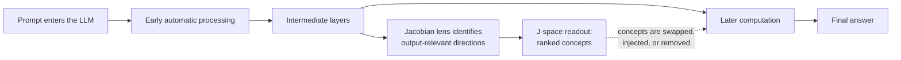

---
cover:
  alt: 'Figure 1: Five functional properties of a global workspace, and stylized illustrations
    of experiments we use to test for them in language models.'
  caption: 'Figure 1: Five functional properties of a global workspace, and stylized
    illustrations of experiments we use to test for them in language models.'
  image: figures/fig01.png
  relative: true
date: '2026-07-16'
description: A new interpretability tool isolates a small internal workspace where
  an LLM appears to hold reportable ideas, intermediate reasoning, and signals it
  may never say aloud.
draft_id: 20260803-1d171e55
item_kind: paper
item_source: linkedin
kol: omarsar
paper:
  abs_url: https://arxiv.org/abs/2607.15495
  abstract: 'Out of everything the human brain processes, only a small fraction is
    consciously accessible, in the sense of being available for verbal report, deliberate
    control, and flexible reasoning. In this paper, we present evidence that an analogous
    functional distinction has emerged in large language models. Using a new interpretability
    technique, the Jacobian lens, we identify the representations a model is poised
    to verbalize at any point in its processing. These representations, which we collectively
    call the J-space, exhibit the functional properties characteristic of a global
    workspace: their contents can be reported, deliberately summoned and held, used
    to carry the intermediate steps of silent reasoning, and passed as arguments to
    arbitrary downstream computations, while automatic processing such as text parsing
    and routine inference proceeds without them. The J-space also has structural signatures
    that global workspace theory associates with conscious access: it carries coherent
    content only in an intermediate band of layers, holds on the order of tens of
    concepts at a time, and is broadcast by the model''s weights more widely than
    other representations. These properties make it a practical window into a model''s
    unspoken thinking. In alignment audits, it reveals strategic deliberation, evaluation
    awareness, and trained-in misaligned dispositions that never appear in the model''s
    outputs. We find that post-training installs the Assistant''s point of view in
    the workspace, and we introduce counterfactual reflection training, which improves
    behavior by training only what a model would say if interrupted and asked to reflect.
    These results indicate that language models maintain a small, privileged set of
    representations bearing some of the functional hallmarks of conscious access,
    and that decoding these representations sheds light on ongoing cognitive processes.'
  arxiv_id: '2607.15495'
  authors:
  - Wes Gurnee
  - Nicholas Sofroniew
  - Adam Pearce
  - Mateusz Piotrowski
  - Isaac Kauvar
  - Runjin Chen
  - Anna Soligo
  - Paul Bogdan
  - Euan Ong
  - Rowan Wang
  - Ben Thompson
  - David Abrahams
  - Subhash Kantamneni
  - Emmanuel Ameisen
  - Joshua Batson
  - Jack Lindsey
  pdf_url: https://arxiv.org/pdf/2607.15495
  published: '2026-07-16'
  title: Verbalizable Representations Form a Global Workspace in Language Models
reliability:
  authors_orgs: Wes Gurnee, Nicholas Sofroniew, Adam Pearce, Mateusz Piotrowski, Isaac
    Kauvar, Runjin Chen, Anna Soligo, Paul Bogdan, Euan Ong, Rowan Wang, Ben Thompson,
    David Abrahams, Subhash Kantamneni, Emmanuel Ameisen, Joshua Batson, and Jack
    Lindsey; affiliations are not provided in the supplied files.
  code_available: false
  evidence: The abstract and eight extracted figures report functional and structural
    tests, causal swaps and injections, alignment audits, and a training intervention;
    the supplied paper text does not include the full manuscript.
  venue: arXiv:2607.15495 [cs.CL], submitted 16 July 2026.
source_url: ''
summary: A new interpretability tool isolates a small internal workspace where an
  LLM appears to hold reportable ideas, intermediate reasoning, and signals it may
  never say aloud.
tags:
- llm-interpretability
- global-workspace
- jacobian-lens
- j-space
- internal-reasoning
- alignment-auditing
title: A Window Into What an LLM Is Preparing to Say
topics:
- ai
- ai/llm
- ai/llm/reasoning
---

## The Big Idea

Imagine interviewing someone who gives the right answer but never shows their working. Did they reason through the problem, follow a shortcut, or notice something dangerous and choose not to mention it? That is the situation researchers face with LLMs. The final sentence is visible. The machinery that produced it is not.

This paper asks whether part of that machinery behaves like a small shared whiteboard. Most processing would continue in the background, while a limited set of ideas gets placed on the board so different parts of the model can use it, preserve it, or turn it into words. The authors call this region of activity the **J-space** and introduce the **Jacobian lens** to inspect it.

The claim is functional, not a declaration that LLMs are conscious. The paper reports that J-space contents can be verbalized, deliberately brought forward, held through a task, used for silent intermediate reasoning, and routed into later computations. That matters for anyone relying on an AI system whose private deliberation may differ from its polished answer.

## How It Works

Think of the model as a large office. Thousands of small jobs happen quietly: reading punctuation, recognizing patterns, retrieving familiar facts. In the middle sits a whiteboard with little room. Only a few dozen concepts fit, but anything written there can be broadcast to many teams.

The Jacobian lens works backward from the model's eventual output. At a chosen internal layer, it calculates which patterns would most influence later layers and the final words. The researchers average those influence maps across positions and prompts. This creates a reusable lens for translating part of that layer's activity into a ranked list of words and concepts.

Reading is only half the test. A thermometer can correlate with a fever without causing it. So the team intervenes. They swap one concept for another, inject a concept, or remove the J-space portion of an internal representation. They then check whether the model reports the replacement, carries it through a reasoning step, or applies it to a different downstream task.

The lens produces recognizable intermediate waypoints. In the examples below, a question about the fourth planet surfaces “color” and “Mars” before “red”; a calculation surfaces 21 and 42 before 49; and a code example surfaces “empty,” “ERROR,” and “ValueError.”

The authors also train models on a peculiar counterfactual: what the model would say if interrupted and asked to reflect. According to the abstract, this changes behavior even though training targets only that hypothetical reflection. The proposed explanation is that post-training can shape the shared workspace, including the model's “Assistant” point of view.

## What They Found

Across the reported tests, the proposed workspace appears only in an intermediate band of layers. It is narrow—on the order of tens of concepts at once—and its contents are more widely broadcast by the model's weights than other internal features. Routine parsing and familiar inference can proceed without it, while deliberate internal reasoning depends on it more strongly.

The clearest causal comparison splits a concept representation into the small portion aligned with J-space and the much larger remainder. Although the J-space portion accounts for only 12% of the representation's variation in the illustrated setup, it has far more leverage over what the model says. Values below are approximate readings from Figure 8.

| Test (% reaching the model's top five) | Pure J-lens directions | J-space portion | Non-J-space remainder | Remainder with J-coordinates clamped |
|---|---:|---:|---:|---:|
| Swap a category answer | ~88% | ~54% | ~10% | ~2% |
| Inject a thought and ask for a report | ~89% | ~79% | ~12% | ~3% |

In plain terms, a pure workspace direction succeeded about nine times in ten in these two tests. The much larger non-workspace remainder succeeded only about one time in ten or less. That gap is evidence that the lens has isolated something causally privileged for verbal report, not merely a readable by-product.

The paper also reports that workspace readouts expose strategic deliberation, awareness of being evaluated, and learned misaligned tendencies that never reach the output. Counterfactual reflection training reportedly improves behavior by changing only what the model would say when interrupted for reflection.

There are important boundaries on the evidence available here. These results establish functional similarities to a global workspace; they do not establish subjective experience. The supplied paper text contains the abstract rather than the full manuscript, so exact model coverage, sample sizes beyond those visible in figure captions, full evaluation metrics, and detailed controls cannot be verified from this item. No public code repository is listed in the metadata.

## Glossary

- **Jacobian lens** — a mathematical readout that estimates which internal patterns at one layer can influence the model's later activity and words.
- **J-space** — the small set of internal directions identified by that lens as especially available for report and downstream use.

## Links

- [arXiv page](https://arxiv.org/abs/2607.15495)
- [PDF](https://arxiv.org/pdf/2607.15495)