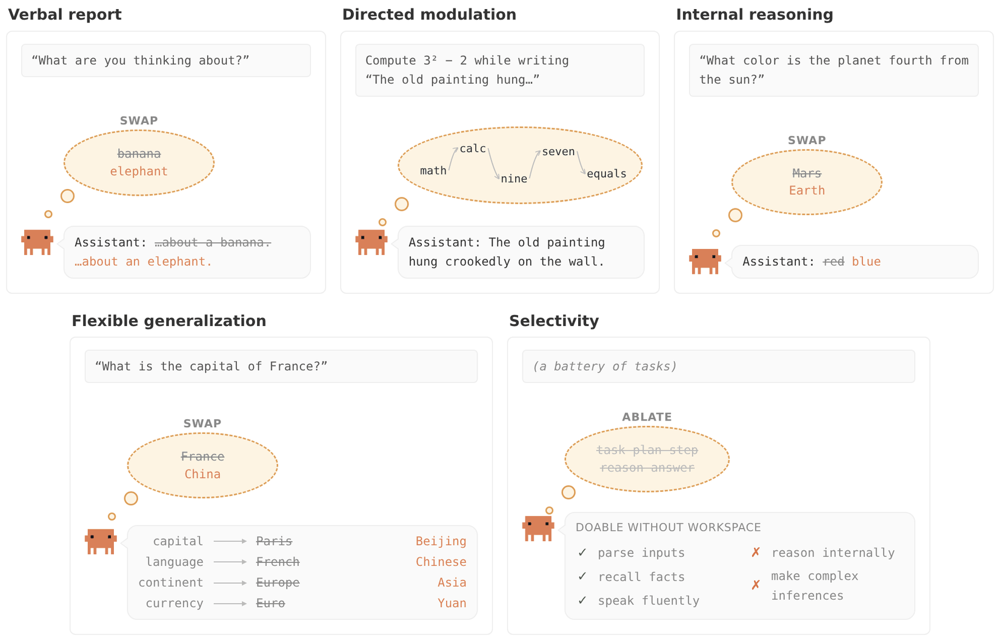
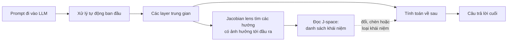
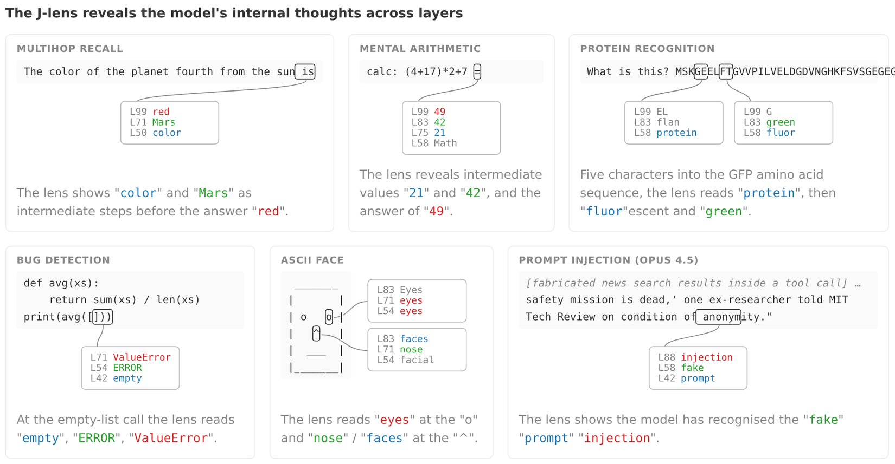
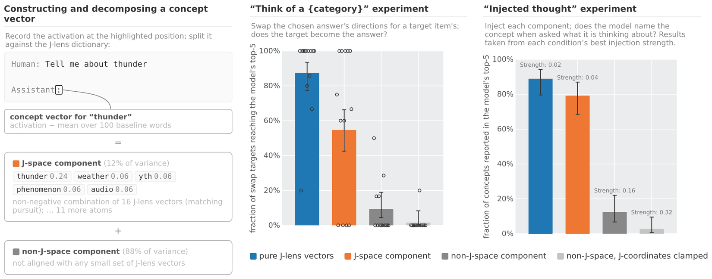

---
cover:
  alt: 'Figure 1: Five functional properties of a global workspace, and stylized illustrations
    of experiments we use to test for them in language models.'
  caption: 'Figure 1: Five functional properties of a global workspace, and stylized
    illustrations of experiments we use to test for them in language models.'
  image: /posts/2026-07-16-a-window-into-what-an-llm-is-preparing-to-say/figures/fig01.png
  relative: false
date: '2026-07-16'
description: Một công cụ mới tìm ra vùng làm việc nhỏ bên trong LLM, nơi model giữ
  các ý có thể nói thành lời, các bước suy luận và cả tín hiệu cuối cùng không xuất
  hiện trong câu trả lời.
draft_id: 20260803-1d171e55
item_kind: paper
item_source: linkedin
kol: omarsar
paper:
  abs_url: https://arxiv.org/abs/2607.15495
  abstract: 'Out of everything the human brain processes, only a small fraction is
    consciously accessible, in the sense of being available for verbal report, deliberate
    control, and flexible reasoning. In this paper, we present evidence that an analogous
    functional distinction has emerged in large language models. Using a new interpretability
    technique, the Jacobian lens, we identify the representations a model is poised
    to verbalize at any point in its processing. These representations, which we collectively
    call the J-space, exhibit the functional properties characteristic of a global
    workspace: their contents can be reported, deliberately summoned and held, used
    to carry the intermediate steps of silent reasoning, and passed as arguments to
    arbitrary downstream computations, while automatic processing such as text parsing
    and routine inference proceeds without them. The J-space also has structural signatures
    that global workspace theory associates with conscious access: it carries coherent
    content only in an intermediate band of layers, holds on the order of tens of
    concepts at a time, and is broadcast by the model''s weights more widely than
    other representations. These properties make it a practical window into a model''s
    unspoken thinking. In alignment audits, it reveals strategic deliberation, evaluation
    awareness, and trained-in misaligned dispositions that never appear in the model''s
    outputs. We find that post-training installs the Assistant''s point of view in
    the workspace, and we introduce counterfactual reflection training, which improves
    behavior by training only what a model would say if interrupted and asked to reflect.
    These results indicate that language models maintain a small, privileged set of
    representations bearing some of the functional hallmarks of conscious access,
    and that decoding these representations sheds light on ongoing cognitive processes.'
  arxiv_id: '2607.15495'
  authors:
  - Wes Gurnee
  - Nicholas Sofroniew
  - Adam Pearce
  - Mateusz Piotrowski
  - Isaac Kauvar
  - Runjin Chen
  - Anna Soligo
  - Paul Bogdan
  - Euan Ong
  - Rowan Wang
  - Ben Thompson
  - David Abrahams
  - Subhash Kantamneni
  - Emmanuel Ameisen
  - Joshua Batson
  - Jack Lindsey
  pdf_url: https://arxiv.org/pdf/2607.15495
  published: '2026-07-16'
  title: Verbalizable Representations Form a Global Workspace in Language Models
reliability:
  authors_orgs: Wes Gurnee, Nicholas Sofroniew, Adam Pearce, Mateusz Piotrowski, Isaac
    Kauvar, Runjin Chen, Anna Soligo, Paul Bogdan, Euan Ong, Rowan Wang, Ben Thompson,
    David Abrahams, Subhash Kantamneni, Emmanuel Ameisen, Joshua Batson, and Jack
    Lindsey; affiliations are not provided in the supplied files.
  code_available: false
  evidence: The abstract and eight extracted figures report functional and structural
    tests, causal swaps and injections, alignment audits, and a training intervention;
    the supplied paper text does not include the full manuscript.
  venue: arXiv:2607.15495 [cs.CL], submitted 16 July 2026.
source_url: ''
summary: Một công cụ mới tìm ra vùng làm việc nhỏ bên trong LLM, nơi model giữ các
  ý có thể nói thành lời, các bước suy luận và cả tín hiệu cuối cùng không xuất hiện
  trong câu trả lời.
tags:
- llm-interpretability
- global-workspace
- jacobian-lens
- j-space
- internal-reasoning
- alignment-auditing
title: Nhìn vào phần suy nghĩ mà LLM đang chuẩn bị nói ra
topics:
- ai
- ai/llm
- ai/llm/reasoning
---

## Ý tưởng chính

Bạn hỏi một LLM một câu khó. Nó trả lời trơn tru, nhưng chỉ đưa ra kết quả cuối. Vậy bên trong nó vừa tính từng bước, đi đường tắt, hay đã phát hiện điều gì đó rồi quyết định không nói? Nhìn vào câu trả lời thôi thì không biết được.

Nhóm tác giả đi tìm một thứ giống chiếc bảng trắng dùng chung trong văn phòng. Phần lớn việc xử lý vẫn diễn ra âm thầm. Nhưng một nhóm nhỏ ý tưởng được đưa lên bảng để nhiều phần khác của model cùng đọc, giữ lại hoặc biến thành lời. Họ gọi vùng này là **J-space**, còn công cụ dùng để soi nó là **Jacobian lens**.

Đây không phải tuyên bố rằng LLM có ý thức. Kết luận hẹp hơn và có thể kiểm tra được: nội dung trong J-space có thể được model nói ra, chủ động gọi lại, giữ qua nhiều bước, dùng để suy luận thầm và chuyển tiếp sang phép tính phía sau. Với người dùng AI trong công việc quan trọng, điểm đáng chú ý là phần model “đang cân nhắc” có thể không trùng với câu chữ cuối cùng.

## Cách hoạt động

Hãy hình dung một công ty rất lớn. Hàng nghìn việc nhỏ chạy ở hậu trường: đọc dấu câu, nhận mẫu quen thuộc, gọi lại một sự kiện. Ở giữa công ty có một chiếc bảng trắng khá bé. Chỉ vài chục khái niệm nằm trên đó cùng lúc, nhưng nhiều phòng ban đều nhìn thấy.

Jacobian lens bắt đầu từ đầu ra rồi lần ngược vào trong. Ở một layer được chọn, công cụ đo xem mẫu hoạt động nào có khả năng ảnh hưởng mạnh tới các layer sau và từ model cuối cùng sẽ nói. Các phép đo được gộp qua nhiều vị trí và nhiều prompt, tạo thành một “kính soi” có thể đổi hoạt động nội bộ thành danh sách khái niệm được xếp hạng.

Chỉ đọc được chưa đủ. Nhiệt kế đi cùng cơn sốt, nhưng nhiệt kế không gây sốt. Vì vậy nhóm nghiên cứu sửa trực tiếp tín hiệu: đổi “Mars” thành một khái niệm khác, chèn một ý mới, hoặc bỏ phần nằm trong J-space. Sau đó họ xem câu trả lời và bước suy luận tiếp theo có đổi theo không.

Các ví dụ cho thấy những mốc khá cụ thể. Trước khi trả lời màu của hành tinh thứ tư, lens thấy “color” rồi “Mars”, sau đó mới tới “red”. Với phép tính, nó lần lượt hiện 21, 42 và 49. Trong đoạn code lỗi, các tín hiệu “empty”, “ERROR” và “ValueError” xuất hiện ngay tại chỗ danh sách rỗng.

Nhóm tác giả còn dùng một cách training lạ: chỉ dạy model câu mà nó *sẽ nói* nếu bị ngắt giữa chừng và được yêu cầu tự phản ánh. Theo abstract, cách này vẫn cải thiện hành vi. Cách giải thích được đưa ra là post-training có thể chỉnh chính workspace dùng chung, bao gồm góc nhìn “Assistant” của model.

## Kết quả

J-space không hiện rõ ở mọi nơi. Nó mang nội dung nhất quán chủ yếu tại một dải layer trung gian, chứa cỡ vài chục khái niệm cùng lúc và được weights của model phát rộng hơn các feature khác. Những việc quen thuộc như parse văn bản hay suy luận thường lệ vẫn có thể chạy ngoài vùng này. Suy luận có chủ đích thì dựa vào nó nhiều hơn.

Thí nghiệm dễ thấy nhất tách một biểu diễn khái niệm thành hai phần: phần nhỏ khớp với J-space và phần còn lại lớn hơn nhiều. Trong ví dụ ở Figure 8, J-space chỉ giải thích 12% độ biến thiên của biểu diễn, nhưng lại tác động mạnh hơn hẳn tới điều model nói. Các số dưới đây là giá trị xấp xỉ đọc từ biểu đồ.

| Phép thử (% lọt vào top 5 của model) | Hướng J-lens thuần | Phần J-space | Phần còn lại ngoài J-space | Phần còn lại khi khóa tọa độ J |
|---|---:|---:|---:|---:|
| Đổi đáp án của một category | ~88% | ~54% | ~10% | ~2% |
| Chèn một ý rồi yêu cầu model kể lại | ~89% | ~79% | ~12% | ~3% |

Nói đơn giản là, hướng workspace thuần thành công gần chín trên mười lần trong cả hai phép thử. Phần còn lại tuy lớn hơn rất nhiều nhưng chỉ thành công khoảng một trên mười lần, thậm chí thấp hơn. Như vậy lens không chỉ tìm được tín hiệu tình cờ dễ đọc; phần tín hiệu đó thật sự có quyền lực đặc biệt đối với lời model sắp nói.

Abstract còn cho biết J-space làm lộ ra việc model cân nhắc chiến lược, nhận biết mình đang bị đánh giá và mang các xu hướng lệch đã học nhưng không nói ra. Counterfactual reflection training cũng được báo cáo là cải thiện hành vi dù chỉ chỉnh câu model sẽ nói khi bị ngắt để tự phản ánh.

Phạm vi kết luận cần được giữ rõ. Các thí nghiệm cho thấy J-space giống global workspace về chức năng, không chứng minh model có trải nghiệm chủ quan. Ngoài ra, file được cung cấp chỉ có abstract thay vì toàn bộ manuscript. Vì thế chưa thể kiểm tra từ item này phạm vi model, toàn bộ sample size, metric chi tiết và các control đầy đủ. Metadata cũng không liệt kê repo code công khai.

## Thuật ngữ

- **Jacobian lens** — cách đọc bằng toán học để ước lượng tín hiệu nội bộ ở một layer sẽ ảnh hưởng thế nào tới hoạt động và câu chữ về sau của model.
- **J-space** — nhóm nhỏ các hướng nội bộ mà lens xác định là đặc biệt dễ được nói ra và chuyển cho bước xử lý tiếp theo.

## Liên kết

- [Trang arXiv](https://arxiv.org/abs/2607.15495)
- [PDF](https://arxiv.org/pdf/2607.15495)