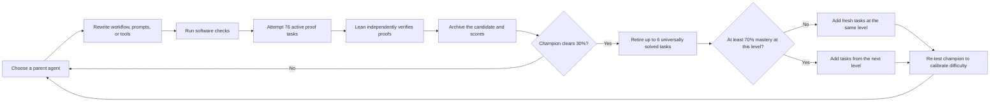

---
cover:
  alt: 'Figure 1: Champion-driven agent–benchmark coevolution. A seed agent produces
    first- generation (G1) children that stream into a shared archive as they are
    evaluated, so a strong early child can already parent later siblings in the same
    generation; the strongest child becomes the champion, seeds the next generation
    (G2), and also drives the benchmark update. Evaluation records from all agents
    are collected. The benchmark is drawn from a candidate problem pool stratified
    by difficulty level (L1: s'
  caption: 'Figure 1: Champion-driven agent–benchmark coevolution. A seed agent produces
    first- generation (G1) children that stream into a shared archive as they are
    evaluated, so a strong early child can already parent later siblings in the same
    generation; the strongest child becomes the champion, seeds the next generation
    (G2), and also drives the benchmark update. Evaluation records from all agents
    are collected. The benchmark is drawn from a candidate problem pool stratified
    by difficulty level (L1: s'
  image: figures/fig01.png
  relative: true
date: '2026-07-19'
description: A theorem-proving agent improved by rewriting its own working habits
  while its practice set became harder. A fixed proof checker kept every claimed success
  honest.
draft_id: 20260803-2d1c153a
item_kind: paper
item_source: linkedin
kol: omarsar
paper:
  abs_url: https://arxiv.org/abs/2607.17352
  abstract: 'Designing effective Lean proof agents is a central challenge in formal
    mathematical reasoning. Beyond building stronger provers, recent work emphasizes
    the workflow around Lean: how an agent decomposes proof obligations, uses tools
    and compiler feedback, diagnoses failures, repairs proofs, and maintains structured
    proof context. Motivated by code-level self-evolving agents, we study whether
    such workflows can be evolved rather than hand-designed. We present a self-evolving
    Lean proof agent in which a small fixed, trusted runtime wraps a fully mutable
    workspace: the proof workflow, prompts, and tools. Unlike most self-evolving systems,
    which optimize against a fixed external benchmark, our system coevolves the agent
    and its benchmark. Between generations, the highest-scoring agent (the champion)
    revises the active task distribution through a mastery-throttled curriculum update
    that introduces harder proof obligations only after the current level is mastered,
    and a single-anchor recalibration re-runs the champion on the updated benchmark
    to keep scores comparable as difficulty rises. All evolution stays inside a Lean-grounded
    verification loop: however the agent rewrites itself, a success counts only when
    its behavior yields Lean-verified proofs under a trusted snapshot, and each attempt
    must emit a machine-readable, Lean-grounded proof context whose representation
    may evolve but whose groundedness is enforced. We run the coevolving trajectory
    and a fixed-benchmark baseline for 15 active generations and compare them on a
    held-out miniF2F test split. The best coevolving agent reaches a 45.1% held-out
    solve rate, versus 12.7% for the seed and 32.0% for the best fixed-benchmark agent,
    showing that verifier-grounded self-evolution can improve Lean proof workflows
    under a coevolving benchmark.'
  arxiv_id: '2607.17352'
  authors:
  - Yuqing Li
  - Zeguan Wu
  - Yu Gan
  - Junyu Liu
  pdf_url: https://arxiv.org/pdf/2607.17352
  published: '2026-07-19'
  title: Self-Modifying Lean Proof Agents with Verifier-Grounded Benchmark Coevolution
reliability:
  authors_orgs: Yuqing Li, Zeguan Wu, Yu Gan, and Junyu Liu; University of Pittsburgh.
  code_available: false
  evidence: One 15-generation coevolving run and one fixed-benchmark run; 244 held-out
    miniF2F tasks; no variance estimates.
  venue: arXiv:2607.17352v1, submitted 19 July 2026.
source_url: ''
summary: A theorem-proving agent improved by rewriting its own working habits while
  its practice set became harder. A fixed proof checker kept every claimed success
  honest.
tags:
- self-improving agents
- theorem proving
- lean
- benchmark coevolution
- formal verification
- agent workflows
title: When an AI Agent Rewrites Its Study Plan—and the Exam Gets Harder
topics:
- ai
- ai/llm
- ai/llm/agents
---

## The Big Idea

Imagine training a student with the same worksheet forever. At first, the questions are useful. Soon, the student memorizes the easy parts, the score plateaus, and “improvement” mostly means getting better at that worksheet. Many self-improving AI agents face the same trap: they rewrite their own prompts, tools, and routines, but keep chasing a fixed test.

This paper moves both sides of the race. It lets an AI agent rewrite the way it attempts mathematical proofs, while a curriculum replaces mastered problems with fresh or harder ones. One thing never moves: Lean, a proof checker, decides whether each answer is actually correct.

That matters beyond mathematics. Any system allowed to change itself can discover shortcuts in its scorekeeping. Here, the score comes from a separate, protected checker. The agent may rewrite its study habits, but it cannot rewrite the answer key.

## How It Works

The starting agent is deliberately bare-bones. It proposes one proof, asks Lean to check it once, and stops. Later versions may change the workflow, prompts, and tools. They can add retries, search for valid lemma names, organize subgoals, or use Lean's error messages to repair a failed proof. The protected runtime, benchmark manager, and verifier stay outside this editable workspace.

Every candidate must first pass basic software checks. Then it faces a 76-problem active benchmark. A proof counts only if the protected runtime independently reruns it in Lean. The agent's own “success” flag is ignored, forbidden shortcuts such as `sorry` and `admit` are rejected, and any supposedly solved intermediate step needs its own verified evidence.

The problem pool has three rungs: simple one-step lemmas, miniF2F competition-style problems, and the harder PutnamBench collection. A level advances only after the champion solves at least 70% of that level. New tasks initially count as unsolved, which stops the curriculum from becoming harder too abruptly.

Scores also need adjustment because 40% on a hard set is not the same as 40% on an easy one. After an update, the system reruns the same champion on the new set and uses that result as an anchor. Over 15 generations, this difficulty coefficient rose from 1.00 to 3.17.

Within each generation, good candidates enter a shared archive immediately. An early strong child can therefore become the parent of a later child in the same generation. Agents that have already produced many children are slightly discounted, which keeps one family from taking over too quickly.

## What They Found

On a separate 244-problem miniF2F test set that never influenced selection, the seed solved 12.7%. The best agent trained against a fixed benchmark reached 32.0%. The best coevolving agent reached 45.1%.

> The coevolving agent solved about 45 in every 100 held-out problems, versus about 13 for the seed.

| Held-out evaluation | Seed workflow | Best fixed-benchmark agent | Best coevolving agent |
|---|---:|---:|---:|
| miniF2F test, 244 problems | 12.7% | 32.0% | 45.1% |

The gains were not smooth. Selected coevolving agents scored 38.9% at generation 2, fell as low as 11.9% at generation 9, and reached their best result at generation 15. Selection rewarded performance on the changing active set, not directly on the held-out test.

The winning behavior was also less grand than “AI invents a new way to do mathematics.” Strong agents mostly learned a compact repair routine: draft a complete proof, run Lean, inspect the error, check whether referenced lemma names really exist, and retry within a fixed budget. More elaborate agents did learn to plan helper lemmas and verify some subgoals separately, but assembling those pieces into a final proof introduced more failure points and often lost to the simpler repair loop.

The study has clear boundaries. It reports one coevolving run and one fixed-benchmark run, both lasting 15 generations, with no variance estimates. A single remote model, DeepSeek `deepseek-v4-pro`, powered both proof solving and self-modification; even at temperature zero, the authors observed output instability on borderline problems. The 45.1% result also remains far below the 99.2% reported by the hand-designed Goedel-Architect system, although that comparison uses a different backend. Finally, the benchmark did not invent new problems: it selected harder items from a fixed, author-organized pool.

## Glossary

- **Lean** — A system that checks whether a mathematical proof follows formal rules, much like a compiler checks whether code is valid.

## Links

- [arXiv page](https://arxiv.org/abs/2607.17352)
- [PDF](https://arxiv.org/pdf/2607.17352)