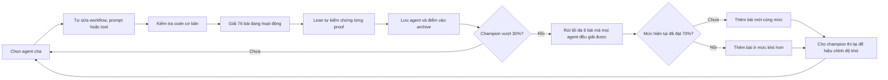
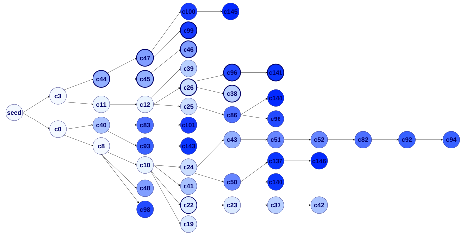

---
cover:
  alt: 'Figure 1: Champion-driven agent–benchmark coevolution. A seed agent produces
    first- generation (G1) children that stream into a shared archive as they are
    evaluated, so a strong early child can already parent later siblings in the same
    generation; the strongest child becomes the champion, seeds the next generation
    (G2), and also drives the benchmark update. Evaluation records from all agents
    are collected. The benchmark is drawn from a candidate problem pool stratified
    by difficulty level (L1: s'
  caption: 'Figure 1: Champion-driven agent–benchmark coevolution. A seed agent produces
    first- generation (G1) children that stream into a shared archive as they are
    evaluated, so a strong early child can already parent later siblings in the same
    generation; the strongest child becomes the champion, seeds the next generation
    (G2), and also drives the benchmark update. Evaluation records from all agents
    are collected. The benchmark is drawn from a candidate problem pool stratified
    by difficulty level (L1: s'
  image: /posts/2026-07-19-when-an-ai-agent-rewrites-its-study-plan-and-the-exam-gets-h/figures/fig01.png
  relative: false
date: '2026-07-19'
description: Một AI agent học cách tự chỉnh workflow giải toán, còn bộ bài tập thì
  tăng độ khó theo năng lực của nó. Mọi đáp án vẫn phải qua một bộ kiểm chứng độc
  lập.
draft_id: 20260803-2d1c153a
item_kind: paper
item_source: linkedin
kol: omarsar
paper:
  abs_url: https://arxiv.org/abs/2607.17352
  abstract: 'Designing effective Lean proof agents is a central challenge in formal
    mathematical reasoning. Beyond building stronger provers, recent work emphasizes
    the workflow around Lean: how an agent decomposes proof obligations, uses tools
    and compiler feedback, diagnoses failures, repairs proofs, and maintains structured
    proof context. Motivated by code-level self-evolving agents, we study whether
    such workflows can be evolved rather than hand-designed. We present a self-evolving
    Lean proof agent in which a small fixed, trusted runtime wraps a fully mutable
    workspace: the proof workflow, prompts, and tools. Unlike most self-evolving systems,
    which optimize against a fixed external benchmark, our system coevolves the agent
    and its benchmark. Between generations, the highest-scoring agent (the champion)
    revises the active task distribution through a mastery-throttled curriculum update
    that introduces harder proof obligations only after the current level is mastered,
    and a single-anchor recalibration re-runs the champion on the updated benchmark
    to keep scores comparable as difficulty rises. All evolution stays inside a Lean-grounded
    verification loop: however the agent rewrites itself, a success counts only when
    its behavior yields Lean-verified proofs under a trusted snapshot, and each attempt
    must emit a machine-readable, Lean-grounded proof context whose representation
    may evolve but whose groundedness is enforced. We run the coevolving trajectory
    and a fixed-benchmark baseline for 15 active generations and compare them on a
    held-out miniF2F test split. The best coevolving agent reaches a 45.1% held-out
    solve rate, versus 12.7% for the seed and 32.0% for the best fixed-benchmark agent,
    showing that verifier-grounded self-evolution can improve Lean proof workflows
    under a coevolving benchmark.'
  arxiv_id: '2607.17352'
  authors:
  - Yuqing Li
  - Zeguan Wu
  - Yu Gan
  - Junyu Liu
  pdf_url: https://arxiv.org/pdf/2607.17352
  published: '2026-07-19'
  title: Self-Modifying Lean Proof Agents with Verifier-Grounded Benchmark Coevolution
reliability:
  authors_orgs: Yuqing Li, Zeguan Wu, Yu Gan, and Junyu Liu; University of Pittsburgh.
  code_available: false
  evidence: One 15-generation coevolving run and one fixed-benchmark run; 244 held-out
    miniF2F tasks; no variance estimates.
  venue: arXiv:2607.17352v1, submitted 19 July 2026.
source_url: ''
summary: Một AI agent học cách tự chỉnh workflow giải toán, còn bộ bài tập thì tăng
  độ khó theo năng lực của nó. Mọi đáp án vẫn phải qua một bộ kiểm chứng độc lập.
tags:
- self-improving agents
- theorem proving
- lean
- benchmark coevolution
- formal verification
- agent workflows
title: Khi AI agent tự sửa cách học — và bài kiểm tra cũng khó dần
topics:
- ai
- ai/llm
- ai/llm/agents
---

## Ý tưởng chính

Bạn thử tưởng tượng một học sinh ôn đi ôn lại đúng một đề. Điểm có thể tăng rất nhanh, nhưng chưa chắc năng lực thật sự tăng theo. Với AI agent cũng vậy. Nếu agent được phép tự sửa prompt, tool và cách làm việc nhưng bài kiểm tra cứ đứng yên, nó rất dễ trở thành “cao thủ của riêng bộ đề đó”.

Nhóm tác giả chọn cách làm cho cả người học lẫn giáo trình cùng thay đổi. Agent tự viết lại workflow chứng minh toán. Khi nó đã xử lý tốt một nhóm bài, hệ thống rút bớt bài cũ và đưa bài mới hoặc khó hơn vào. Riêng Lean vẫn đứng ngoài cuộc chơi, làm trọng tài cố định.

Nói đơn giản là agent được thay cách học, nhưng không được chạm vào đáp án hay người chấm. Đây là điểm đáng chú ý với mọi hệ thống tự cải tiến: nếu máy vừa thi vừa tự chấm, điểm số rất dễ mất ý nghĩa.

## Cách hoạt động

Mọi thứ bắt đầu từ một agent cực kỳ đơn giản. Nó viết một proof, gửi Lean kiểm tra đúng một lần, rồi dừng. Các thế hệ sau có thể tự thêm vòng sửa lỗi, tìm lemma phù hợp, chia bài thành subgoal hoặc đổi cách dùng feedback. Phần runtime tin cậy, bộ quản lý benchmark và Lean thì bị khóa, không nằm trong vùng được phép sửa.

Một agent mới phải chạy qua smoke test trước. Qua được cửa này vẫn chưa có nghĩa là giải đúng. Nó tiếp tục làm 76 bài đang hoạt động, và runtime sẽ tự đưa từng proof vào Lean để kiểm tra lại. Cờ “đã giải xong” do agent báo không có giá trị. Các lối tắt như `sorry` hay `admit` bị loại. Nếu agent nói một bước trung gian đã đúng, bước đó cũng cần bằng chứng mà Lean xác nhận.

Kho bài được xếp thành ba nấc. Nấc đầu là các lemma một bước do tác giả tạo. Tiếp theo là bài miniF2F. Cao nhất là PutnamBench. Champion chỉ được kéo giáo trình lên nấc mới khi đạt ít nhất 70% ở nấc hiện tại. Bài vừa thêm được xem là chưa giải, nên độ khó không thể nhảy vọt một cách mất kiểm soát.

Có thêm một rắc rối: 40% trên đề khó không thể so thẳng với 40% trên đề dễ. Vì vậy, mỗi lần đổi benchmark, chính champion cũ phải làm lại đề mới. Kết quả đó trở thành mốc hiệu chỉnh. Sau 15 thế hệ, hệ số độ khó tăng từ 1,00 lên 3,17.

Archive được cập nhật ngay trong lúc một thế hệ đang chạy. Nếu một “đứa con” xuất hiện sớm và làm tốt, nó có thể lập tức sinh ra các biến thể tiếp theo ngay trong cùng thế hệ. Tuy nhiên, agent đã có nhiều con sẽ bị giảm nhẹ cơ hội được chọn, tránh một nhánh chiếm toàn bộ cuộc tìm kiếm.

## Kết quả

Bài kiểm tra cuối gồm 244 bài miniF2F, tách hẳn khỏi curriculum và không được dùng để chọn agent. Agent ban đầu giải được 12,7%. Agent tốt nhất khi luyện với benchmark cố định đạt 32,0%. Khi benchmark cùng tiến hóa, kết quả cao nhất là 45,1%.

> Hiểu nôm na, agent coevolving giải được khoảng 45 trên 100 bài chưa từng dùng để chọn nó; agent ban đầu chỉ giải được khoảng 13.

| Bài kiểm tra độc lập | Workflow ban đầu | Agent tốt nhất với benchmark cố định | Agent tốt nhất với benchmark coevolving |
|---|---:|---:|---:|
| miniF2F test, 244 bài | 12,7% | 32,0% | 45,1% |

Đường đi không hề tăng đều. Một agent ở thế hệ 2 đã đạt 38,9%, nhưng thế hệ 9 có mẫu được chọn chỉ đạt 11,9%. Đến thế hệ 15 mới xuất hiện mức cao nhất 45,1%. Lý do là quá trình tiến hóa tối ưu điểm trên bộ bài đang thay đổi, chứ không nhìn thấy bộ test độc lập.

Thật ra thì workflow thắng cuộc khá thực dụng. Agent viết trọn proof, chạy Lean, đọc lỗi, kiểm tra xem tên lemma có tồn tại hay không, rồi thử lại trong một ngân sách hữu hạn. Một số nhánh đã biết lập kế hoạch với helper lemma và kiểm chứng subgoal riêng. Nhưng khi ghép các mảnh đó thành proof cuối, số chỗ có thể hỏng tăng lên. Workflow nhiều tầng vì thế thường thua vòng repair ngắn gọn.

Có vài giới hạn cần đọc cùng con số 45,1%. Đây là một run coevolving và một run benchmark cố định, mỗi run 15 thế hệ; paper không có ước lượng phương sai. Cả việc giải proof lẫn tự sửa agent đều dùng một backend là DeepSeek `deepseek-v4-pro`. Dù temperature bằng 0, nhóm tác giả vẫn thấy output thiếu ổn định ở các bài sát ranh giới đúng–sai. Kết quả này cũng còn thấp hơn mức 99,2% mà Goedel-Architect với workflow thiết kế thủ công từng báo cáo, nhưng hai hệ thống dùng backend khác nhau nên không phải phép so sánh ngang hàng. Ngoài ra, benchmark chỉ chọn từ một kho bài có sẵn và đã được tác giả chia mức; nó chưa tự sáng tác bài mới.

## Thuật ngữ

- **Lean** — Hệ thống kiểm tra một proof có tuân thủ đầy đủ các quy tắc hình thức hay không, gần giống cách compiler kiểm tra code hợp lệ.

## Liên kết

- [Trang arXiv](https://arxiv.org/abs/2607.17352)
- [PDF](https://arxiv.org/pdf/2607.17352)