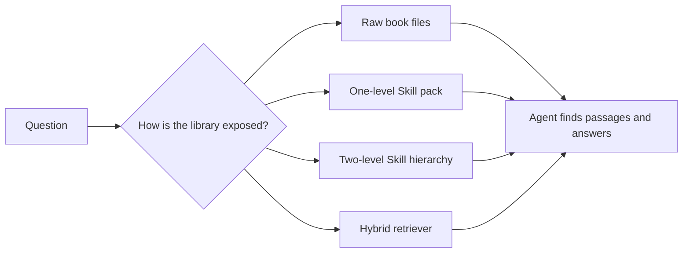

---
cover:
  alt: 'Figure 1: The flat pack. Example is Frankenstein.'
  caption: 'Figure 1: The flat pack. Example is Frankenstein.'
  image: figures/fig01.png
  relative: true
date: '2026-07-20'
description: A controlled study tests whether revealing long documents in stages helps
  AI agents answer questions. One routing layer holds up as libraries grow; a second
  can send the agent the wrong way.
draft_id: 20260803-2c944755
item_kind: paper
item_source: linkedin
kol: omarsar
paper:
  abs_url: https://arxiv.org/abs/2607.17598
  abstract: 'Long-document question answering usually forces a choice between loading
    the whole document into the context window and bolting on a separate retriever.
    Agentic AI suggests a broader option, giving the agent the document path and letting
    it decide how and what to read. Agent Skills, a standard for packaging expertise
    into folders an agent loads on demand, supply a ready mechanism: progressive disclosure,
    which exposes only what a query needs, from a short description down to the specific
    passages. Practitioners rapidly adopted this pattern for book-length understanding
    tasks, but the evidence to support such choices has been anecdotal. We run the
    first controlled study of the pattern, comparing raw-document navigation and several
    designs of Agent Skills packs against a classical hybrid retriever across three
    agent harnesses and three model families on InfiniteBench. On a single book, the
    gain depends on the harness, running large when the agent navigates the raw document
    poorly but near zero when a strong agent harness already divides and retrieves
    on its own. When scaling up to tasks that span many books, raw-document navigation
    collapses while one-level progressive disclosure degrades more slowly and pulls
    ahead. A second, deeper routing level never helps and sometimes breaks accuracy
    outright, so one level is enough. Progressive disclosure buys context, not intelligence:
    it is redundant while a strong agent can locate the right passages itself, and
    decisive once the corpus grows too large to navigate by reading.'
  arxiv_id: '2607.17598'
  authors:
  - Yifeng He
  - Yinzhe Zhao
  - Jicheng Wang
  - Hao Chen
  pdf_url: https://arxiv.org/pdf/2607.17598
  published: '2026-07-20'
  title: Is Progressive Disclosure All You Need for Long-Context Agents?
reliability:
  authors_orgs: Yifeng He, Yinzhe Zhao, Jicheng Wang, and Hao Chen; affiliations are
    not listed in the supplied files.
  code_available: false
  evidence: InfiniteBench experiments across 3 agent harnesses and 3 model families,
    with single-book and 5-, 10-, and 20-book settings.
  venue: arXiv preprint 2607.17598, submitted July 20, 2026.
source_url: ''
summary: A controlled study tests whether revealing long documents in stages helps
  AI agents answer questions. One routing layer holds up as libraries grow; a second
  can send the agent the wrong way.
tags:
- progressive disclosure
- agent skills
- long-context agents
- document navigation
- infinitebench
- retrieval
title: When an AI Agent Has Too Much to Read, Give It a Better Filing Cabinet
topics:
- ai
- ai/llm
- ai/llm/agents
---

## The Big Idea

Imagine asking an assistant one question about a shelf of novels. You could dump every page onto its desk. You could build a separate search system. Or you could give it a labeled filing cabinet and let it open only the drawers that look relevant.

This paper tests that third option. The authors package long books as Agent Skills: a short description is visible first, while chapter-sized files stay closed until the agent chooses to read them. This “progressive disclosure” is meant to save context by revealing information in stages.

The practical question is not whether the idea sounds tidy. It is whether the filing cabinet actually helps. The study compares raw book files, one-level and two-level Skill packs, and a conventional hybrid retriever across three agent harnesses and three model families on InfiniteBench.

> Progressive disclosure buys context, not intelligence.

## How It Works

The experiment gives an agent questions about one book or a library containing 5, 10, or 20 books. The question instructions stay fixed. What changes is how the reading material is arranged.

The one-level pack works like a restaurant menu. A compact description and table of contents help the agent choose; the actual chapter files are opened only on demand. The agent does not pay the context cost of reading every chapter up front.

The two-level version adds another receptionist. A top-level router points toward separate chapter Skills, each with its own description and content. That sounds more organized, but every handoff is another chance to choose the wrong door.

For comparison, the hybrid retrieval system searches indexed chunks in two ways, merges the candidate lists, reranks the evidence, and hands the best passages to the answer model. The raw-file condition supplies no such map: the agent must navigate the books using whatever file-reading behavior its harness already provides.

## What They Found

On one book, the answer depends heavily on the agent harness. Progressive disclosure helps when the harness is poor at navigating a raw document. When the harness already splits and retrieves effectively, the extra packaging adds almost nothing.

The gap opens as the library grows. Raw navigation deteriorates sharply across the 5-, 10-, and 20-book settings, while the one-level pack loses ground more slowly and moves ahead. The second routing level never improves accuracy in the reported experiments and sometimes makes it worse. In plain terms: one useful index helps; putting another index in front of it creates more wrong turns.

| Experimental setting | Raw documents | One-level disclosure | Two-level disclosure | Hybrid retriever |
|---|---|---|---|---|
| One book; weak raw navigation | Performs poorly | Large gain | No added benefit reported | Compared as a classical baseline |
| One book; strong built-in retrieval | Already strong | Near-zero gain | No added benefit reported | Compared as a classical baseline |
| Libraries of 5, 10, and 20 books | Accuracy collapses as the corpus grows | Degrades more slowly and pulls ahead | Never helps; sometimes hurts accuracy | Included in the controlled comparison |

The evidence spans InfiniteBench, three harnesses, three model families, and both single-book and multi-book tasks. The supplied paper text is truncated to the abstract, so it does not expose exact accuracy or cost values; those cannot be reported here. The study also concerns book question answering, so the findings do not by themselves establish that the same design wins for codebases, legal archives, or company knowledge systems.

## Glossary

- **Progressive disclosure** — an information design that shows a short guide first and loads detailed material only when it becomes relevant.
- **Agent harness** — the software surrounding a model that gives it tools, files, instructions, and rules for completing a task.

## Links

- [arXiv page](https://arxiv.org/abs/2607.17598)
- [PDF](https://arxiv.org/pdf/2607.17598)