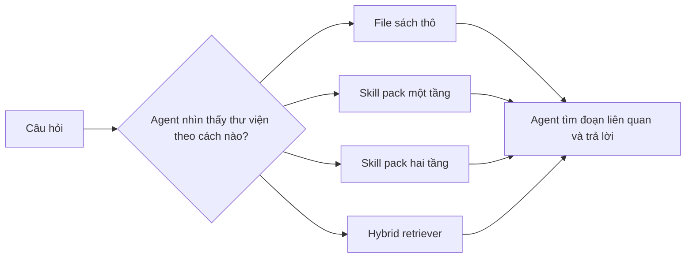
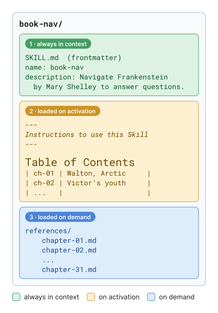
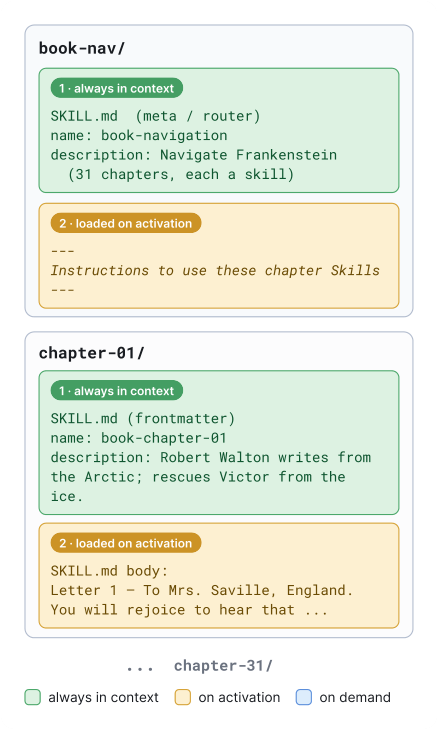

---
cover:
  alt: 'Figure 1: The flat pack. Example is Frankenstein.'
  caption: 'Figure 1: The flat pack. Example is Frankenstein.'
  image: /posts/2026-07-20-when-an-ai-agent-has-too-much-to-read-give-it-a-better-filin/figures/fig01.png
  relative: false
date: '2026-07-20'
description: Một nghiên cứu có kiểm soát thử cách mở dần tài liệu dài cho AI agent.
  Một tầng routing vẫn hiệu quả khi thư viện lớn lên, còn tầng thứ hai có thể khiến
  agent đi sai đường.
draft_id: 20260803-2c944755
item_kind: paper
item_source: linkedin
kol: omarsar
paper:
  abs_url: https://arxiv.org/abs/2607.17598
  abstract: 'Long-document question answering usually forces a choice between loading
    the whole document into the context window and bolting on a separate retriever.
    Agentic AI suggests a broader option, giving the agent the document path and letting
    it decide how and what to read. Agent Skills, a standard for packaging expertise
    into folders an agent loads on demand, supply a ready mechanism: progressive disclosure,
    which exposes only what a query needs, from a short description down to the specific
    passages. Practitioners rapidly adopted this pattern for book-length understanding
    tasks, but the evidence to support such choices has been anecdotal. We run the
    first controlled study of the pattern, comparing raw-document navigation and several
    designs of Agent Skills packs against a classical hybrid retriever across three
    agent harnesses and three model families on InfiniteBench. On a single book, the
    gain depends on the harness, running large when the agent navigates the raw document
    poorly but near zero when a strong agent harness already divides and retrieves
    on its own. When scaling up to tasks that span many books, raw-document navigation
    collapses while one-level progressive disclosure degrades more slowly and pulls
    ahead. A second, deeper routing level never helps and sometimes breaks accuracy
    outright, so one level is enough. Progressive disclosure buys context, not intelligence:
    it is redundant while a strong agent can locate the right passages itself, and
    decisive once the corpus grows too large to navigate by reading.'
  arxiv_id: '2607.17598'
  authors:
  - Yifeng He
  - Yinzhe Zhao
  - Jicheng Wang
  - Hao Chen
  pdf_url: https://arxiv.org/pdf/2607.17598
  published: '2026-07-20'
  title: Is Progressive Disclosure All You Need for Long-Context Agents?
reliability:
  authors_orgs: Yifeng He, Yinzhe Zhao, Jicheng Wang, and Hao Chen; affiliations are
    not listed in the supplied files.
  code_available: false
  evidence: InfiniteBench experiments across 3 agent harnesses and 3 model families,
    with single-book and 5-, 10-, and 20-book settings.
  venue: arXiv preprint 2607.17598, submitted July 20, 2026.
source_url: ''
summary: Một nghiên cứu có kiểm soát thử cách mở dần tài liệu dài cho AI agent. Một
  tầng routing vẫn hiệu quả khi thư viện lớn lên, còn tầng thứ hai có thể khiến agent
  đi sai đường.
tags:
- progressive disclosure
- agent skills
- long-context agents
- document navigation
- infinitebench
- retrieval
title: Khi AI agent có quá nhiều thứ để đọc, hãy cho nó một tủ hồ sơ tốt hơn
topics:
- ai
- ai/llm
- ai/llm/agents
---

## Ý tưởng chính

Bạn có một tủ sách và muốn AI trả lời đúng một câu hỏi nằm đâu đó trong hàng nghìn trang. Đưa hết mọi trang vào cùng lúc thì tốn context. Dựng riêng một hệ thống tìm kiếm lại thêm công sức. Còn một cách khác: cho agent xem “mục lục có chú thích”, rồi để nó tự mở đúng phần cần đọc.

Đó là bài toán của paper này. Nhóm tác giả đóng gói sách thành Agent Skills. Agent luôn thấy phần mô tả ngắn, nhưng nội dung từng chương chỉ được nạp khi cần. Cách tổ chức ấy được gọi là progressive disclosure.

Điểm đáng chú ý là họ không chỉ trình diễn một demo đẹp. Họ đặt raw document, Skill pack một tầng, Skill pack hai tầng và hybrid retriever vào cùng một phép thử trên InfiniteBench, với ba agent harness và ba họ model.

> Progressive disclosure mua thêm context, chứ không làm agent thông minh hơn.

## Cách hoạt động

Mỗi lượt thử bắt đầu bằng câu hỏi về một cuốn sách, hoặc về cả thư viện gồm 5, 10 hay 20 cuốn. Instruction dành cho agent không đổi. Chỉ có cách bày tài liệu là khác.

Với pack một tầng, hãy hình dung một menu. Agent đọc mô tả và mục lục trước. Chương nào có vẻ liên quan thì mới mở file chương đó. Nói đơn giản là nó không phải trả “phí context” cho cả cuốn sách ngay từ đầu.

Pack hai tầng đặt thêm một quầy chỉ dẫn ở phía trước. Router cấp cao dẫn agent tới từng chapter Skill; bên trong mỗi Skill lại có mô tả và nội dung riêng. Cấu trúc nhìn rất ngăn nắp, nhưng thêm một lần chọn đường cũng có nghĩa là thêm một lần có thể rẽ sai.

Hybrid retriever là đối chứng quen thuộc: chia sách thành các đoạn, tìm bằng hai cách, gộp danh sách ứng viên, rerank rồi đưa những đoạn tốt nhất cho model trả lời. Còn ở chế độ raw file, agent không được phát bản đồ. Nó phải dựa vào khả năng đọc và tìm file sẵn có của harness.

## Kết quả

Với một cuốn sách, progressive disclosure có hữu ích hay không phụ thuộc nhiều vào harness. Harness vốn đọc raw document kém thì hưởng lợi rõ. Harness đã tự chia nhỏ và tìm đoạn tốt thì Skill pack gần như không đem thêm điểm.

Khi thư viện tăng lên 5, 10 rồi 20 cuốn, câu chuyện đổi hẳn. Raw navigation tụt mạnh. Pack một tầng xuống chậm hơn và vượt lên. Pack hai tầng không thắng trong bất kỳ kết quả nào được báo cáo, thậm chí có lúc làm accuracy giảm. Hiểu nôm na: một mục lục tốt giúp tìm đường; thêm một mục lục nằm trước mục lục lại dễ đưa agent đi lạc.

| Thiết lập thử nghiệm | Raw document | Progressive disclosure một tầng | Progressive disclosure hai tầng | Hybrid retriever |
|---|---|---|---|---|
| Một cuốn; harness tìm trong raw file kém | Kết quả thấp | Cải thiện lớn | Không có thêm lợi ích được báo cáo | Được dùng làm baseline cổ điển |
| Một cuốn; harness có retrieval mạnh | Vốn đã tốt | Mức tăng gần bằng 0 | Không có thêm lợi ích được báo cáo | Được dùng làm baseline cổ điển |
| Thư viện 5, 10 và 20 cuốn | Accuracy sụp khi corpus lớn dần | Giảm chậm hơn rồi vượt lên | Không bao giờ giúp; đôi khi làm accuracy kém đi | Có mặt trong phép so sánh có kiểm soát |

Phạm vi bằng chứng gồm InfiniteBench, ba harness, ba họ model, cùng bài toán một sách và nhiều sách. Tuy nhiên, file paper được cung cấp chỉ còn phần abstract nên không có các con số accuracy hay chi phí chính xác để trích lại. Thử nghiệm cũng chỉ xoay quanh hỏi đáp trên sách; từ đó chưa thể kết luận cùng thiết kế sẽ thắng khi dùng cho codebase, hồ sơ pháp lý hay kho tri thức doanh nghiệp.

## Thuật ngữ

- **Progressive disclosure** — cách thiết kế chỉ đưa ra hướng dẫn ngắn trước, còn nội dung chi tiết được nạp khi thật sự liên quan.
- **Agent harness** — lớp phần mềm bao quanh model, cung cấp tool, file, instruction và luật để nó hoàn thành công việc.

## Liên kết

- [Trang arXiv](https://arxiv.org/abs/2607.17598)
- [PDF](https://arxiv.org/pdf/2607.17598)