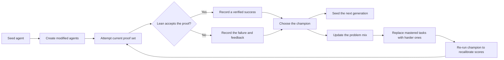
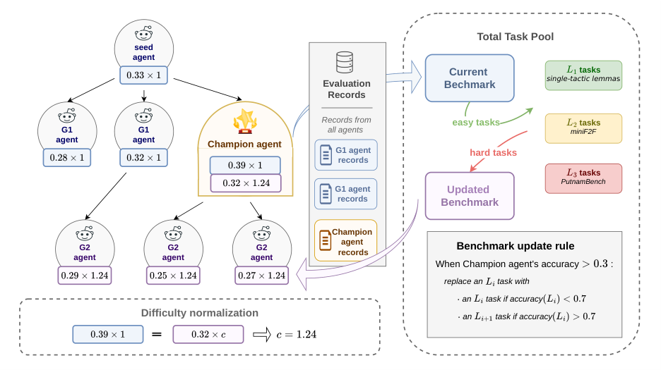

---
cover:
  alt: 'Figure 1: Champion-driven agent–benchmark coevolution. A seed agent produces
    first- generation (G1) children that stream into a shared archive as they are
    evaluated, so a strong early child can already parent later siblings in the same
    generation; the strongest child becomes the champion, seeds the next generation
    (G2), and also drives the benchmark update. Evaluation records from all agents
    are collected. The benchmark is drawn from a candidate problem pool stratified
    by difficulty level (L1: s'
  caption: 'Figure 1: Champion-driven agent–benchmark coevolution. A seed agent produces
    first- generation (G1) children that stream into a shared archive as they are
    evaluated, so a strong early child can already parent later siblings in the same
    generation; the strongest child becomes the champion, seeds the next generation
    (G2), and also drives the benchmark update. Evaluation records from all agents
    are collected. The benchmark is drawn from a candidate problem pool stratified
    by difficulty level (L1: s'
  image: figures/fig01.png
  relative: true
date: '2026-07-27'
description: This paper lets a mathematical proof agent rewrite its own working methods
  while its training problems grow harder in step. A strict proof checker keeps every
  claimed success honest.
draft_id: 20260803-ad462cf8
item_kind: paper
item_source: linkedin
kol: omarsar
paper:
  abs_url: https://arxiv.org/abs/2607.17352
  abstract: 'Designing effective Lean proof agents is a central challenge in formal
    mathematical reasoning. Beyond building stronger provers, recent work emphasizes
    the workflow around Lean: how an agent decomposes proof obligations, uses tools
    and compiler feedback, diagnoses failures, repairs proofs, and maintains structured
    proof context. Motivated by code-level self-evolving agents, we study whether
    such workflows can be evolved rather than hand-designed. We present a self-evolving
    Lean proof agent in which a small fixed, trusted runtime wraps a fully mutable
    workspace: the proof workflow, prompts, and tools. Unlike most self-evolving systems,
    which optimize against a fixed external benchmark, our system coevolves the agent
    and its benchmark. Between generations, the highest-scoring agent (the champion)
    revises the active task distribution through a mastery-throttled curriculum update
    that introduces harder proof obligations only after the current level is mastered,
    and a single-anchor recalibration re-runs the champion on the updated benchmark
    to keep scores comparable as difficulty rises. All evolution stays inside a Lean-grounded
    verification loop: however the agent rewrites itself, a success counts only when
    its behavior yields Lean-verified proofs under a trusted snapshot, and each attempt
    must emit a machine-readable, Lean-grounded proof context whose representation
    may evolve but whose groundedness is enforced. We run the coevolving trajectory
    and a fixed-benchmark baseline for 15 active generations and compare them on a
    held-out miniF2F test split. The best coevolving agent reaches a 45.1% held-out
    solve rate, versus 12.7% for the seed and 32.0% for the best fixed-benchmark agent,
    showing that verifier-grounded self-evolution can improve Lean proof workflows
    under a coevolving benchmark.'
  arxiv_id: '2607.17352'
  authors:
  - Yuqing Li
  - Zeguan Wu
  - Yu Gan
  - Junyu Liu
  pdf_url: https://arxiv.org/pdf/2607.17352
  published: '2026-07-19'
  title: Self-Modifying Lean Proof Agents with Verifier-Grounded Benchmark Coevolution
reliability:
  authors_orgs: Yuqing Li, Zeguan Wu, Yu Gan, and Junyu Liu; affiliations are not
    provided in the supplied files.
  code_available: false
  evidence: 15 active generations; held-out miniF2F comparison against a seed and
    fixed-benchmark baseline; 2 figures and 3 tables reported.
  venue: arXiv preprint 2607.17352, submitted July 19, 2026.
social:
  author: Elvis S.
  created_at: '2026-07-27'
  text: 'I agree with what this AI paper suggests.

    Self-improving agents should evolve their benchmarks too.

    (bookmark it)

    Self-improving agents are one of the most important directions in AI right now,
    and most of them optimize against a fixed benchmark. This paper argues the benchmark
    should evolve alongside the agent.

    The setup is a self-evolving Lean proof agent. A small trusted runtime wraps a
    fully mutable workspace of workflow, prompts, and tools, so the agent can rewrite
    how it decomposes pro'
source_url: https://www.linkedin.com/in/omarsar/
summary: This paper lets a mathematical proof agent rewrite its own working methods
  while its training problems grow harder in step. A strict proof checker keeps every
  claimed success honest.
tags:
- self-improving agents
- formal verification
- lean
- benchmark coevolution
- theorem proving
- minif2f
title: When an AI Proof Solver Improves, Its Exam Gets Harder Too
topics:
- ai
- ai/llm
- ai/llm/agents
---

## The Big Idea

Imagine training a student by giving them the same worksheet every week. Their score rises. But did they learn mathematics, or merely learn that worksheet? AI agents face the same trap. A system that can rewrite its prompts, tools, and work habits may become very good at a fixed test without becoming broadly better at the job.

This paper applies that problem to mathematical proofs written in Lean, where every finished proof can be checked mechanically. Its answer is to evolve two things together: the agent's way of working and the set of problems used to train it. As the agent masters one level, the exam starts drawing harder questions.

That matters beyond theorem proving. Any self-improving system needs both pressure to keep learning and a trustworthy way to tell genuine improvement from clever score-chasing. Here, Lean supplies the referee: a proof counts only if the checker accepts it.



## How It Works

The setup resembles a workshop with a locked safety inspector's office in the middle. The agent may rearrange almost everything in its workshop: its proof workflow, prompts, and tools. It can change how it breaks a theorem into smaller obligations, reacts to compiler feedback, diagnoses a failed attempt, and repairs the proof. But it cannot rewrite the inspector. A small trusted runtime and a fixed Lean snapshot decide whether the final proof is valid.

Work proceeds in generations. The seed agent produces variants. Each variant attempts the active set of proof problems, and successful proofs are verified. The highest-scoring variant becomes the “champion.” That champion supplies the starting point for the next generation and also helps update the next exam.

The curriculum does not simply become harder on a timer. It waits for evidence of mastery. Once the current level is handled well enough, easier obligations are replaced with harder ones from a tiered problem pool. The champion is then run once on the revised benchmark so scores before and after the difficulty change remain comparable.

The crucial separation is simple: the working area is mutable, while the judge is not. Even the machine-readable proof context may change its format over time, but it must stay tied to Lean's checked state.

## What They Found

The researchers ran both the coevolving system and a version trained against a fixed benchmark for 15 active generations. They then tested the strongest agents on a held-out split of miniF2F, a collection of formalized competition-style math problems.

| Held-out task | Seed agent | Best fixed-benchmark agent | Best coevolving agent |
|---|---:|---:|---:|
| miniF2F solve rate | 12.7% | 32.0% | **45.1%** |

In plain terms, the best coevolving agent solved about 45 of every 100 held-out problems. That is 32.4 percentage points above the starting agent and 13.1 points above the best agent whose exam stayed fixed.

The result supports the paper's central comparison: within this 15-generation Lean experiment, changing the curriculum alongside the agent produced a stronger held-out solver than changing the agent alone. The verifier also gives the success signal a firm meaning—an accepted proof, not a self-reported answer.

The scope is narrow. The reported test is one held-out split in formal mathematics, where correctness can be checked exactly. The supplied text does not give run-to-run variation, uncertainty intervals, compute cost, or evidence that the same method transfers to areas without a formal checker. It also does not identify a public code repository.

## Glossary

- **Lean** — A proof assistant that checks, step by step, whether a mathematical proof follows its formal rules.

## Links

- [arXiv page](https://arxiv.org/abs/2607.17352)
- [PDF](https://arxiv.org/pdf/2607.17352)
- GitHub repository: not provided in the supplied files.
- [Original social post](https://www.linkedin.com/in/omarsar/)
- Project page: not provided in the supplied files.