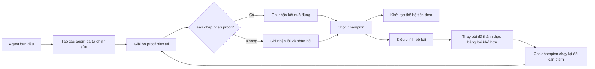

---
cover:
  alt: 'Figure 1: Champion-driven agent–benchmark coevolution. A seed agent produces
    first- generation (G1) children that stream into a shared archive as they are
    evaluated, so a strong early child can already parent later siblings in the same
    generation; the strongest child becomes the champion, seeds the next generation
    (G2), and also drives the benchmark update. Evaluation records from all agents
    are collected. The benchmark is drawn from a candidate problem pool stratified
    by difficulty level (L1: s'
  caption: 'Figure 1: Champion-driven agent–benchmark coevolution. A seed agent produces
    first- generation (G1) children that stream into a shared archive as they are
    evaluated, so a strong early child can already parent later siblings in the same
    generation; the strongest child becomes the champion, seeds the next generation
    (G2), and also drives the benchmark update. Evaluation records from all agents
    are collected. The benchmark is drawn from a candidate problem pool stratified
    by difficulty level (L1: s'
  image: /posts/2026-07-27-when-an-ai-proof-solver-improves-its-exam-gets-harder-too/figures/fig01.png
  relative: false
date: '2026-07-27'
description: Paper này cho một AI agent tự sửa cách làm việc, đồng thời nâng độ khó
  của bộ bài tập theo năng lực mới. Mọi kết quả vẫn phải qua bộ kiểm chứng toán học
  độc lập.
draft_id: 20260803-ad462cf8
item_kind: paper
item_source: linkedin
kol: omarsar
paper:
  abs_url: https://arxiv.org/abs/2607.17352
  abstract: 'Designing effective Lean proof agents is a central challenge in formal
    mathematical reasoning. Beyond building stronger provers, recent work emphasizes
    the workflow around Lean: how an agent decomposes proof obligations, uses tools
    and compiler feedback, diagnoses failures, repairs proofs, and maintains structured
    proof context. Motivated by code-level self-evolving agents, we study whether
    such workflows can be evolved rather than hand-designed. We present a self-evolving
    Lean proof agent in which a small fixed, trusted runtime wraps a fully mutable
    workspace: the proof workflow, prompts, and tools. Unlike most self-evolving systems,
    which optimize against a fixed external benchmark, our system coevolves the agent
    and its benchmark. Between generations, the highest-scoring agent (the champion)
    revises the active task distribution through a mastery-throttled curriculum update
    that introduces harder proof obligations only after the current level is mastered,
    and a single-anchor recalibration re-runs the champion on the updated benchmark
    to keep scores comparable as difficulty rises. All evolution stays inside a Lean-grounded
    verification loop: however the agent rewrites itself, a success counts only when
    its behavior yields Lean-verified proofs under a trusted snapshot, and each attempt
    must emit a machine-readable, Lean-grounded proof context whose representation
    may evolve but whose groundedness is enforced. We run the coevolving trajectory
    and a fixed-benchmark baseline for 15 active generations and compare them on a
    held-out miniF2F test split. The best coevolving agent reaches a 45.1% held-out
    solve rate, versus 12.7% for the seed and 32.0% for the best fixed-benchmark agent,
    showing that verifier-grounded self-evolution can improve Lean proof workflows
    under a coevolving benchmark.'
  arxiv_id: '2607.17352'
  authors:
  - Yuqing Li
  - Zeguan Wu
  - Yu Gan
  - Junyu Liu
  pdf_url: https://arxiv.org/pdf/2607.17352
  published: '2026-07-19'
  title: Self-Modifying Lean Proof Agents with Verifier-Grounded Benchmark Coevolution
reliability:
  authors_orgs: Yuqing Li, Zeguan Wu, Yu Gan, and Junyu Liu; affiliations are not
    provided in the supplied files.
  code_available: false
  evidence: 15 active generations; held-out miniF2F comparison against a seed and
    fixed-benchmark baseline; 2 figures and 3 tables reported.
  venue: arXiv preprint 2607.17352, submitted July 19, 2026.
social:
  author: Elvis S.
  created_at: '2026-07-27'
  text: 'I agree with what this AI paper suggests.

    Self-improving agents should evolve their benchmarks too.

    (bookmark it)

    Self-improving agents are one of the most important directions in AI right now,
    and most of them optimize against a fixed benchmark. This paper argues the benchmark
    should evolve alongside the agent.

    The setup is a self-evolving Lean proof agent. A small trusted runtime wraps a
    fully mutable workspace of workflow, prompts, and tools, so the agent can rewrite
    how it decomposes pro'
source_url: https://www.linkedin.com/in/omarsar/
summary: Paper này cho một AI agent tự sửa cách làm việc, đồng thời nâng độ khó của
  bộ bài tập theo năng lực mới. Mọi kết quả vẫn phải qua bộ kiểm chứng toán học độc
  lập.
tags:
- self-improving agents
- formal verification
- lean
- benchmark coevolution
- theorem proving
- minif2f
title: AI agent chứng minh Lean tự nâng cấp, còn đề bài cũng khó dần
topics:
- ai
- ai/llm
- ai/llm/agents
---

## Ý tưởng chính

Bạn thử hình dung một học sinh tuần nào cũng làm đúng một đề. Điểm cứ tăng, nhưng chưa chắc bạn ấy giỏi toán hơn. Có thể bạn ấy chỉ thuộc đề. AI agent tự cải thiện cũng vướng đúng chuyện đó: nếu benchmark đứng yên, agent rất dễ tối ưu cho riêng bộ câu hỏi quen thuộc.

Nhóm tác giả chọn một môi trường khá đặc biệt để thử cách khác: chứng minh toán học bằng Lean. Agent được phép sửa workflow, prompt và công cụ của chính nó. Đồng thời, bộ bài tập cũng thay đổi theo năng lực mới. Làm tốt bài dễ rồi thì phải chuyển sang bài khó hơn.

Điểm mấu chốt nằm ở “trọng tài”. Agent có thể đổi cách làm, nhưng không thể tự quyết rằng mình đã làm đúng. Lean kiểm tra từng proof và chỉ công nhận kết quả hợp lệ. Nói đơn giản là cả vận động viên lẫn bài tập đều tiến hóa, còn luật thi vẫn khóa chặt.



## Cách hoạt động

Có thể xem hệ thống như một xưởng sửa chữa cạnh một phòng kiểm định niêm phong. Bên trong xưởng, agent tha hồ thay quy trình: chia một theorem thành các phần nhỏ hơn, đọc phản hồi từ compiler, đoán nguyên nhân lỗi rồi thử sửa proof. Nhưng phòng kiểm định—trusted runtime và bản Lean cố định—không được đụng tới.

Mỗi vòng tạo ra nhiều phiên bản agent mới. Tất cả cùng giải bộ bài hiện tại. Proof nào qua Lean thì mới được tính. Phiên bản có điểm cao nhất trở thành champion, rồi làm “bố mẹ” cho thế hệ tiếp theo.

Champion còn tham gia đổi đề. Hệ thống chỉ nâng độ khó khi agent đã thể hiện rằng nó làm chủ mức hiện tại; khi đó, một số bài dễ được thay bằng bài ở tầng khó hơn. Sau khi đổi benchmark, champion chạy lại một lần để tạo mốc so sánh mới. Nhờ vậy, điểm số không bị hiểu sai chỉ vì đề vừa khó lên.

Agent còn phải xuất ra ngữ cảnh proof ở dạng máy đọc được. Cách biểu diễn phần này có thể đổi, nhưng nội dung vẫn phải bám vào trạng thái mà Lean đã kiểm tra. Đây là ranh giới giúp hệ thống tự sửa mình mà không tự sửa luôn thước đo đúng–sai.

## Kết quả

Hai hướng được chạy trong 15 thế hệ hoạt động: một hướng cho benchmark thay đổi cùng agent, hướng còn lại giữ benchmark cố định. Cuối cùng, nhóm tác giả lấy phiên bản tốt nhất và kiểm tra trên phần test miniF2F đã được giữ riêng—các bài toán kiểu thi đấu đã được viết lại dưới dạng formal proof.

| Bộ test giữ riêng | Agent ban đầu | Agent tốt nhất với benchmark cố định | Agent tốt nhất với benchmark đồng tiến hóa |
|---|---:|---:|---:|
| Tỷ lệ giải được miniF2F | 12,7% | 32,0% | **45,1%** |

Tức là nếu có 100 bài chưa từng dùng để chọn agent, phiên bản tốt nhất của hướng coevolution giải được khoảng 45 bài. So với điểm xuất phát, mức tăng là 32,4 điểm phần trăm. So với agent tốt nhất học trên bộ đề cố định, nó vẫn hơn 13,1 điểm.

Đáng chú ý là “giải được” ở đây không phải do agent tự tuyên bố. Lean phải chấp nhận proof. Trong phạm vi thí nghiệm 15 thế hệ này, việc nâng cả năng lực lẫn độ khó của bài tập tạo ra kết quả held-out cao hơn so với chỉ sửa agent.

Phạm vi bằng chứng vẫn khá cụ thể: một test split trong toán học hình thức, nơi câu trả lời có thể được kiểm tra chính xác. Phần tài liệu được cung cấp không có số liệu về độ dao động giữa nhiều lần chạy, khoảng bất định, chi phí compute hay thử nghiệm ở lĩnh vực không có formal checker. Metadata cũng không nêu GitHub repo công khai.

## Thuật ngữ

- **Lean** — Một proof assistant kiểm tra từng bước để xác nhận một chứng minh tuân theo các quy tắc toán học đã được formalize.

## Liên kết

- [Trang arXiv](https://arxiv.org/abs/2607.17352)
- [Bản PDF](https://arxiv.org/pdf/2607.17352)
- GitHub repo: không có trong các file được cung cấp.
- [Bài đăng gốc](https://www.linkedin.com/in/omarsar/)
- Project page: không có trong các file được cung cấp.