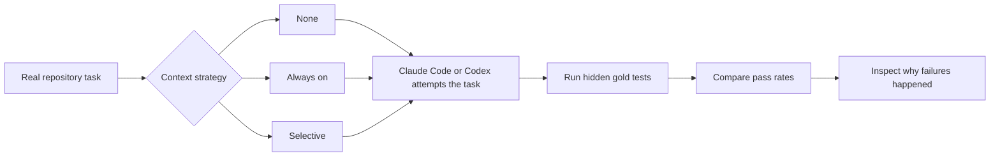
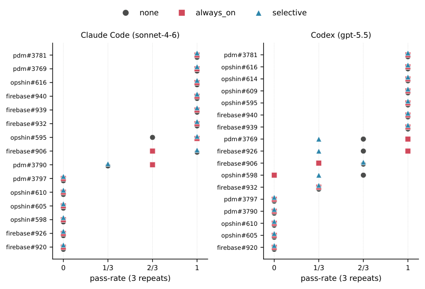

---
cover:
  alt: 'Figure 2: Per-task pass-rate (3 repeats) by injection strategy, one panel
    per agent, tasks ordered by mean pass-rate. For the large majority of tasks the
    NONE/ALWAYS ON/SELECTIVE markers coincide—strategy does not move correctness—and
    tasks sit at the floor (0) or ceiling (1). The markers separate only on the handful
    of borderline tasks, which differ by agent (e.g. pdm#3790 for Claude; pdm#3769,
    firebase#926 for Codex), illustrating the agent- specific difficulty of §4.3.'
  caption: 'Figure 2: Per-task pass-rate (3 repeats) by injection strategy, one panel
    per agent, tasks ordered by mean pass-rate. For the large majority of tasks the
    NONE/ALWAYS ON/SELECTIVE markers coincide—strategy does not move correctness—and
    tasks sit at the floor (0) or ceiling (1). The markers separate only on the handful
    of borderline tasks, which differ by agent (e.g. pdm#3790 for Claude; pdm#3769,
    firebase#926 for Codex), illustrating the agent- specific difficulty of §4.3.'
  image: figures/fig01.png
  relative: true
date: '2026-07-28'
description: A controlled study tested whether repository instruction files help two
  coding agents solve real software tasks. Across 288 runs, changing how those instructions
  were supplied did not measurably improve correctness.
draft_id: 20260803-971ec1a4
item_kind: paper
item_source: linkedin
kol: dair-ai
paper:
  abs_url: https://arxiv.org/abs/2607.27250
  abstract: 'Persistent context files (AGENTS.md, CLAUDE.md) are standard practice
    for guiding AI coding agents, yet evidence for their effectiveness is contradictory.
    We present a controlled ablation of context-injection strategy across two frontier
    agents (Claude Code and Codex), 17 real tasks from 3 repositories (15 shared +
    2 Codex-only), and 288 evaluated runs with gold-test evaluation. Context strategy
    does not measurably move correctness on either agent (bounded to <=10-15pp via
    equivalence testing). A failure-mode triage reveals why: agents fail on implementation
    skill---feature design, pattern selection, exact wiring---not missing repository
    knowledge that a context file could supply; a manipulation probe confirms the
    real AGENTS.md never converts a near-miss to a pass on either agent. We further
    show that borderline task difficulty is agent-specific (Spearman rho=0.75), offering
    a candidate explanation for prior contradictions: single-agent studies draw tasks
    from different agents'' informative bands. We release all code, data, and analysis.'
  arxiv_id: '2607.27250'
  authors:
  - Prakhar Khatri
  pdf_url: https://arxiv.org/pdf/2607.27250
  published: '2026-07-28'
  title: Do Context Files Help Coding Agents? A Two-Agent Ablation Study on Real Repositories
reliability:
  authors_orgs: Prakhar Khatri; affiliation not stated in the supplied files.
  code_available: false
  code_url: ''
  evidence: 288 gold-test evaluated runs across two agents, 17 tasks, and 3 repositories;
    includes failure-mode triage, equivalence testing, and a manipulation probe.
  venue: arXiv preprint 2607.27250, submitted 28 July 2026; cs.SE and cs.AI.
source_url: ''
summary: A controlled study tested whether repository instruction files help two coding
  agents solve real software tasks. Across 288 runs, changing how those instructions
  were supplied did not measurably improve correctness.
tags:
- coding-agents
- repository-context
- agents.md
- claude-code
- codex
- software-engineering
- context-injection
title: Do Repository Rule Files Actually Help Coding Agents?
topics:
- ai
- ai/llm
- ai/llm/agents
---

## The Big Idea

Imagine joining a software project and finding a neat note on the desk: how the codebase is organized, which conventions matter, and what not to touch. Files such as AGENTS.md and CLAUDE.md play that role for coding agents. Teams maintain them because the promise is appealing: explain the local terrain once, and the agent should make fewer expensive mistakes.

But a failed coding task can come from two very different problems. The agent may not know the house rules. Or it may know the rules and still choose the wrong design, copy the wrong pattern, or connect the right pieces incorrectly. A better handbook can fix the first problem. It cannot necessarily fix the second.

This paper isolates that distinction. It runs Claude Code and Codex on real repository tasks while changing only how repository context is supplied: not at all, always, or selectively. The answer is blunt: none of those strategies measurably changed whether the finished code was correct.

## How It Works

The experiment is like testing a recipe card with several cooks. Give one cook no card, another the card every time, and a third the card only under a chosen condition. Keep the kitchen, ingredients, and requested dish fixed. Then judge the plates with the same test.

Here, the “plates” were solutions to 17 tasks from three real repositories. Fifteen tasks were shared by both agents, with two additional Codex-only tasks. Each task-and-strategy combination was repeated three times, producing 288 evaluated runs.

The decisive judge was a set of gold tests: checks written to determine whether the requested behavior actually worked. The author then triaged failures by cause. Finally, a manipulation probe asked an especially practical question: when an attempt came close, did supplying the repository’s real AGENTS.md turn that near-miss into a pass?

## What They Found

Most tasks were not delicately balanced. An agent either solved them almost every time or failed almost every time, whichever context strategy it received. The few middle-ground tasks were different for Claude Code and Codex.

| Agent | No context (baseline) | Always on | Selective |
|---|---:|---:|---:|
| Claude Code | Reference condition | No measurable correctness change | No measurable correctness change |
| Codex | Reference condition | No measurable correctness change | No measurable correctness change |
| Reported bound across strategy comparisons | — | At most 10–15 percentage points | At most 10–15 percentage points |

In plain terms, changing the context strategy did not reliably turn failures into successes. The statistical analysis bounds any missed effect to roughly 10–15 additional passes per 100 attempts, rather than supporting a large hidden benefit.

The failure review gives a reason. Mistakes centered on implementation skill: designing the feature, selecting the right code pattern, and wiring details together exactly. Missing repository facts—the kind of information an instruction file can supply—were not the main obstacle. Consistent with that diagnosis, the real AGENTS.md did not convert a near-miss into a pass for either agent.

There was also substantial agreement in which tasks the two agents found difficult: the reported rank correlation was 0.75, where 1 would mean identical ordering. Yet their borderline tasks were not the same. That matters because a small study using only one agent may accidentally choose tasks sitting in that agent’s narrow “sometimes works” zone and reach a different conclusion.

The evidence covers two agents, 17 tasks, three repositories, and three repeats per condition. It does not establish that context files never help other agents, repositories, or kinds of task. The supplied paper text also does not report author affiliation or a public code URL, although the abstract states that code, data, and analysis were released.

## Glossary

- **Equivalence testing** — a statistical check used to show that any difference is smaller than a chosen practically meaningful limit.

## Links

- [arXiv page](https://arxiv.org/abs/2607.27250)
- [PDF](https://arxiv.org/pdf/2607.27250)