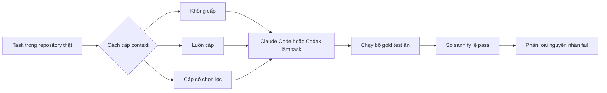

---
cover:
  alt: 'Figure 2: Per-task pass-rate (3 repeats) by injection strategy, one panel
    per agent, tasks ordered by mean pass-rate. For the large majority of tasks the
    NONE/ALWAYS ON/SELECTIVE markers coincide—strategy does not move correctness—and
    tasks sit at the floor (0) or ceiling (1). The markers separate only on the handful
    of borderline tasks, which differ by agent (e.g. pdm#3790 for Claude; pdm#3769,
    firebase#926 for Codex), illustrating the agent- specific difficulty of §4.3.'
  caption: 'Figure 2: Per-task pass-rate (3 repeats) by injection strategy, one panel
    per agent, tasks ordered by mean pass-rate. For the large majority of tasks the
    NONE/ALWAYS ON/SELECTIVE markers coincide—strategy does not move correctness—and
    tasks sit at the floor (0) or ceiling (1). The markers separate only on the handful
    of borderline tasks, which differ by agent (e.g. pdm#3790 for Claude; pdm#3769,
    firebase#926 for Codex), illustrating the agent- specific difficulty of §4.3.'
  image: /posts/2026-07-28-do-repository-rule-files-actually-help-coding-agents/figures/fig01.png
  relative: false
date: '2026-07-28'
description: Một nghiên cứu có kiểm soát thử xem file hướng dẫn của repository có
  giúp hai coding agent xử lý việc thật tốt hơn không. Sau 288 lượt chạy, cách đưa
  những hướng dẫn này vào không tạo ra cải thiện đo được về độ đúng.
draft_id: 20260803-971ec1a4
item_kind: paper
item_source: linkedin
kol: dair-ai
paper:
  abs_url: https://arxiv.org/abs/2607.27250
  abstract: 'Persistent context files (AGENTS.md, CLAUDE.md) are standard practice
    for guiding AI coding agents, yet evidence for their effectiveness is contradictory.
    We present a controlled ablation of context-injection strategy across two frontier
    agents (Claude Code and Codex), 17 real tasks from 3 repositories (15 shared +
    2 Codex-only), and 288 evaluated runs with gold-test evaluation. Context strategy
    does not measurably move correctness on either agent (bounded to <=10-15pp via
    equivalence testing). A failure-mode triage reveals why: agents fail on implementation
    skill---feature design, pattern selection, exact wiring---not missing repository
    knowledge that a context file could supply; a manipulation probe confirms the
    real AGENTS.md never converts a near-miss to a pass on either agent. We further
    show that borderline task difficulty is agent-specific (Spearman rho=0.75), offering
    a candidate explanation for prior contradictions: single-agent studies draw tasks
    from different agents'' informative bands. We release all code, data, and analysis.'
  arxiv_id: '2607.27250'
  authors:
  - Prakhar Khatri
  pdf_url: https://arxiv.org/pdf/2607.27250
  published: '2026-07-28'
  title: Do Context Files Help Coding Agents? A Two-Agent Ablation Study on Real Repositories
reliability:
  authors_orgs: Prakhar Khatri; affiliation not stated in the supplied files.
  code_available: false
  code_url: ''
  evidence: 288 gold-test evaluated runs across two agents, 17 tasks, and 3 repositories;
    includes failure-mode triage, equivalence testing, and a manipulation probe.
  venue: arXiv preprint 2607.27250, submitted 28 July 2026; cs.SE and cs.AI.
source_url: ''
summary: Một nghiên cứu có kiểm soát thử xem file hướng dẫn của repository có giúp
  hai coding agent xử lý việc thật tốt hơn không. Sau 288 lượt chạy, cách đưa những
  hướng dẫn này vào không tạo ra cải thiện đo được về độ đúng.
tags:
- coding-agents
- repository-context
- agents.md
- claude-code
- codex
- software-engineering
- context-injection
title: AGENTS.md có thực sự giúp coding agent làm việc tốt hơn?
topics:
- ai
- ai/llm
- ai/llm/agents
---

## Ý tưởng chính

Bạn vừa giao cho coding agent sửa một repository lạ. Để nó khỏi mò mẫm, team chuẩn bị sẵn AGENTS.md hoặc CLAUDE.md: code nằm đâu, convention nào phải theo, chỗ nào dễ đụng nhầm. Nghe rất hợp lý. Một tờ “nội quy trong nhà” tốt có vẻ như sẽ tiết kiệm kha khá lần sửa sai.

Nhưng thật ra thì biết nội quy chưa chắc đồng nghĩa với làm được việc. Agent có thể đã hiểu cấu trúc repository mà vẫn thiết kế feature sai, chọn nhầm pattern, hoặc nối thiếu đúng một chi tiết quan trọng. Trong trường hợp ấy, viết thêm hướng dẫn cũng giống như đưa bản đồ cho người đã biết đường nhưng chưa đủ tay nghề sửa máy.

Paper này tách riêng đúng câu hỏi đó. Tác giả cho Claude Code và Codex làm task thật, giữ nguyên mọi thứ và chỉ đổi cách cung cấp context: không đưa, luôn đưa, hoặc đưa có chọn lọc. Kết quả: không cách nào làm tỷ lệ code đúng thay đổi ở mức đo được.

## Cách hoạt động

Hãy hình dung một bài thử nấu ăn. Cùng món, cùng nguyên liệu, cùng căn bếp. Điểm khác duy nhất là đầu bếp có nhận tờ hướng dẫn hay không. Thành phẩm sau đó được chấm bằng cùng một bộ tiêu chí, chứ không dựa vào việc nhìn có vẻ ổn.

Nghiên cứu dùng 17 task từ ba repository thật. Claude Code và Codex cùng làm 15 task; Codex làm thêm hai task. Mỗi tổ hợp giữa task và cách cấp context được chạy ba lần. Tổng cộng có 288 lượt được đánh giá.

Code cuối cùng phải vượt qua gold test, tức bộ kiểm tra xác nhận feature có thực sự chạy đúng hay không. Sau đó, tác giả xem từng nhóm lỗi để tìm nguyên nhân. Một probe riêng còn thử câu hỏi rất sát thực tế: nếu agent đã làm gần đúng, AGENTS.md thật của repository có đủ sức đẩy kết quả đó qua vạch pass không?

## Kết quả

Biểu đồ kể câu chuyện khá rõ. Phần lớn task nằm hẳn ở hai đầu: hoặc agent gần như luôn làm được, hoặc gần như luôn thất bại. Ba dấu biểu diễn ba cách cấp context thường chồng lên nhau. Chỉ vài task ở vùng lưng chừng mới dao động, và nhóm task này lại khác nhau giữa hai agent.

| Agent | Không có context (mốc so sánh) | Luôn cấp | Cấp có chọn lọc |
|---|---:|---:|---:|
| Claude Code | Điều kiện gốc | Không có thay đổi đo được về độ đúng | Không có thay đổi đo được về độ đúng |
| Codex | Điều kiện gốc | Không có thay đổi đo được về độ đúng | Không có thay đổi đo được về độ đúng |
| Giới hạn được báo cáo cho các so sánh | — | Tối đa 10–15 điểm phần trăm | Tối đa 10–15 điểm phần trăm |

Nói đơn giản là, đổi cách đưa file hướng dẫn vào không biến các ca fail thành pass một cách ổn định. Phân tích thống kê cho thấy nếu vẫn có hiệu ứng bị bỏ sót, quy mô của nó chỉ nằm trong khoảng tối đa 10–15 lượt pass thêm trên mỗi 100 lần thử, chứ dữ liệu không ủng hộ một lợi ích lớn đang bị che khuất.

Khi mổ xẻ lỗi, tác giả thấy nút thắt chủ yếu nằm ở năng lực triển khai: thiết kế feature, chọn đúng pattern và nối các thành phần thật chính xác. Agent không fail chủ yếu vì thiếu kiến thức về repository. Đáng chú ý là AGENTS.md thật cũng không cứu được bất kỳ ca “suýt đúng” nào thành pass, trên cả hai agent.

Mức độ khó giữa hai agent có tương quan thứ hạng 0,75; nếu hoàn toàn giống nhau thì con số sẽ là 1. Tuy vậy, những task nằm đúng vùng chập chờn “lúc được lúc không” của Claude Code không trùng hẳn với Codex. Vì thế, nghiên cứu chỉ dùng một agent có thể vô tình lấy đúng nhóm task nhạy với agent đó rồi cho ra kết luận khác.

Phạm vi bằng chứng hiện tại là hai agent, 17 task, ba repository và ba lần lặp cho mỗi điều kiện. Kết quả chưa bao phủ mọi agent, mọi codebase hay mọi loại công việc. Phần text được cung cấp cũng không nêu nơi công tác của tác giả hoặc URL code công khai, dù abstract nói rằng code, data và analysis đã được phát hành.

## Thuật ngữ

- **Equivalence testing** — phép kiểm tra thống kê nhằm xác nhận rằng chênh lệch, nếu có, nhỏ hơn một ngưỡng được xem là đáng kể trong thực tế.

## Liên kết

- [Trang arXiv](https://arxiv.org/abs/2607.27250)
- [PDF](https://arxiv.org/pdf/2607.27250)