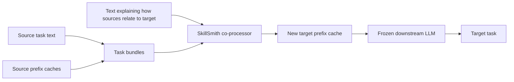
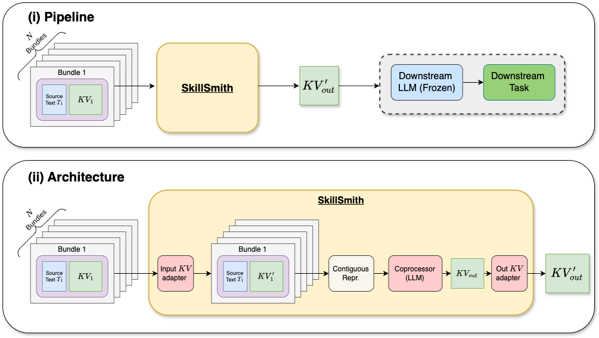
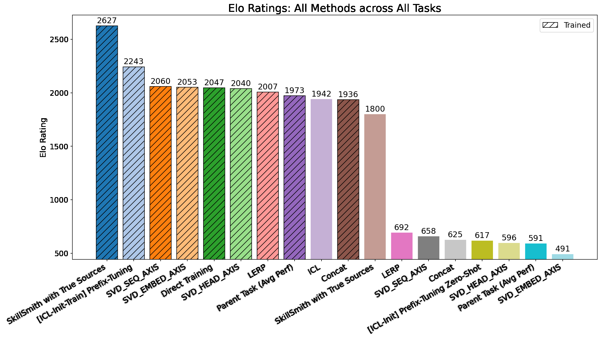
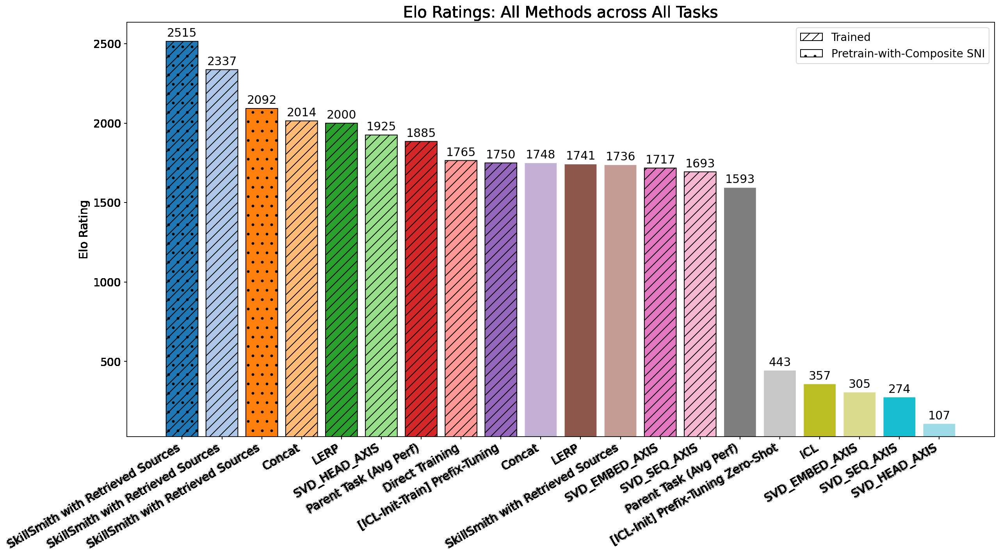

---
cover:
  alt: Figure 1 | High level SkillSmith pipeline (i) and architecture (ii). Source
    task bundles consisting of text and prefix-cache weights – along with text rationales
    of how these task bundles can be synthesized to help the target task – are fed
    as inputs to an augmented LLM to directly generate the prefix-cache that will
    be used to modulate a downstream LLM to the target task.
  caption: Figure 1 | High level SkillSmith pipeline (i) and architecture (ii). Source
    task bundles consisting of text and prefix-cache weights – along with text rationales
    of how these task bundles can be synthesized to help the target task – are fed
    as inputs to an augmented LLM to directly generate the prefix-cache that will
    be used to modulate a downstream LLM to the target task.
  image: figures/fig02.png
  relative: true
date: '2026-07-29'
description: SkillSmith combines written guidance with reusable fragments of learned
  behavior to prepare an AI for a new task—without retraining the whole model.
draft_id: 20260803-496ce59b
item_kind: paper
item_source: linkedin
kol: omarsar
paper:
  abs_url: https://arxiv.org/abs/2607.27497
  abstract: 'Agentic systems driven by large language models (LLMs) regularly feature
    two key mechanisms to autonomously solve complex problems: synthesizing text-based
    knowledge and procedures from past experiences and building parametric (weight-space)
    skill libraries for recurring sub-goals. To date, research has largely treated
    these as orthogonal pursuits: either organizing textual knowledge through composition
    and reflection, or consolidating parametric skills via weight-space merging. Consequently,
    the seamless integration of text and model weights for targeted performance improvements
    remains largely unexplored. This work bridges this modality gap by treating model
    weights as an additional modality that an LLM can natively reason over. We instantiate
    parametric learning via prefix-tuning and augment an LLM to ingest both prefix
    weights and rich textual data which capture relationships to a target capability.
    Our augmented LLM, which we call SkillSmith, synthesizes these inputs to perform
    instruction-steered parametric synthesis, directly outputting new prefix weights
    that manifest the target skill. We demonstrate that our approach significantly
    outperforms both text-only and weight-space-only baselines, unlocking performance
    gains that are out of reach for uni-modal (text-only or weight-only) adaptations.'
  arxiv_id: '2607.27497'
  authors:
  - Lucio M. Dery
  - Benedict Aaron Tjandra
  - Siavash Samiei
  - Adhiguna Kuncoro
  - Zohar Yahav
  - Jiajun Shen
  - Arthur Szlam
  pdf_url: https://arxiv.org/pdf/2607.27497
  published: '2026-07-29'
  title: 'SkillSmith: Learning to Compose Parametric Skills and Textual Knowledge'
reliability:
  authors_orgs: Lucio M. Dery, Benedict Aaron Tjandra, Siavash Samiei, Adhiguna Kuncoro,
    Zohar Yahav, Jiajun Shen, and Arthur Szlam; affiliations are not provided in the
    supplied files.
  code_available: false
  evidence: Comparative Elo evaluations on 15 Composite-SNI, 10 held-out SNI, and
    6 MMLU-ProX tasks.
  venue: arXiv preprint 2607.27497, submitted July 29, 2026.
source_url: ''
summary: SkillSmith combines written guidance with reusable fragments of learned behavior
  to prepare an AI for a new task—without retraining the whole model.
tags:
- skillsmith
- prefix-tuning
- weight-space composition
- skill synthesis
- llm adaptation
title: SkillSmith Forges New LLM Skills from Text and Model Weights
topics:
- ai
- ai/llm
- ai/llm/training
---

## The Big Idea

Imagine a company with a shelf full of specialist playbooks. One explains how to classify customer complaints. Another helps extract dates. A third handles legal-style questions. A new job arrives that needs pieces of all three. Today, an AI team often has two awkward choices: paste more instructions into the prompt, or run another training job to alter the model.

SkillSmith asks whether those two forms of know-how can be mixed directly. Its answer is to let an LLM read both written guidance and small, task-specific fragments of model state, then manufacture a new fragment for the target job. The large downstream model stays frozen.

The everyday analogy is a locksmith. Existing weight fragments are unfinished keys; the text explains which grooves matter for the new lock. SkillSmith does not merely choose a key or glue several together. It learns to cut a new one.

> Skill composition becomes something the system can do at inference time, rather than a fresh training run for every new task.

## How It Works

Each source task becomes a “bundle.” One half is text describing the task. The other is a prefix cache: a compact set of learned values that steers a frozen LLM toward that task.

SkillSmith receives several bundles plus text explaining how the source tasks relate to the target. Adapters convert the weight fragments into a form its internal LLM can process. That co-processor reads the combined sequence and emits a new prefix cache. Attach that cache to the frozen downstream LLM, and the model is steered toward the new task without changing all of its weights.

The important move is not simple averaging. SkillSmith is trained across many examples of task relationships, so it learns how an instruction about composition should translate into a new set of steering values.

## What They Found

The authors evaluate with Elo ratings: methods repeatedly face one another, and a higher score means stronger results across those comparisons. The headline is straightforward. On 15 Composite-SNI tasks, SkillSmith with the correct source tasks reached 2,627 Elo, 384 points above the next method shown. In plain language, it finished clearly first across that collection rather than producing a small tie at the top.

| Evaluation set | Best SkillSmith result | Best non-SkillSmith result shown | Difference |
|---|---:|---:|---:|
| Composite-SNI, 15 tasks | 2,627 | 2,243 | +384 |
| Held-out SNI, 10 tasks | 2,845 | 2,853 | −8 |
| MMLU-ProX, 6 tasks | 2,515 | 2,014 | +501 |

The held-out SNI result is more restrained. A SkillSmith variant scored 2,845, almost level with the 2,853 leader. On MMLU-ProX, the best SkillSmith configuration reached 2,515, ahead of the best non-SkillSmith bar at 2,014.

The strongest Composite-SNI number uses the true source tasks—the helpful ingredients are already known. The figures also test retrieved, noisier sources and report competitive results, which is closer to how a real system would operate. Still, the supplied paper extract does not provide statistical uncertainty, per-task scores, model-size details, or compute costs. The evidence available here is therefore strongest for the comparative rankings across the 15, 10, and 6-task suites, not for claims about production efficiency or universal transfer.

## Glossary

- **Prefix cache** — a small learned block of values attached to a frozen model to steer its behavior without rewriting the whole model.
- **Weight space** — the numerical setting inside a trained model where its learned behavior is stored and can be combined or modified.

## Links

- [arXiv page](https://arxiv.org/abs/2607.27497)
- [PDF](https://arxiv.org/pdf/2607.27497)