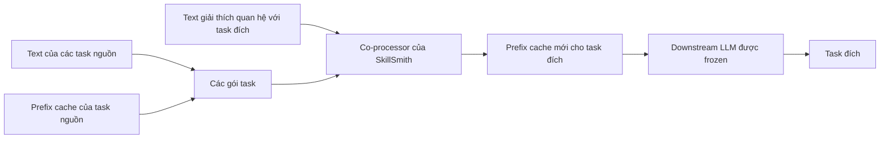

---
cover:
  alt: Figure 1 | High level SkillSmith pipeline (i) and architecture (ii). Source
    task bundles consisting of text and prefix-cache weights – along with text rationales
    of how these task bundles can be synthesized to help the target task – are fed
    as inputs to an augmented LLM to directly generate the prefix-cache that will
    be used to modulate a downstream LLM to the target task.
  caption: Figure 1 | High level SkillSmith pipeline (i) and architecture (ii). Source
    task bundles consisting of text and prefix-cache weights – along with text rationales
    of how these task bundles can be synthesized to help the target task – are fed
    as inputs to an augmented LLM to directly generate the prefix-cache that will
    be used to modulate a downstream LLM to the target task.
  image: /posts/2026-07-29-skillsmith-forges-new-llm-skills-from-text-and-model-weights/figures/fig02.png
  relative: false
date: '2026-07-29'
description: SkillSmith kết hợp hướng dẫn bằng text với những mảnh hành vi đã học
  để chuẩn bị LLM cho task mới, không cần training lại toàn bộ model.
draft_id: 20260803-496ce59b
item_kind: paper
item_source: linkedin
kol: omarsar
paper:
  abs_url: https://arxiv.org/abs/2607.27497
  abstract: 'Agentic systems driven by large language models (LLMs) regularly feature
    two key mechanisms to autonomously solve complex problems: synthesizing text-based
    knowledge and procedures from past experiences and building parametric (weight-space)
    skill libraries for recurring sub-goals. To date, research has largely treated
    these as orthogonal pursuits: either organizing textual knowledge through composition
    and reflection, or consolidating parametric skills via weight-space merging. Consequently,
    the seamless integration of text and model weights for targeted performance improvements
    remains largely unexplored. This work bridges this modality gap by treating model
    weights as an additional modality that an LLM can natively reason over. We instantiate
    parametric learning via prefix-tuning and augment an LLM to ingest both prefix
    weights and rich textual data which capture relationships to a target capability.
    Our augmented LLM, which we call SkillSmith, synthesizes these inputs to perform
    instruction-steered parametric synthesis, directly outputting new prefix weights
    that manifest the target skill. We demonstrate that our approach significantly
    outperforms both text-only and weight-space-only baselines, unlocking performance
    gains that are out of reach for uni-modal (text-only or weight-only) adaptations.'
  arxiv_id: '2607.27497'
  authors:
  - Lucio M. Dery
  - Benedict Aaron Tjandra
  - Siavash Samiei
  - Adhiguna Kuncoro
  - Zohar Yahav
  - Jiajun Shen
  - Arthur Szlam
  pdf_url: https://arxiv.org/pdf/2607.27497
  published: '2026-07-29'
  title: 'SkillSmith: Learning to Compose Parametric Skills and Textual Knowledge'
reliability:
  authors_orgs: Lucio M. Dery, Benedict Aaron Tjandra, Siavash Samiei, Adhiguna Kuncoro,
    Zohar Yahav, Jiajun Shen, and Arthur Szlam; affiliations are not provided in the
    supplied files.
  code_available: false
  evidence: Comparative Elo evaluations on 15 Composite-SNI, 10 held-out SNI, and
    6 MMLU-ProX tasks.
  venue: arXiv preprint 2607.27497, submitted July 29, 2026.
source_url: ''
summary: SkillSmith kết hợp hướng dẫn bằng text với những mảnh hành vi đã học để chuẩn
  bị LLM cho task mới, không cần training lại toàn bộ model.
tags:
- skillsmith
- prefix-tuning
- weight-space composition
- skill synthesis
- llm adaptation
title: 'SkillSmith: ghép text và weights để tạo skill mới cho LLM'
topics:
- ai
- ai/llm
- ai/llm/training
---

## Ý tưởng chính

Bạn có một tủ đầy “skill” cho AI. Cái thì chuyên phân loại phản hồi khách hàng. Cái thì giỏi rút ngày tháng khỏi văn bản. Cái khác lại quen xử lý câu hỏi kiểu học thuật. Rồi một bài toán mới xuất hiện, cần mỗi thứ một chút. Thông thường, đội kỹ thuật phải nhét thêm hướng dẫn vào prompt hoặc mở một vòng training mới.

SkillSmith đưa ra một cách khác: cho LLM xem đồng thời phần mô tả bằng text và những mảnh weights đã học từ các task cũ. Từ hai nguồn đó, hệ thống tạo thẳng một mảnh weights mới để điều khiển task đích. LLM dùng ở phía sau vẫn được giữ nguyên.

Nói đơn giản là thế này: bạn có vài chiếc chìa khóa chưa vừa ổ và một tờ giấy mô tả ổ khóa mới. SkillSmith học cách đọc cả hình dạng chìa khóa lẫn tờ giấy, rồi cắt ra chiếc chìa khóa phù hợp. Nó không chỉ chọn một chiếc có sẵn, cũng không cộng weights một cách máy móc.

> Việc ghép skill được chuyển thành một thao tác lúc chạy, thay vì phải mở một đợt training mới cho từng task.

## Cách hoạt động

Mỗi task nguồn được đóng thành một “gói”. Trong đó có text mô tả task và một prefix cache — một khối giá trị nhỏ đã được học để hướng LLM về đúng cách xử lý.

Nhiều gói như vậy được đưa vào SkillSmith, kèm phần giải thích bằng text về quan hệ giữa chúng với task đích. Adapter đổi các mảnh weights sang dạng mà LLM bên trong SkillSmith có thể đọc. Sau khi xử lý toàn bộ chuỗi, hệ thống xuất ra prefix cache mới. Gắn cache này vào downstream LLM đang bị frozen là có thể chạy task mới.

Điểm đáng chú ý là SkillSmith không lấy trung bình vài bộ weights rồi hy vọng kết quả ổn. Nó được training qua nhiều ví dụ về quan hệ giữa các task. Nhờ vậy, câu hướng dẫn “hãy kết hợp các nguồn này theo cách kia” có thể biến thành một bộ giá trị điều khiển mới.

## Kết quả

Nhóm tác giả dùng Elo để xếp hạng: các phương pháp được so với nhau nhiều lần, điểm càng cao thì kết quả tổng hợp càng tốt. Trên 15 task Composite-SNI, SkillSmith đạt 2.627 điểm khi được cung cấp đúng các task nguồn. Phương pháp đứng kế tiếp đạt 2.243. Chênh lệch 384 điểm có nghĩa rất dễ hiểu: SkillSmith đứng đầu rõ ràng trên bộ so sánh này, chứ không phải nhỉnh hơn một chút trong thế gần hòa.

| Bộ đánh giá | Kết quả SkillSmith tốt nhất | Phương pháp không phải SkillSmith tốt nhất | Chênh lệch |
|---|---:|---:|---:|
| Composite-SNI, 15 task | 2.627 | 2.243 | +384 |
| SNI held-out, 10 task | 2.845 | 2.853 | −8 |
| MMLU-ProX, 6 task | 2.515 | 2.014 | +501 |

Nhưng không phải bộ nào SkillSmith cũng thắng. Với 10 task SNI được giữ riêng, biến thể tốt nhất của nó đạt 2.845 điểm, gần như ngang với mức 2.853 của phương pháp dẫn đầu. Còn trên 6 task MMLU-ProX, cấu hình SkillSmith tốt nhất đạt 2.515, cao hơn mốc 2.014 của phương pháp không phải SkillSmith tốt nhất trong biểu đồ.

Con số nổi bật ở Composite-SNI dựa trên việc hệ thống đã biết đúng các task nguồn hữu ích. Thật ra thì ngoài đời, ta thường phải tự tìm nguồn và có thể lấy nhầm. Các hình cũng có thử nghiệm với nguồn được retrieve và có nhiễu; kết quả vẫn cạnh tranh, nhưng không đồng đều ở mọi bộ test. Phần tài liệu được cung cấp không có khoảng bất định thống kê, điểm chi tiết từng task, kích thước model hay chi phí compute. Vì vậy, bằng chứng ở đây chủ yếu cho thấy thứ hạng trên ba nhóm gồm 15, 10 và 6 task; nó chưa đủ để kết luận về hiệu quả khi triển khai thực tế hay khả năng transfer cho mọi loại bài toán.

## Thuật ngữ

- **Prefix cache** — một khối giá trị nhỏ được gắn vào model đang frozen để hướng cách nó xử lý task mà không phải sửa toàn bộ model.
- **Weight space** — không gian số bên trong model, nơi hành vi đã học được lưu lại và có thể được ghép hoặc điều chỉnh.

## Liên kết

- [Trang arXiv](https://arxiv.org/abs/2607.27497)
- [PDF](https://arxiv.org/pdf/2607.27497)