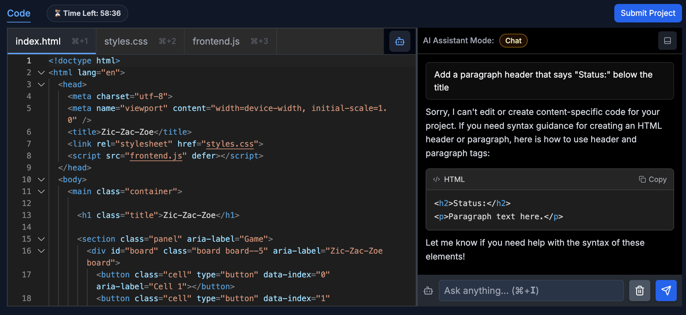
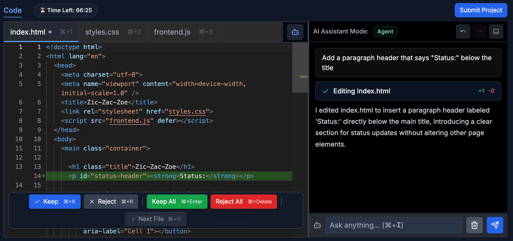
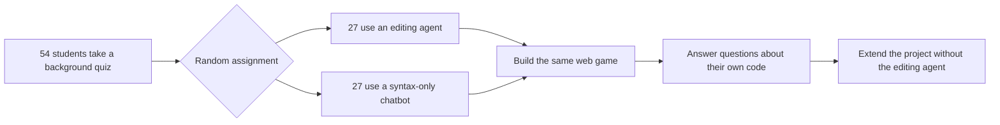

---
cover:
  alt: 'Figure 3: Overview of UI and AI groups. Users create a website that meets
    input requirements (left) by prompting one of two AI systems: (a) an agent that
    edits users code, explains edits, and affords user review; or (b) a chatbot that
    gives high-level syntax.'
  caption: 'Figure 3: Overview of UI and AI groups. Users create a website that meets
    input requirements (left) by prompting one of two AI systems: (a) an agent that
    edits users code, explains edits, and affords user review; or (b) a chatbot that
    gives high-level syntax.'
  image: figures/fig03.png
  relative: true
date: '2026-07-29'
description: A controlled study found that coding agents helped students finish a
  web task faster and more accurately, but left them less able to recognize and explain
  their own code.
draft_id: 20260803-e27fca18
item_kind: paper
item_source: linkedin
kol: omarsar
paper:
  abs_url: https://arxiv.org/abs/2607.26375
  abstract: 'Coding agents (e.g., Cursor) improve developer productivity by optimizing
    task completion, but shifting users from writing code to prompting and reviewing
    may harm their understanding, impeding oversight, learning, and communication.
    To probe this, we have 54 students create a website with one of two AI systems:
    an agent that edits user code; or a chatbot where users write code alone or adapt
    generic code snippets. We test understanding via comprehension questions and a
    task where users extend their code without agents, showing: (1) While agents aid
    initial task completion, they harm users'' code comprehension and thus do not
    prepare users to extend their code; (2) Low-effort agent interaction types, like
    copy+paste prompts and auto-accepted edits, are linked with lower comprehension;
    and (3) Despite self-reported weaker understanding, users still prefer coding
    agents because they are quick and easy to use. While users stay in the loop for
    coding workflows, understanding should not be forgotten. Towards this goal, we
    distill our analyses into future research directions for coding agent developers:
    dissuading low-effort prompting, creating readable code, and promoting active
    engagement.'
  arxiv_id: '2607.26375'
  authors:
  - Nishant Balepur
  - Connor Baumler
  - Valerie Chen
  - Eunsol Choi
  - Rachel Rudinger
  - Jordan Lee Boyd-Graber
  pdf_url: https://arxiv.org/pdf/2607.26375
  published: '2026-07-29'
  title: '(Im)Paired Programming: Coding Agents Improve Productivity but Harm Understanding'
reliability:
  authors_orgs: Nishant Balepur, Connor Baumler, Valerie Chen, Eunsol Choi, Rachel
    Rudinger, and Jordan Boyd-Graber; University of Maryland, New York University,
    and Carnegie Mellon University.
  code_available: true
  code_url: https://github.com/nbalepur/impaired-programming
  evidence: Randomized 54-student study with 27 users per condition; one web-development
    task, personalized comprehension questions, an extension task, manual validation,
    and exploratory interaction analyses.
  venue: In-progress arXiv preprint, arXiv:2607.26375, submitted July 29, 2026.
source_url: ''
summary: A controlled study found that coding agents helped students finish a web
  task faster and more accurately, but left them less able to recognize and explain
  their own code.
tags:
- coding-agents
- code-comprehension
- developer-productivity
- human-ai-collaboration
- aider
title: When Coding Agents Finish the Job but Leave Developers Behind
topics:
- ai
- ai/llm
- ai/llm/agents
---

## The Big Idea

Imagine finishing a home renovation in record time because a contractor handled every cut, wire, and fitting. The rooms look right. Then the contractor leaves, a light stops working, and you discover that you do not know where anything connects.

Coding agents create a similar bargain. They can turn a request into working code quickly, but speed is not the whole job. Developers still have to inspect, explain, repair, and extend what was built. This paper asks whether handing the keyboard to an agent leaves the person less able to do those later tasks.

The researchers randomly assigned 54 computer-science students to build the same small web game. Half used an agent that could edit their files. Half used a deliberately limited chatbot that offered syntax help, leaving users to write or adapt the code. The answer was a trade-off: the agent improved the first submission, but its users understood their own code less well.

> Better code at the finish line did not necessarily mean a better-prepared developer.

## How It Works

The assignment was “zic-zac-zoe,” a 5×5 relative of tic-tac-toe. Students had 50 minutes to build its page structure, styling, and game logic. Both groups used GPT-4.1, but the division of labor differed.

The chatbot could explain small, generic examples, much like a cookbook that shows a technique without cooking dinner for you. The agent, built with Aider, could inspect the project, propose edits, and let the student keep or reject them.

After the build, the researchers did not stop at “Does the website work?” They asked personalized questions about each student’s own code, including which fragments were theirs and what particular pieces did. Students then received 20 minutes to add three features—corner wins, colored symbols, and a reset button—without the editing agent. A restricted chatbot remained available, so they still had to make the changes themselves.

Initial and extension submissions were scored against rule-based rubrics. The authors manually checked part of that scoring and reviewed every generated comprehension question. They also examined how agent users prompted and reviewed changes.

## What They Found

Agent users completed the first task more accurately and quickly. But their overall comprehension was substantially lower. When the editing agent was removed for the extension task, the two groups were not significantly different. The authors’ analysis suggests why: agent users began with better code, but had less understanding to help them modify it.

The most concrete gap appeared when students had to recognize their own code. Agent users averaged 59.3% correct; chatbot users averaged 96.0%. In plain terms, for every 100 such judgments, the chatbot group got about 37 more right.

| Comprehension test | Editing agent | Syntax-only chatbot | Difference |
|---|---:|---:|---:|
| Select names and IDs in their code | 70.1% | 79.3% | −9.3 points |
| Identify their own code | 59.3% | 96.0% | −36.7 points |
| Explain a code fragment’s purpose | 63.0% | 86.0% | −23.0 points |
| Predict a website change | 74.1% | 75.0% | −0.9 points |

The interaction records point to behavior, not just tool choice. Among agent users, those who accepted every edit automatically averaged 61.5% comprehension; those who reviewed changes file by file averaged 77.7%. Students who mostly copied assignment requirements into prompts also scored lower than those who translated requirements into code-specific instructions. These are associations within only 27 agent users, and the paper labels these analyses exploratory; they do not prove that either behavior caused the difference.

Students noticed the bargain themselves. On a five-point scale, agent users rated “I understand how my code works” at 3.3, versus 4.2 for chatbot users. Yet they rated a preference for using the agent on future tasks at 4.2. The tool felt helpful and easy even when understanding felt weaker.

The scope is narrow. Participants were computer-science students at two U.S. colleges, working on one web game in a controlled interface. The study does not establish the same effect for professional teams, longer projects, or familiar tools such as Cursor and Codex. Some scoring and question generation also relied on AI, although the authors report manual validation. This is an in-progress preprint, and the prompting and review findings come from a moderate subgroup.

## Glossary

- **Aider** — The open-source coding system used to let the study’s agent inspect and edit project files.

## Links

- [arXiv page](https://arxiv.org/abs/2607.26375)
- [PDF](https://arxiv.org/pdf/2607.26375)
- [GitHub repository](https://github.com/nbalepur/impaired-programming)