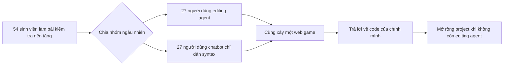

---
cover:
  alt: 'Figure 3: Overview of UI and AI groups. Users create a website that meets
    input requirements (left) by prompting one of two AI systems: (a) an agent that
    edits users code, explains edits, and affords user review; or (b) a chatbot that
    gives high-level syntax.'
  caption: 'Figure 3: Overview of UI and AI groups. Users create a website that meets
    input requirements (left) by prompting one of two AI systems: (a) an agent that
    edits users code, explains edits, and affords user review; or (b) a chatbot that
    gives high-level syntax.'
  image: /posts/2026-07-29-when-coding-agents-finish-the-job-but-leave-developers-behin/figures/fig03.png
  relative: false
date: '2026-07-29'
description: Một nghiên cứu có đối chứng cho thấy coding agent giúp sinh viên hoàn
  thành bài web nhanh và đúng hơn, nhưng khiến họ khó nhận ra và giải thích code của
  chính mình.
draft_id: 20260803-e27fca18
item_kind: paper
item_source: linkedin
kol: omarsar
paper:
  abs_url: https://arxiv.org/abs/2607.26375
  abstract: 'Coding agents (e.g., Cursor) improve developer productivity by optimizing
    task completion, but shifting users from writing code to prompting and reviewing
    may harm their understanding, impeding oversight, learning, and communication.
    To probe this, we have 54 students create a website with one of two AI systems:
    an agent that edits user code; or a chatbot where users write code alone or adapt
    generic code snippets. We test understanding via comprehension questions and a
    task where users extend their code without agents, showing: (1) While agents aid
    initial task completion, they harm users'' code comprehension and thus do not
    prepare users to extend their code; (2) Low-effort agent interaction types, like
    copy+paste prompts and auto-accepted edits, are linked with lower comprehension;
    and (3) Despite self-reported weaker understanding, users still prefer coding
    agents because they are quick and easy to use. While users stay in the loop for
    coding workflows, understanding should not be forgotten. Towards this goal, we
    distill our analyses into future research directions for coding agent developers:
    dissuading low-effort prompting, creating readable code, and promoting active
    engagement.'
  arxiv_id: '2607.26375'
  authors:
  - Nishant Balepur
  - Connor Baumler
  - Valerie Chen
  - Eunsol Choi
  - Rachel Rudinger
  - Jordan Lee Boyd-Graber
  pdf_url: https://arxiv.org/pdf/2607.26375
  published: '2026-07-29'
  title: '(Im)Paired Programming: Coding Agents Improve Productivity but Harm Understanding'
reliability:
  authors_orgs: Nishant Balepur, Connor Baumler, Valerie Chen, Eunsol Choi, Rachel
    Rudinger, and Jordan Boyd-Graber; University of Maryland, New York University,
    and Carnegie Mellon University.
  code_available: true
  code_url: https://github.com/nbalepur/impaired-programming
  evidence: Randomized 54-student study with 27 users per condition; one web-development
    task, personalized comprehension questions, an extension task, manual validation,
    and exploratory interaction analyses.
  venue: In-progress arXiv preprint, arXiv:2607.26375, submitted July 29, 2026.
source_url: ''
summary: Một nghiên cứu có đối chứng cho thấy coding agent giúp sinh viên hoàn thành
  bài web nhanh và đúng hơn, nhưng khiến họ khó nhận ra và giải thích code của chính
  mình.
tags:
- coding-agents
- code-comprehension
- developer-productivity
- human-ai-collaboration
- aider
title: Khi coding agent làm xong việc nhưng developer không theo kịp
topics:
- ai
- ai/llm
- ai/llm/agents
---

## Ý tưởng chính

Bạn nhờ một người lắp trọn bộ tủ bếp. Chưa đến chiều mọi thứ đã xong, nhìn rất đẹp. Nhưng vài hôm sau một cánh tủ bị lệch, và bạn không biết con ốc nào giữ phần nào. Với coding agent, chuyện tương tự có thể xảy ra: sản phẩm chạy được, còn người đứng tên làm ra nó lại không nắm rõ bên trong.

Đó là bài toán của nghiên cứu này. Code xong nhanh chưa đủ. Người viết còn phải kiểm tra lỗi, giải thích cho đồng đội, rồi sửa tiếp khi yêu cầu đổi. Nhóm tác giả muốn biết: nếu agent cầm phần lớn “tay lái”, developer có còn hiểu code của chính mình không?

Họ chia ngẫu nhiên 54 sinh viên ngành computer science thành hai nhóm. Một nhóm dùng agent có quyền sửa file. Nhóm kia chỉ có chatbot hướng dẫn syntax, nên vẫn phải tự gõ hoặc tự chỉnh snippet. Kết quả khá rõ: agent giúp bài đầu chạy tốt hơn, nhưng người dùng lại hiểu code kém hơn.

> Code tốt hơn ở lần nộp đầu không đồng nghĩa người làm ra nó đã sẵn sàng cho lần sửa tiếp theo.

## Cách hoạt động

Bài thi là “zic-zac-zoe”, một biến thể 5×5 của tic-tac-toe. Trong 50 phút, mỗi bạn phải làm giao diện, CSS và logic trò chơi. Cả hai công cụ đều dùng GPT-4.1. Điểm khác nằm ở việc ai thực sự viết code.

Chatbot giống người đưa bạn công thức mẫu: chỉ vài dòng chung chung, không đọc project và cũng không làm hộ cả món. Agent dùng Aider thì khác. Nó xem được codebase, tạo bản sửa, rồi chờ người dùng bấm giữ hoặc từ chối.

Sau khi nộp website, các bạn chưa được “tan ca”. Hệ thống tạo câu hỏi riêng dựa trên đúng code của từng người: đoạn nào là code của bạn, đoạn này dùng để làm gì, đổi nó thì website sẽ ra sao. Tiếp đó là 20 phút thêm ba tính năng: thắng bằng bốn góc, tô màu ký hiệu và nút reset. Lúc này editing agent bị rút đi. Mọi người chỉ còn chatbot giới hạn và phải tự tay chỉnh file.

Website ở cả hai vòng được chấm theo rubric gồm các yêu cầu nhỏ. Tác giả kiểm tra thủ công một phần kết quả chấm và toàn bộ câu hỏi comprehension do AI tạo. Log thao tác cũng được phân tích để xem người dùng prompt và duyệt thay đổi theo kiểu nào.

## Kết quả

Ở vòng đầu, nhóm agent làm nhanh và đúng yêu cầu hơn. Nhưng đến phần hiểu code, họ tụt lại rõ rệt. Sang bài mở rộng, chênh lệch giữa hai nhóm không còn có ý nghĩa thống kê. Nói đơn giản là nhóm agent mang theo một codebase tốt hơn, nhưng phần hiểu biết để tiếp tục sửa nó lại yếu hơn.

Con số nổi bật nhất nằm ở câu hỏi nhận ra code của chính mình. Nhóm agent đạt 59,3%; nhóm chatbot đạt 96,0%. Nếu có 100 lượt nhận diện như vậy, nhóm phải tự viết code sẽ trả lời đúng nhiều hơn khoảng 37 lượt.

| Bài kiểm tra comprehension | Editing agent | Chatbot chỉ dẫn syntax | Chênh lệch |
|---|---:|---:|---:|
| Chọn đúng tên và ID có trong code | 70,1% | 79,3% | −9,3 điểm |
| Nhận ra code của chính mình | 59,3% | 96,0% | −36,7 điểm |
| Nêu mục đích của một đoạn code | 63,0% | 86,0% | −23,0 điểm |
| Đoán website thay đổi thế nào | 74,1% | 75,0% | −0,9 điểm |

Cách dùng agent cũng đi cùng mức hiểu khác nhau. Những người bấm nhận toàn bộ thay đổi tự động có điểm comprehension trung bình 61,5%. Người xem từng file rồi mới duyệt đạt 77,7%. Tương tự, kiểu copy nguyên yêu cầu bài tập vào prompt đi cùng điểm thấp hơn kiểu diễn đạt yêu cầu bằng chi tiết code. Tuy vậy, đây chỉ là tương quan trong nhóm 27 người dùng agent. Chính paper cũng gọi phần này là phân tích thăm dò, nên chưa thể nói thao tác nào trực tiếp gây ra kết quả.

Đáng chú ý là người tham gia cảm nhận được vấn đề. Với thang 5 điểm, câu “Tôi hiểu code của mình hoạt động thế nào” được nhóm agent chấm 3,3; nhóm chatbot chấm 4,2. Thế nhưng mức muốn dùng agent cho bài sau của nhóm agent vẫn là 4,2. Nhanh và tiện vẫn rất hấp dẫn, kể cả khi người dùng biết mình đang hiểu ít hơn.

Giới hạn của nghiên cứu khá cụ thể. Mẫu chỉ gồm sinh viên computer science ở hai trường tại Mỹ. Họ làm một web game trong giao diện được kiểm soát, không phải project dài ngày của một team chuyên nghiệp. Kết quả vì thế chưa thể áp thẳng sang Cursor, Codex hay mọi workflow ngoài đời. Việc chấm bài và tạo câu hỏi có dùng AI, dù tác giả đã kiểm tra thủ công. Đây cũng mới là preprint đang hoàn thiện; các kết luận về cách prompt và review dựa trên một nhóm nhỏ.

## Thuật ngữ

- **Aider** — Hệ thống coding open source được dùng để agent trong nghiên cứu đọc và sửa các file của project.

## Liên kết

- [Trang arXiv](https://arxiv.org/abs/2607.26375)
- [PDF](https://arxiv.org/pdf/2607.26375)
- [GitHub repository](https://github.com/nbalepur/impaired-programming)