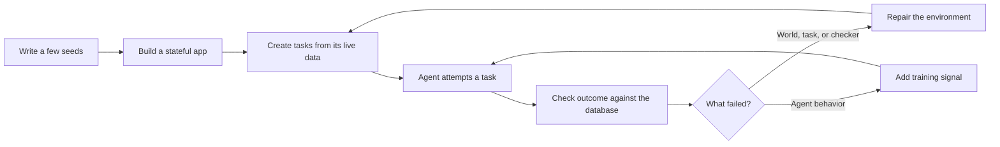
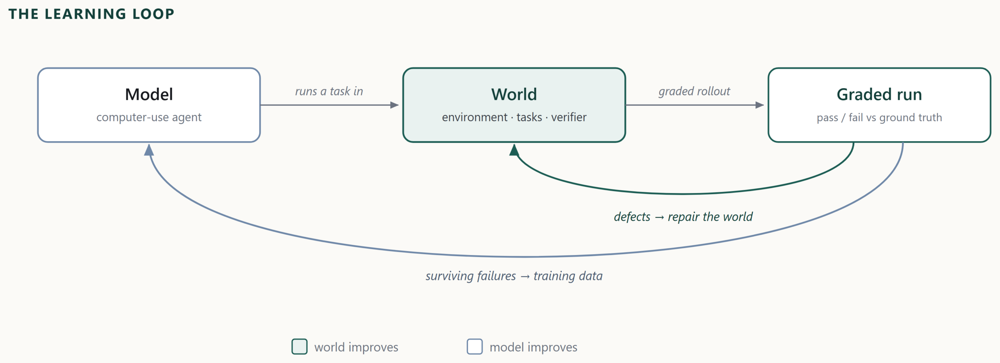

---
cover:
  alt: 'Figure 1: The learning loop. Every graded run is read twice. Failures that
    survive triage become model training data; defects in the environment, its tasks
    or its verifier become repairs. The same graded run that measures the model also
    sharpens the world.'
  caption: 'Figure 1: The learning loop. Every graded run is read twice. Failures
    that survive triage become model training data; defects in the environment, its
    tasks or its verifier become repairs. The same graded run that measures the model
    also sharpens the world.'
  image: figures/fig01.png
  relative: true
date: '2026-07-30'
description: Echoverse builds realistic practice apps that improve alongside the AI
  agents using them. A 9B model rose from 36.5% to 67.1% across 14 evaluation splits.
draft_id: 20260803-6620891c
item_kind: paper
item_source: linkedin
kol: omarsar
paper:
  abs_url: https://arxiv.org/abs/2607.28074
  abstract: 'Computer-use agents learn from what their actions change, so training
    one needs applications it can act on, break and reset. The applications that matter
    most are login-gated and stateful, so synthetic environments stand in for them.
    Recent pipelines generate such environments in bulk, which moves the bottleneck
    from how many exist to what is inside each one. The returns, we find, come from
    three properties: how much behavioural depth an environment carries, whether it
    targets the interaction an agent actually fails, and whether it improves alongside
    the model. We present Echoverse, which compiles specifications into stateful applications
    whose tasks are graded against the application''s own database, and a co-evolution
    loop that reads every graded rollout twice: as repairs to the environment, its
    tasks and its verifier, and as training signal for the model. Trained on twelve
    such environments, a 9B model improves from $36.5\%$ to $67.1\%$ across fourteen
    evaluation splits, within fourteen points of the much larger frontier model that
    taught it. We examine each property in turn. On the same domains, shallow environments
    push live-site accuracy below the base model ($80.0 \to 75.0$) while deep ones
    raise it ($80.0 \to 85.0$ and $48.0 \to 65.0$); drilling one interface control
    across many renderings transfers to held-out widget families and to the open web;
    and repairing a single environment lifts the model trained on it from $16.2\%$
    to $38.5\%$. The same worlds serve as reinforcement-learning environments, where
    a reward combining the grounded verifier with a dense per-step judge raises held-out
    score from $58.8\%$ to $68.0\%$. We release four environments as a benchmark,
    with their applications, seed data and grounded graders. Code: https://aka.ms/echoverse'
  arxiv_id: '2607.28074'
  authors:
  - Yash Pandya
  - Sahil Gupta
  - Sarthak Harne
  - Archana Yadav
  - Kavyansh Chourasia
  - Hussein Mozannar
  - Vibhav Vineet
  - Sara Abdali
  - Corby Rosset
  - Yash Lara
  - Ahmed Awadallah
  - Ece Kamar
  - Akshay Nambi
  pdf_url: https://arxiv.org/pdf/2607.28074
  published: '2026-07-30'
  title: 'Echoverse: Deep, Evolving Environments for Training Computer-Use Agents
    at Scale'
reliability:
  authors_orgs: Yash Pandya and 12 coauthors; affiliations are not listed in the provided
    text.
  code_available: true
  code_url: https://github.com/microsoft/Echoverse
  evidence: 12 training environments, 14 evaluation splits, shallow/deep comparisons,
    environment repair test, and reinforcement-learning result reported.
  venue: arXiv preprint 2607.28074, submitted 30 July 2026.
source_url: ''
summary: Echoverse builds realistic practice apps that improve alongside the AI agents
  using them. A 9B model rose from 36.5% to 67.1% across 14 evaluation splits.
tags:
- computer-use agents
- synthetic environments
- stateful applications
- reinforcement learning
- grounded evaluation
- agent training
title: Echoverse Trains Computer-Use Agents by Improving Their Practice Worlds
topics:
- ai
- ai/llm
- ai/llm/agents
---

## The Big Idea

Imagine teaching a new assistant to handle your online banking. It must find the right account, schedule a transfer, and confirm that the balance really changed. Letting a trainee loose on a live bank account would be reckless. A fake website is safer—but if it is only a painted backdrop, the assistant learns to click through a toy, not to complete real work.

That is the problem Echoverse attacks. Computer-use agents need practice applications with logins, changing data, and consequences that persist after a click. Echoverse builds those stateful practice worlds, checks outcomes against their databases, and improves both the agent and its training world whenever something goes wrong.

The broader lesson is useful beyond AI research: more simulations are not necessarily better. The paper reports that shallow copies can make an agent worse on live sites, while deeper environments can improve it.

## How It Works

Think of Echoverse as a flight simulator whose mechanics inspect both the pilot and the simulator after every failed landing.

First, a few hand-written seeds are expanded into a specification for an application. The system generates the database, backend, and interface, then checks machine-testable claims about how they should behave. Next it creates tasks tied to the live data inside that application. Success is judged against the application's own database, not merely by whether the screen looks plausible.

An agent then attempts those tasks. Each graded attempt goes through triage. If the application, task, or checker is defective, Echoverse repairs the practice world. If the failure is genuinely the agent's, it becomes training material. The loop repeats as both sides improve.

> Every graded run is read twice.

Echoverse also varies one troublesome interface control across many visual forms. That is like practicing the same driving maneuver on different roads: the aim is to learn the underlying action, not memorize one screen. The same environments can also support reinforcement learning, with a database-backed final score plus step-by-step feedback.

## What They Found

The headline experiment trained a 9B model on 12 environments and evaluated it across 14 splits. Its score rose from 36.5% to 67.1%—an improvement of 30.6 percentage points. In plain terms, roughly three more tasks out of every ten were completed successfully.

| Evaluation | Starting model or setup | Echoverse result | Change |
|---|---:|---:|---:|
| 14 evaluation splits, 12 training environments | 36.5% | 67.1% | +30.6 points |
| Live-site accuracy, shallow environment | 80.0% | 75.0% | −5.0 points |
| Live-site accuracy, deep environment, comparison 1 | 80.0% | 85.0% | +5.0 points |
| Live-site accuracy, deep environment, comparison 2 | 48.0% | 65.0% | +17.0 points |
| Model trained on one repaired environment | 16.2% | 38.5% | +22.3 points |
| Held-out score with reinforcement learning | 58.8% | 68.0% | +9.2 points |

The 67.1% result remained within 14 points of the much larger frontier model that supplied teaching data. The paper also reports transfer from repeated practice on one interface control to unseen widget families and the open web, though the available text does not provide the corresponding numbers.

The evidence supplied here is the paper's abstract rather than its full experimental sections, so details such as uncertainty ranges and per-split results are unavailable. The reported tests nevertheless separate several factors: shallow versus deep worlds, repair of one environment, targeted interface practice, and reinforcement learning. Four environments are released as a benchmark with applications, seed data, and database-backed graders.

## Glossary

- **Grounded verifier** — a checker that decides success from the application's underlying data rather than from appearances alone.

## Links

- [arXiv page](https://arxiv.org/abs/2607.28074)
- [PDF](https://arxiv.org/pdf/2607.28074)
- [Code and project resources](https://aka.ms/echoverse)