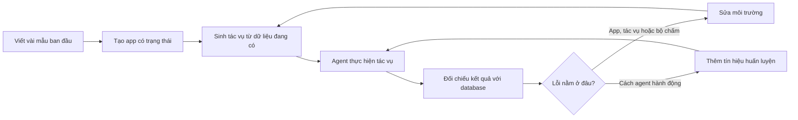

---
cover:
  alt: 'Figure 1: The learning loop. Every graded run is read twice. Failures that
    survive triage become model training data; defects in the environment, its tasks
    or its verifier become repairs. The same graded run that measures the model also
    sharpens the world.'
  caption: 'Figure 1: The learning loop. Every graded run is read twice. Failures
    that survive triage become model training data; defects in the environment, its
    tasks or its verifier become repairs. The same graded run that measures the model
    also sharpens the world.'
  image: /posts/2026-07-30-echoverse-trains-computer-use-agents-by-improving-their-prac/figures/fig01.png
  relative: false
date: '2026-07-30'
description: Echoverse tạo các app mô phỏng có dữ liệu thật bên dưới và sửa chúng
  cùng lúc với việc huấn luyện agent. Model 9B tăng điểm từ 36,5% lên 67,1% trên 14
  tập đánh giá.
draft_id: 20260803-6620891c
item_kind: paper
item_source: linkedin
kol: omarsar
paper:
  abs_url: https://arxiv.org/abs/2607.28074
  abstract: 'Computer-use agents learn from what their actions change, so training
    one needs applications it can act on, break and reset. The applications that matter
    most are login-gated and stateful, so synthetic environments stand in for them.
    Recent pipelines generate such environments in bulk, which moves the bottleneck
    from how many exist to what is inside each one. The returns, we find, come from
    three properties: how much behavioural depth an environment carries, whether it
    targets the interaction an agent actually fails, and whether it improves alongside
    the model. We present Echoverse, which compiles specifications into stateful applications
    whose tasks are graded against the application''s own database, and a co-evolution
    loop that reads every graded rollout twice: as repairs to the environment, its
    tasks and its verifier, and as training signal for the model. Trained on twelve
    such environments, a 9B model improves from $36.5\%$ to $67.1\%$ across fourteen
    evaluation splits, within fourteen points of the much larger frontier model that
    taught it. We examine each property in turn. On the same domains, shallow environments
    push live-site accuracy below the base model ($80.0 \to 75.0$) while deep ones
    raise it ($80.0 \to 85.0$ and $48.0 \to 65.0$); drilling one interface control
    across many renderings transfers to held-out widget families and to the open web;
    and repairing a single environment lifts the model trained on it from $16.2\%$
    to $38.5\%$. The same worlds serve as reinforcement-learning environments, where
    a reward combining the grounded verifier with a dense per-step judge raises held-out
    score from $58.8\%$ to $68.0\%$. We release four environments as a benchmark,
    with their applications, seed data and grounded graders. Code: https://aka.ms/echoverse'
  arxiv_id: '2607.28074'
  authors:
  - Yash Pandya
  - Sahil Gupta
  - Sarthak Harne
  - Archana Yadav
  - Kavyansh Chourasia
  - Hussein Mozannar
  - Vibhav Vineet
  - Sara Abdali
  - Corby Rosset
  - Yash Lara
  - Ahmed Awadallah
  - Ece Kamar
  - Akshay Nambi
  pdf_url: https://arxiv.org/pdf/2607.28074
  published: '2026-07-30'
  title: 'Echoverse: Deep, Evolving Environments for Training Computer-Use Agents
    at Scale'
reliability:
  authors_orgs: Yash Pandya and 12 coauthors; affiliations are not listed in the provided
    text.
  code_available: true
  code_url: https://github.com/microsoft/Echoverse
  evidence: 12 training environments, 14 evaluation splits, shallow/deep comparisons,
    environment repair test, and reinforcement-learning result reported.
  venue: arXiv preprint 2607.28074, submitted 30 July 2026.
source_url: ''
summary: Echoverse tạo các app mô phỏng có dữ liệu thật bên dưới và sửa chúng cùng
  lúc với việc huấn luyện agent. Model 9B tăng điểm từ 36,5% lên 67,1% trên 14 tập
  đánh giá.
tags:
- computer-use agents
- synthetic environments
- stateful applications
- reinforcement learning
- grounded evaluation
- agent training
title: 'Echoverse: cho AI agent luyện tập trong những app biết tự cải thiện'
topics:
- ai
- ai/llm
- ai/llm/agents
---

## Ý tưởng chính

Bạn muốn dạy một AI agent chuyển tiền trong app ngân hàng. Cho nó thử trên tài khoản thật thì quá rủi ro. Dựng một trang web giả lại dễ rơi vào cảnh “sân khấu bằng bìa”: nút bấm trông đúng, nhưng phía sau chẳng có số dư, lịch chuyển tiền hay dữ liệu nào thật sự thay đổi.

Echoverse chọn cách dựng hẳn một thế giới tập luyện có trạng thái. App có database, có backend, có tác vụ và có cách kiểm tra kết quả. Mỗi lần agent làm sai, hệ thống không chỉ hỏi “agent cần học gì?” mà còn hỏi “môi trường tập có bị lỗi không?”.

Điểm đáng chú ý là số lượng app giả không phải yếu tố quyết định. Theo kết quả được báo cáo, môi trường nông thậm chí làm khả năng chạy trên website thật giảm xuống. Môi trường đủ sâu thì cho chiều hướng ngược lại.

## Cách hoạt động

Hãy hình dung một buồng lái mô phỏng. Sau mỗi cú hạ cánh hỏng, đội kỹ thuật kiểm tra cả phi công lẫn chiếc máy mô phỏng. Echoverse làm gần giống vậy.

Từ vài mẫu do con người viết, hệ thống mở rộng thành đặc tả rồi tạo cả app: database, backend và giao diện. Các thành phần này phải vượt qua những kiểm tra có thể chạy tự động. Sau đó, tác vụ được gắn với dữ liệu đang thực sự nằm trong app. Nói đơn giản là, nếu đề bài yêu cầu chuyển tiền thì người chấm nhìn vào database xem giao dịch có xảy ra không, chứ không chỉ nhìn màn hình.

Agent bắt đầu thao tác. Mỗi kết quả được phân loại. Nếu app, đề bài hoặc bộ chấm có lỗi, Echoverse sửa môi trường. Nếu lỗi đúng là của agent, lần thất bại đó trở thành tín hiệu huấn luyện. Rồi vòng lặp chạy tiếp.

> Mỗi lần chạy đã chấm điểm được đọc theo hai cách.

Echoverse còn cho agent luyện cùng một kiểu điều khiển giao diện dưới nhiều hình thức khác nhau. Giống như bạn tập đỗ xe ở nhiều bãi thay vì học thuộc một ô duy nhất. Mục tiêu là hiểu thao tác, không phải nhớ vị trí của một nút. Những thế giới này cũng dùng được cho reinforcement learning, kết hợp điểm cuối dựa trên database với nhận xét ở từng bước.

## Kết quả

Thí nghiệm chính dùng 12 môi trường để huấn luyện một model 9B, rồi đánh giá trên 14 tập chia. Điểm tăng từ 36,5% lên 67,1%, tức thêm 30,6 điểm phần trăm. Hiểu nôm na: cứ 10 tác vụ thì agent hoàn thành thêm khoảng 3 tác vụ.

| Phép đánh giá | Model hoặc thiết lập ban đầu | Kết quả với Echoverse | Mức thay đổi |
|---|---:|---:|---:|
| 14 tập đánh giá, 12 môi trường huấn luyện | 36,5% | 67,1% | +30,6 điểm |
| Độ chính xác trên website thật, môi trường nông | 80,0% | 75,0% | −5,0 điểm |
| Độ chính xác trên website thật, môi trường sâu, so sánh 1 | 80,0% | 85,0% | +5,0 điểm |
| Độ chính xác trên website thật, môi trường sâu, so sánh 2 | 48,0% | 65,0% | +17,0 điểm |
| Model học từ một môi trường đã được sửa | 16,2% | 38,5% | +22,3 điểm |
| Điểm trên tập chưa thấy với reinforcement learning | 58,8% | 68,0% | +9,2 điểm |

Mức 67,1% còn cách model frontier lớn hơn—model đã cung cấp dữ liệu dạy—không quá 14 điểm. Nhóm tác giả cũng cho biết việc luyện kỹ một loại điều khiển giao diện có thể chuyển sang các họ widget chưa gặp và cả web mở, nhưng phần văn bản hiện có không nêu con số cụ thể.

Có một giới hạn cần nói rõ: dữ liệu được cung cấp cho bài viết này là abstract, không có toàn bộ phần thí nghiệm. Vì vậy ta chưa thấy khoảng bất định hay kết quả chi tiết của từng tập. Dù vậy, các so sánh được báo cáo đã tách riêng môi trường nông/sâu, việc sửa một môi trường, bài luyện giao diện có mục tiêu và reinforcement learning. Nhóm nghiên cứu phát hành 4 môi trường làm benchmark, kèm app, dữ liệu khởi tạo và bộ chấm dựa trên database.

## Thuật ngữ

- **Grounded verifier** — bộ kiểm tra xác định tác vụ thành công từ dữ liệu thật bên dưới app, thay vì chỉ nhìn giao diện có vẻ đúng.

## Liên kết

- [Trang arXiv](https://arxiv.org/abs/2607.28074)
- [PDF](https://arxiv.org/pdf/2607.28074)
- [Code và tài nguyên dự án](https://aka.ms/echoverse)