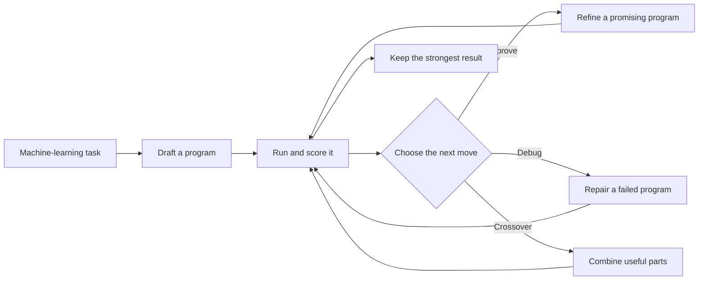

## The Big Idea

Imagine hiring a data-science team for a competition. They write a solution, run it, inspect the score, repair mistakes, borrow the best parts from several attempts, and keep going for hours. An AI agent can already do pieces of that job. The hard part is making the whole cycle reliable—and making the agent better at improving its own work.

That matters beyond machine learning contests. Building an AI system is expensive partly because progress depends on many rounds of code, experiments, and judgment. If an agent can carry out those rounds with results that software can check, AI development becomes a practical laboratory for studying whether AI can improve the process used to build AI.

The paper introduces OpenMLE, an open stack for running that laboratory, and Frontis-MA1, a 35-billion-parameter model trained to use it. Its central idea is simple: teach the same four moves the agent will use during a long search—Draft, Improve, Debug, and Crossover—then let measured execution results guide which attempts survive.

## How It Works

Think of OpenMLE as a test kitchen. Frontis-MA1 proposes recipes, the kitchen actually cooks them, and a score—not the model's confidence—decides what deserves another iteration.

OpenMLE-Gym supplies tasks where code can be executed and checked. OpenMLE-RL trains the model from this execution feedback. The training data were deduplicated against every evaluation benchmark, according to the abstract, to reduce the chance that the agent had already seen the test problems.

At evaluation time, OpenMLE-Evo composes the four moves into a long search rather than asking for one polished answer. A larger variant, OpenMLE-Evo-Max, adds experience gathered independently of the benchmarks and runs parts of the search asynchronously. The result is closer to managing a portfolio of experiments than chatting once with a coding assistant.

## What They Found

On MLE-Bench Lite, every task received up to 12 hours on one RTX 4090 limited to 12 GB of memory. The reported Medal Average rose by 21.22 percentage points from the base setup to Frontis-MA1 with OpenMLE-Evo. OpenMLE-Evo-Max added another 10.60 points. In plain language, the final setup earned about 71 points out of every 100 available under this aggregate medal measure, versus about 39 for the base model.

| MLE-Bench Lite result | Base model | Frontis-MA1 + OpenMLE-Evo | Frontis-MA1 + OpenMLE-Evo-Max |
|---|---:|---:|---:|
| Medal Average | 39.39% | 60.61% | 71.21% |

The abstract says the 71.21% result exceeded GPT-5.5 with Codex and approached GPT-5.6 Sol and Kimi K3, although it does not provide their exact scores in the supplied text.

A held-out set, NatureBench Lite, was used to separate the value of the trained model from the value of the search framework. Keeping the framework fixed and changing the model raised Match-SOTA from 50% to 70%—two more tasks in every ten matched the best-known result. Keeping the model fixed and changing the search framework raised it from 20% to 50%—three more tasks in every ten.

| NatureBench Lite comparison | Before swap | After swap |
|---|---:|---:|
| Swap in the trained Frontis-MA1 model; keep framework fixed | 50% | 70% |
| Swap in OpenMLE-Evo; keep model fixed | 20% | 50% |

These results cover two “Lite” benchmarks, not unrestricted real-world engineering. The main benchmark also permits a long per-task compute budget. The supplied paper text is abstract-only, so it does not expose task counts, uncertainty estimates, detailed failure cases, or full ablations. The claims should therefore be read as reported benchmark evidence for this specific model-and-search system.

## Glossary

- **recursive self-improvement** — the idea that an AI system can help improve the tools and processes used to build better AI systems.
- **Crossover** — a search operation that creates a new program by combining useful parts of earlier programs.

## Links

- [arXiv page](https://arxiv.org/abs/2607.28568)
- [PDF](https://arxiv.org/pdf/2607.28568)
- [GitHub repository](https://github.com/FrontisAI/OpenRSI)