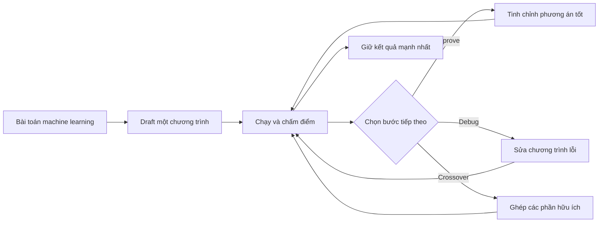

## Ý tưởng chính

Một team data science thường làm việc theo vòng lặp: viết code, chạy thử, nhìn điểm, sửa lỗi, giữ lại cách làm tốt rồi thử tiếp. Một AI agent có thể viết code khá nhanh. Nhưng để tự điều hành cả chuỗi thí nghiệm kéo dài nhiều giờ, nó cần biết lúc nào nên sửa, lúc nào nên làm lại, và quan trọng nhất là phải nghe kết quả chạy thật thay vì tự tin vào câu trả lời của mình.

OpenMLE biến bài toán đó thành một môi trường có thể chạy và chấm điểm. Trên nền này, nhóm tác giả huấn luyện Frontis-MA1, model 35 tỷ tham số chuyên thực hiện bốn động tác: Draft, Improve, Debug và Crossover. Nói đơn giản là viết bản đầu, nâng cấp, sửa lỗi, rồi ghép phần hay từ nhiều phương án.

Điểm đáng chú ý không chỉ nằm ở việc giải benchmark. Machine learning engineering ở đây đóng vai trò như một phòng thí nghiệm cho câu hỏi lớn hơn: AI có thể cải thiện chính quy trình dùng để tạo ra AI hay không?

## Cách hoạt động

Hãy hình dung một bếp thử món. Frontis-MA1 đưa ra công thức. Hệ thống nấu thật, chấm thật. Công thức nào có tín hiệu tốt mới được đem ra chỉnh tiếp.

OpenMLE-Gym cung cấp những task có thể chạy code và kiểm tra kết quả. OpenMLE-RL dùng chính feedback đó để huấn luyện model. Theo abstract, dữ liệu huấn luyện đã được loại các mẫu trùng với toàn bộ benchmark đánh giá. Mục tiêu là hạn chế chuyện model từng thấy trước đề thi.

Khi làm bài, OpenMLE-Evo không yêu cầu agent nghĩ ra một đáp án hoàn hảo ngay lần đầu. Nó xâu chuỗi bốn động tác thành một cuộc tìm kiếm dài, giống như quản lý cả danh mục thí nghiệm. Bản OpenMLE-Evo-Max còn dùng kinh nghiệm không phụ thuộc benchmark và cho một số nhánh tìm kiếm chạy bất đồng bộ.

## Kết quả

Trên MLE-Bench Lite, mỗi task được chạy tối đa 12 giờ với một RTX 4090 bị giới hạn ở 12 GB bộ nhớ. Medal Average tăng 21,22 điểm phần trăm khi chuyển từ base model sang Frontis-MA1 kết hợp OpenMLE-Evo. Bản Max tăng thêm 10,60 điểm. Hiểu nôm na, cấu hình cuối đạt khoảng 71 trên 100 điểm của thước đo medal tổng hợp, trong khi base model chỉ gần 39.

| Kết quả MLE-Bench Lite | Base model | Frontis-MA1 + OpenMLE-Evo | Frontis-MA1 + OpenMLE-Evo-Max |
|---|---:|---:|---:|
| Medal Average | 39,39% | 60,61% | 71,21% |

Abstract cho biết mức 71,21% vượt GPT-5.5 với Codex và tiến gần GPT-5.6 Sol cùng Kimi K3. Tuy nhiên, phần văn bản được cung cấp không có điểm số cụ thể của ba hệ thống này.

Nhóm tác giả còn thử trên NatureBench Lite, một bộ được giữ riêng, để tách tác dụng của model và framework. Giữ nguyên framework nhưng thay Frontis-MA1 vào giúp Match-SOTA tăng từ 50% lên 70%—tức thêm hai task trong mỗi mười task đạt ngang kết quả tốt nhất đã biết. Giữ nguyên model nhưng chuyển sang OpenMLE-Evo đưa con số từ 20% lên 50%—thêm ba task trong mỗi mười task.

| So sánh trên NatureBench Lite | Trước khi thay | Sau khi thay |
|---|---:|---:|
| Thay bằng Frontis-MA1, giữ nguyên framework | 50% | 70% |
| Thay bằng OpenMLE-Evo, giữ nguyên model | 20% | 50% |

Phạm vi bằng chứng hiện có là hai benchmark bản “Lite”, chưa phải hoạt động engineering ngoài đời không giới hạn. MLE-Bench Lite cũng cho mỗi task một ngân sách tính toán khá dài. Do paper.txt chỉ chứa abstract, ta chưa có số lượng task, khoảng bất định, phân tích lỗi hay ablation đầy đủ. Vì vậy, các con số trên phản ánh đúng kết quả benchmark mà nhóm tác giả báo cáo cho tổ hợp model và search này.

## Thuật ngữ

- **recursive self-improvement** — ý tưởng rằng AI có thể tham gia cải thiện chính công cụ và quy trình dùng để xây AI tốt hơn.
- **Crossover** — thao tác tìm kiếm tạo chương trình mới bằng cách ghép những phần hữu ích từ các chương trình trước.

## Liên kết

- [Trang arXiv](https://arxiv.org/abs/2607.28568)
- [PDF](https://arxiv.org/pdf/2607.28568)
- [GitHub repository](https://github.com/FrontisAI/OpenRSI)